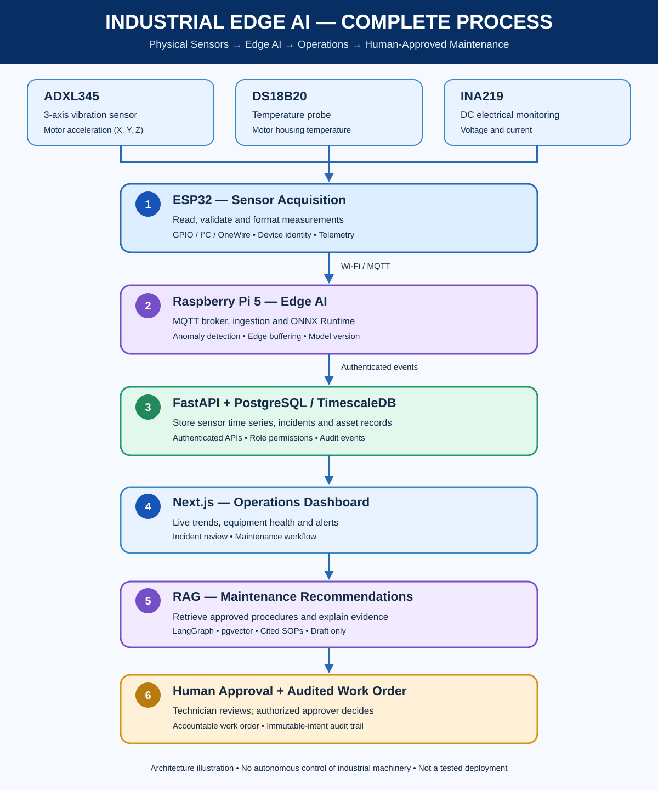

# AI · EDGE AI · SEMICONDUCTOR ENGINEERING

### Practical Engineering Portfolio & End-to-End Project Roadmap

**From software intelligence to physical sensors, embedded systems, silicon-aware inference, industrial automation and digital chip verification**

**7 portfolio projects** · **8 engineering learning phases** · **1 detailed flagship implementation track**

[Explore the flagship EDGEOPS project](projects/industrial-edge-ai-predictive-maintenance/README.md) · [Learning roadmap](#engineering-learning-roadmap) · [Project portfolio](#project-portfolio) · [Getting started](#getting-started) · [Implementation status](#what-is-actually-implemented)

---

## About this repository

This repository organizes a hands-on transition from **AI / full-stack engineering** into **embedded electronics, edge AI, industrial IoT, computer vision, FPGA architecture, semiconductor verification and production-grade edge-to-cloud engineering**.

It is intentionally structured as both:

1. **A project portfolio** — seven problem-driven, measurable engineering builds with architectures, input/output definitions, implementation milestones and evaluation requirements.
2. **A practical learning roadmap** — eight skill tracks that progressively connect fundamental electronics and firmware to AI inference, RTL verification and deployed services.

> **Evidence-first status:** A project description is not proof of an implemented system. This repository currently includes extensive engineering documentation, system diagrams and initial ESP32/serial-capture starter code for EDGEOPS. Earlier visual dashboard prototypes use **simulated data**. Real hardware operation, complete backend connectivity and production-level measurements remain to be validated. The six other projects below are **planned portfolio builds**, not completed applications.

## At a glance

| Area | Technology focus | Engineering outcome |
|---|---|---|
| **Electronics** | Sensors, circuit protection, ADC/I²C/1-Wire, measurement | Acquire repeatable real-world data |
| **Embedded & IoT** | ESP32, C/C++, FreeRTOS, MQTT, secure device identity | Reliable and observable sensor transmission |
| **Edge AI** | Python, PyTorch, ONNX Runtime, quantization, accelerators | Run measured inference close to the sensor |
| **Industrial AI** | Signal processing, anomaly detection, maintenance workflows | Convert noisy readings into reviewed decisions |
| **Computer vision** | OpenCV, object detection, wafer defect classification | Detect, classify and evaluate physical defects |
| **Digital hardware** | Verilog/SystemVerilog, FPGA, MAC datapaths, synthesis | Understand computation at RTL and silicon boundaries |
| **AI for verification** | cocotb, Verilator, LangGraph, regression testing | Assist engineers without replacing verification evidence |
| **Production systems** | FastAPI, TimescaleDB, Docker, observability, RBAC | Build secure and recoverable edge-to-cloud services |

## Complete engineering ecosystem

\`\`\`mermaid
flowchart LR
    A["Physical equipment / images / RTL"] --> B["Data acquisition or test stimulus"]
    B --> C["Embedded, edge and simulation compute"]
    C --> D["AI inference / verification models"]
    D --> E["Backend APIs, time-series and artifact storage"]
    E --> F["Operations UI and reproducible reports"]
    F --> G["Human review, approval and evaluation"]
    G --> H["Measured improvement and controlled release"]
\`\`\`

This portfolio intentionally links **software, hardware and AI** while keeping their evaluation paths distinct: physical sensor data requires calibration; chip benchmarks require device measurements; RTL correctness requires deterministic tests; and industrial actions require safety controls.

# Project portfolio

## 01 · EDGEOPS — Industrial Edge AI Predictive Maintenance & Autonomous Operations

**Priority:** Flagship build · **Current state:** Documentation + starter embedded code + simulated visual prototype; full integration pending.

**Problem:** Equipment vibration, temperature and electrical-load changes can go unnoticed when telemetry, anomaly detection, maintenance reviews and operational evidence are fragmented.

**Proposed solution:** A guarded low-voltage motor laboratory in which an ESP32 acquires sensor readings, MQTT transports them to Raspberry Pi, ONNX performs local anomaly inference, and a FastAPI/TimescaleDB-backed dashboard supports **human-approved** maintenance decisions.

| Layer | Proposed implementation |
|---|---|
| Physical test rig | Guarded **12V DC motor**, safe power distribution, fuse and disconnect |
| Sensors | **ADXL345** vibration, **DS18B20** temperature, **INA219** DC current/voltage |
| Embedded | **ESP32**, PlatformIO/C++, timestamps, validation, reconnect |
| Edge | **Raspberry Pi 5**, MQTT, signal features, **ONNX Runtime** |
| Platform | **FastAPI**, **PostgreSQL + TimescaleDB**, API authorization |
| UX & intelligence | **EDGEOPS** dashboard, incidents, work orders, RAG maintenance assistance |
| Operations | Security, audit trails, digital-twin scenarios, evaluation and rollback |

**End-to-end practical flow**

\`\`\`text
Guarded motor
  -> vibration / temperature / current sensors
  -> ESP32 acquisition
  -> MQTT transport
  -> Raspberry Pi 5 + ONNX inference
  -> FastAPI + PostgreSQL / TimescaleDB
  -> EDGEOPS monitoring UI
  -> investigation -> work order -> human approval -> auditable outcome
\`\`\`

**Primary deliverables:** wiring and safety documentation, firmware, timestamped telemetry, baseline recording, packet-loss results, model evaluation, edge latency benchmarks, authenticated maintenance workflow, dashboard and deployment runbook.

**Success evidence:** repeatable sensor readings; actual MQTT recovery data; held-out precision/recall and false alarm rates; measured p50/p95 inference latency; persisted work-order audit trail; successful server-side approval tests.

**Deep documentation**

- **[Full project README — architecture, 15-screen UX, data contract, APIs, security, testing and milestones](projects/industrial-edge-ai-predictive-maintenance/README.md)**
- [Hardware specifications and bill of materials](projects/industrial-edge-ai-predictive-maintenance/HARDWARE_REQUIREMENTS.md)
- [Hardware integration and buying guide](projects/industrial-edge-ai-predictive-maintenance/HARDWARE_BUYING_INTEGRATION_AND_CAREER_GUIDE.md)
- [Phase 01 — hardware implementation](projects/industrial-edge-ai-predictive-maintenance/PHASE_01_HARDWARE_IMPLEMENTATION.md)
- [Phase 02 — embedded IoT and MQTT](projects/industrial-edge-ai-predictive-maintenance/PHASE_02_EMBEDDED_IOT_MQTT_IMPLEMENTATION.md)
- [Phase 03 — edge AI and ONNX](projects/industrial-edge-ai-predictive-maintenance/PHASE_03_EDGE_AI_ONNX_IMPLEMENTATION.md)
- [Phase 04 — predictive maintenance](projects/industrial-edge-ai-predictive-maintenance/PHASE_04_INDUSTRIAL_PREDICTIVE_MAINTENANCE_IMPLEMENTATION.md)
- [Phase 05 — backend, timeseries and dashboard](projects/industrial-edge-ai-predictive-maintenance/PHASE_05_PRODUCTION_BACKEND_TIMESERIES_DASHBOARD.md)
- [Phase 06 — agentic AI and RAG](projects/industrial-edge-ai-predictive-maintenance/PHASE_06_AGENTIC_AI_RAG_CONTROLLED_AUTOMATION.md)
- [Phase 07 — digital twin, fleet and evaluation](projects/industrial-edge-ai-predictive-maintenance/PHASE_07_DIGITAL_TWIN_FLEET_ANALYTICS_EVALUATION.md)
- [Phase 08 — security, MLOps and release](projects/industrial-edge-ai-predictive-maintenance/PHASE_08_SECURITY_MLOPS_DEPLOYMENT_PORTFOLIO.md)

## 02 · AI Chip Inference Optimization & Benchmarking Lab

**Status:** Planned · **Focus:** AI performance on real compute hardware.

**Problem:** Neural models may achieve good accuracy on a workstation but consume too much latency, RAM or electrical power to deploy on edge devices.

**Proposed solution:** Benchmark a reproducible neural-network workload across CPU and compatible accelerators, comparing **FP32, FP16 and supported INT8 quantization** under equivalent data, batch and runtime settings.

**Implementation path:** choose a fixed dataset/model → export ONNX → validate prediction parity → establish CPU baseline → evaluate supported accelerators → profile utilization, memory and power → publish tradeoff analysis.

**Candidate stack:** PyTorch, ONNX Runtime, Python; TensorRT/OpenVINO where device/runtime compatibility permits; Raspberry Pi, optional Jetson or NPU.

**Expected artifacts:** device specification sheet, reproducible benchmark script, raw CSV, inference trace, accuracy/latency comparison chart and optimization report.

**Metrics:** p50/p95 latency, throughput, CPU/GPU/NPU utilization, peak memory, energy or watts when measurable, model size and post-quantization quality.

**Acceptance:** comparable workloads and verified measurements; no claimed acceleration without physical or rigorously documented simulator evidence.

**Related guide:** [Edge AI and chip optimization](phases/03-edge-ai-chips.md).

## 03 · FPGA-Based Neural Network Accelerator

**Status:** Planned · **Focus:** RTL, fixed-point arithmetic and hardware acceleration.

**Problem:** Software-only inference provides limited insight into the arithmetic units, pipelines, memory constraints and timing paths that determine compute efficiency.

**Proposed solution:** Design a small **fixed-point multiply-accumulate (MAC) and matrix-multiply datapath** in Verilog/SystemVerilog, validate with independent testbenches and—when available—synthesize on an FPGA board.

**Implementation path:** define numerical format → design MAC module → build pipelined datapath → simulate edge cases → compare results with Python golden model → run cocotb assertions → synthesize → analyze timing and resource utilization.

**Candidate stack:** Verilog/SystemVerilog, Verilator, cocotb, GTKWave and Vivado/Quartus when applicable.

**Expected artifacts:** RTL source, testbenches, waveforms, synthesis logs, timing analysis, quantization notes and a reproducible demonstration.

**Metrics:** clock frequency, cycles per operation, LUTs, registers, DSP use, numerical error and throughput.

**Acceptance:** passing deterministic tests and reproducible synthesis; distinguish simulation results from board-verified performance.

**Related guide:** [FPGA and digital chip engineering](phases/06-fpga.md).

## 04 · Real-Time Edge Computer Vision & Quality Inspection

**Status:** Planned · **Focus:** Cameras, industrial inspection and edge deployment.

**Problem:** Manual visual inspection is inconsistent and expensive; conventional GPU models may not fit small on-site devices.

**Proposed solution:** Use a controlled camera test station to detect visible defects or part-presence anomalies and evaluate deployment through an optimized edge inference runtime.

**Implementation path:** select test parts and defect classes → document camera lighting and labeling → collect/annotate images → train a baseline detector/classifier → export ONNX → measure edge-frame processing → inspect false positives and misses.

**Candidate stack:** OpenCV, PyTorch, ONNX, CVAT, FastAPI, Raspberry Pi/optional accelerator and a USB camera.

**Expected artifacts:** dataset provenance, annotation schema, training configuration, confusion matrix, annotated test results and an interactive inspection demonstration.

**Metrics:** precision, recall, mAP where relevant, per-class accuracy, FPS, p95 latency and drift sensitivity.

**Acceptance:** evaluation on held-out scenes/lighting; no production quality-control certification is claimed.

**Related guide:** [Computer vision and semiconductor quality AI](phases/05-vision-wafer.md).

## 05 · Semiconductor Wafer Defect Detection AI

**Status:** Planned · **Focus:** Semiconductor defect patterns and class imbalance.

**Problem:** Wafer defect maps can exhibit rare or overlapping patterns that make robust classification and failure analysis difficult.

**Proposed solution:** Train and compare defect-map classification approaches on **appropriately licensed public data**, with strong provenance and separate train/validation/test splits.

**Implementation path:** audit dataset origin and permitted use → inspect class distribution → clean and split by appropriate grouping → develop baseline → train CNN or another suitable model → evaluate minority classes → analyze misclassifications and drift.

**Candidate stack:** Python, NumPy, PyTorch, scikit-learn, MLflow and reproducible notebooks.

**Expected artifacts:** dataset card, preprocessing code, evaluation tables, class-level confusion matrices, failure examples and inference report.

**Metrics:** macro-F1, per-class precision/recall, balanced accuracy, confusion patterns, calibration and robustness.

**Acceptance:** reproducible held-out evaluation and explicit dataset limitations. This project does **not** assert access to semiconductor fabrication-line data.

**Related guide:** [Computer vision and semiconductor quality AI](phases/05-vision-wafer.md).

## 06 · AI-Assisted Semiconductor Design Verification Platform

**Status:** Planned · **Focus:** Deterministic EDA workflows assisted by language models.

**Problem:** Chip design verification generates many repetitive test cases, compiler warnings, simulation failures and regression logs that require careful engineering review.

**Proposed solution:** An AI-assisted workflow to draft candidate RTL tests, execute them in an isolated **Verilator + cocotb** environment, group failures and present traceable evidence for **human verification**.

**Implementation path:** build intentionally bug-seeded RTL modules → define golden behavior → assemble deterministic regression suite → add agent-generated candidate tests → sandbox test execution → retain logs/waveforms → evaluate useful failures and false diagnoses.

**Candidate stack:** Python, SystemVerilog, Verilator, cocotb, LangGraph, FastAPI and a review UI.

**Expected artifacts:** RTL fixtures, test generation prompts/configuration, testbench source, regression logs, waveforms, failure classifications and coverage summary.

**Metrics:** bugs detected, regression pass rate, coverage change, duplicate-test rate, runtime and false-positive suggestions.

**Acceptance:** deterministic reproduction of bugs and coverage evidence. **LLM output is not proof of chip correctness.**

**Related guide:** [AI-assisted chip design verification](phases/07-ai-eda.md).

## 07 · AI-Powered Smart Energy Digital Twin

**Status:** Planned · **Focus:** Time-series modeling, scenarios and energy analytics.

**Problem:** Energy and equipment operators need a way to compare operating scenarios without risky intervention in live infrastructure.

**Proposed solution:** Create a synthetic or safely recorded low-voltage energy dataset, model baseline consumption, and explore **what-if** changes in workload, temperature, load and equipment efficiency through a digital-twin dashboard.

**Implementation path:** define asset and energy states → instrument or simulate energy measurements → validate units and baseline → implement scenario/replay engine → compare forecasts against held-out data → add alarms and human-reviewed recommendations.

**Candidate stack:** Python, pandas, scikit-learn or PyTorch, FastAPI, PostgreSQL/TimescaleDB and a web dashboard.

**Expected artifacts:** data model, scenario definitions, replay scripts, baseline/evaluation report, energy charts and an interactive demo.

**Metrics:** energy forecasting error (MAE/RMSE where applicable), scenario consistency, computation latency, alert precision and resource usage.

**Acceptance:** meaningful validation against ground truth; clearly label synthetic scenarios. Do not imply real electrical infrastructure control.

**Related guides:** [Industrial AI](phases/04-industrial-ai.md) · [Secure production engineering](phases/08-production.md).

# Engineering learning roadmap

These are **cross-portfolio learning phases**, not the same as the eight implementation phases within EDGEOPS. The two tracks complement each other.

| Phase | Core learning topics | Hands-on proof | Guide |
|---|---|---|---|
| **1. Hardware & electronics** | Voltage/current, sensors, grounding, I²C, measurement | Wiring diagram, 10-minute reading capture | [Open](phases/01-hardware-electronics.md) |
| **2. Embedded systems & IoT** | C/C++, ESP32, FreeRTOS, MQTT, reconnect and TLS | Firmware, validated schema, soak/recovery test | [Open](phases/02-embedded-iot.md) |
| **3. Edge AI & chip optimization** | ONNX, quantization, NPU/GPU/CPU profiling | Model-parity and latency/power benchmark | [Open](phases/03-edge-ai-chips.md) |
| **4. Industrial predictive maintenance** | Signal features, anomaly models, work orders | Held-out evaluation and approval trace | [Open](phases/04-industrial-ai.md) |
| **5. Computer vision & wafer quality** | OpenCV, segmentation/classification, defect datasets | Per-class report and edge FPS test | [Open](phases/05-vision-wafer.md) |
| **6. FPGA & digital hardware** | RTL, MAC, fixed-point math, timing, synthesis | Testbench, waveform, utilization report | [Open](phases/06-fpga.md) |
| **7. AI-assisted design verification** | cocotb, Verilator, coverage, agent review | Bug-seeded deterministic regression | [Open](phases/07-ai-eda.md) |
| **8. Secure edge-to-cloud production** | Containers, RBAC, monitoring, backup, CI/CD | Deploy/test/runbook and recovery drill | [Open](phases/08-production.md) |

## Suggested learning and build order

\`\`\`mermaid
flowchart LR
    A["Electronics and Sensors"] --> B["ESP32 and MQTT"]
    B --> C["Motor Monitoring Prototype"]
    C --> D["Edge AI and ONNX"]
    D --> E["Secure Backend and UI"]
    E --> F["Digital Twin and MLOps"]
    D --> G["Vision and Wafer AI"]
    D --> H["FPGA Accelerator"]
    H --> I["AI-Assisted RTL Verification"]
\`\`\`

**Recommended first priority:** complete the EDGEOPS low-voltage sensor → MQTT → edge inference milestone before expanding into several hardware-heavy projects. Reuse its telemetry conventions, evaluation habits and release workflow in the other portfolio builds.

# What is actually implemented?

| Item | Verified in repository | Maturity |
|---|---|---|
| Root portfolio roadmap | Project descriptions and phase links | **Documented** |
| Eight cross-portfolio phase guides | Eight Markdown guides | **Documented; activities planned** |
| EDGEOPS end-to-end README | Architecture, API proposal, security, test plan | **Documented** |
| EDGEOPS implementation guides | Eight additional detailed engineering phase files | **Documented** |
| Hardware requirements and diagrams | Requirements, buying/integration notes, SVG diagrams | **Documented** |
| Initial embedded lab source | PlatformIO project, C++ firmware, serial capture and starter tests | **Starter code; hardware testing not established** |
| EDGEOPS dashboard design | Simulated interactive HTML prototypes produced separately | **Prototype; not confirmed committed here** |
| MQTT → Raspberry Pi → ONNX → FastAPI → database | Architecture and proposed integration sequence | **Not verified end-to-end** |
| FPGA accelerator, wafer AI and RTL agent | Project descriptions / learning guides | **Planned** |
| Full CI/CD, security assessment and industrial release | Requirements and acceptance criteria | **Not verified production-ready** |

> Status changes should be backed by a commit, setup instructions, tests, measurements, run logs and demo evidence. Avoid calling a future design “deployed”, “validated” or “production-ready” before those artifacts exist.

# Getting started

## Explore the repository

\`\`\`text
AI-Edge-Semiconductor-Career-Projects./
├── README.md                          # Portfolio overview (this file)
├── phases/                            # Eight cross-portfolio skill guides
│   ├── 01-hardware-electronics.md
│   ├── 02-embedded-iot.md
│   ├── 03-edge-ai-chips.md
│   ├── 04-industrial-ai.md
│   ├── 05-vision-wafer.md
│   ├── 06-fpga.md
│   ├── 07-ai-eda.md
│   └── 08-production.md
└── projects/
    └── industrial-edge-ai-predictive-maintenance/
        ├── README.md                  # Flagship system specification
        ├── HARDWARE_REQUIREMENTS.md
        ├── HARDWARE_BUYING_INTEGRATION_AND_CAREER_GUIDE.md
        ├── PHASE_01_*.md ... PHASE_08_*.md
        ├── assets/                    # Architecture and lifecycle SVGs
        └── phase-01-hardware/
            ├── firmware/              # Initial PlatformIO / ESP32 source
            ├── scripts/               # Serial-capture starter utility
            ├── tests/                 # Starter test file
            └── docs/                  # Wiring and safety notes
\`\`\`

**Other six project folders have not been represented as existing directories.** Add each as a standalone module when implementation begins.

## Clone the repository

Because the GitHub repository name **ends with a literal period**, provide a convenient local directory explicitly:

\`\`\`bash
git clone "https://github.com/zenithdevelopers7-source/AI-Edge-Semiconductor-Career-Projects..git" edge-semiconductor-lab
cd edge-semiconductor-lab
\`\`\`

## Start the first practical build

1. Read the [EDGEOPS project README](projects/industrial-edge-ai-predictive-maintenance/README.md).
2. Review the [hardware requirements](projects/industrial-edge-ai-predictive-maintenance/HARDWARE_REQUIREMENTS.md) and the [electrical/rotating-part safety notes](projects/industrial-edge-ai-predictive-maintenance/phase-01-hardware/docs/WIRING_AND_SAFETY.md).
3. Inspect the ESP32 [PlatformIO configuration](projects/industrial-edge-ai-predictive-maintenance/phase-01-hardware/firmware/platformio.ini) and [starter firmware](projects/industrial-edge-ai-predictive-maintenance/phase-01-hardware/firmware/src/main.cpp).
4. Run the firmware build and starter tests **locally**, then record actual results.
5. Validate sensor readings before connecting motor power and before implementing MQTT.
6. Use the detailed EDGEOPS phases as integration milestones.

Build entrypoint (requires locally installed PlatformIO):

\`\`\`bash
cd projects/industrial-edge-ai-predictive-maintenance/phase-01-hardware/firmware
pio run
\`\`\`

This command is a build instruction, **not a claim that the firmware currently passes** or that hardware was tested.

# Evaluation, engineering standards and definition of done

Each portfolio project must supply:

| Requirement | Minimum credible evidence |
|---|---|
| Reproducibility | Pinned tools/dependencies, exact commands, device specifications |
| Architecture | System diagram, interfaces, trust boundaries and data contracts |
| Functional implementation | Source code and meaningful repeatable tests |
| Quantitative performance | Raw results and methodology for latency, quality and resource use |
| Security | Credential handling, authorization tests and threat assumptions |
| Safety | Lab electrical/mechanical precautions; no unauthorized machine control |
| Data provenance | Dataset licensing, labeling method and leakage prevention |
| Reliability | Fault injection, reconnect/retry, logging and recovery behavior |
| User experience | Working demo with accessible control states and clear error handling |
| Communication | Screenshots, measured tables, limitations and next actions |

**Completion rule:** A project is *completed* only when code, reproduction steps, tests, measured results, safety limitations and a working demonstration are published. A design concept, checklist or AI-generated illustration alone does not meet this bar.

# Why these projects matter

Together, the planned portfolio demonstrates how engineering decisions propagate from **physical sensing and embedded constraints** to **model quality, compute latency, silicon utilization, secure services and operational decisions**.

The completed work should help demonstrate skills relevant to:

- Embedded and IoT software engineering
- Edge ML and inference optimization
- Industrial monitoring and AI application engineering
- Computer vision and semiconductor quality analysis
- FPGA / RTL development and verification automation
- Backend infrastructure, observability and secure MLOps

This is an **engineering research and portfolio repository**. It is not an industrially certified control system or a claim of completed semiconductor fabrication.

---

**Build → Measure → Verify → Document → Improve**

[Start with EDGEOPS](projects/industrial-edge-ai-predictive-maintenance/README.md) · [Explore all eight learning phases](phases/01-hardware-electronics.md) · [Return to top](#ai--edge-ai--semiconductor-engineering)

