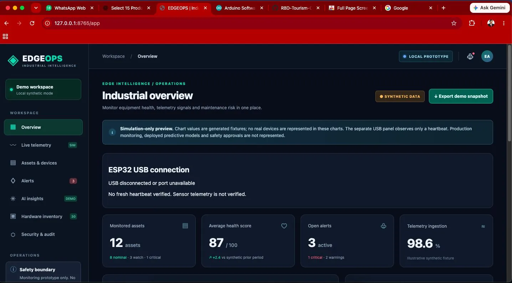
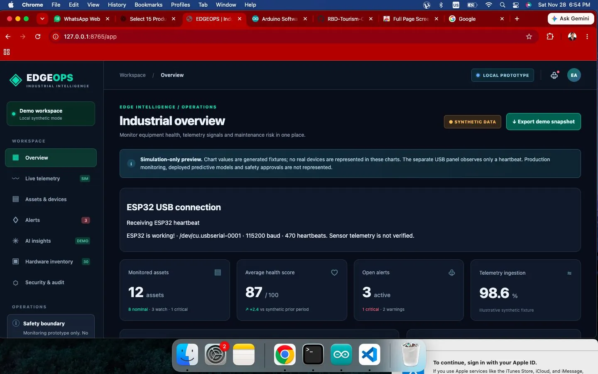
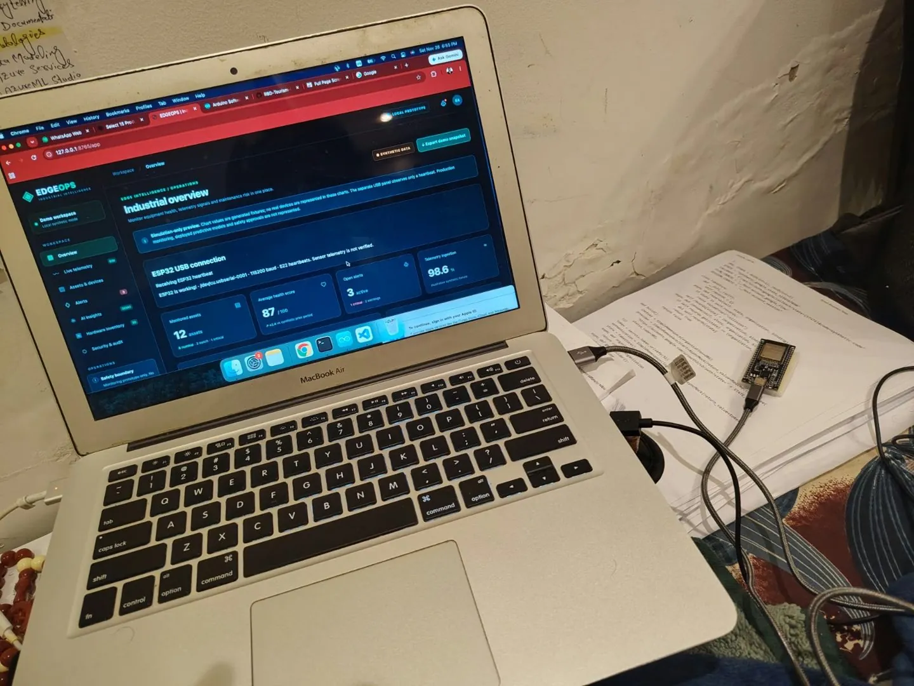
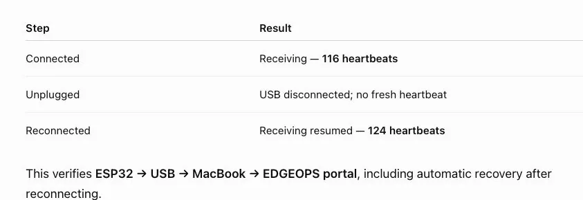
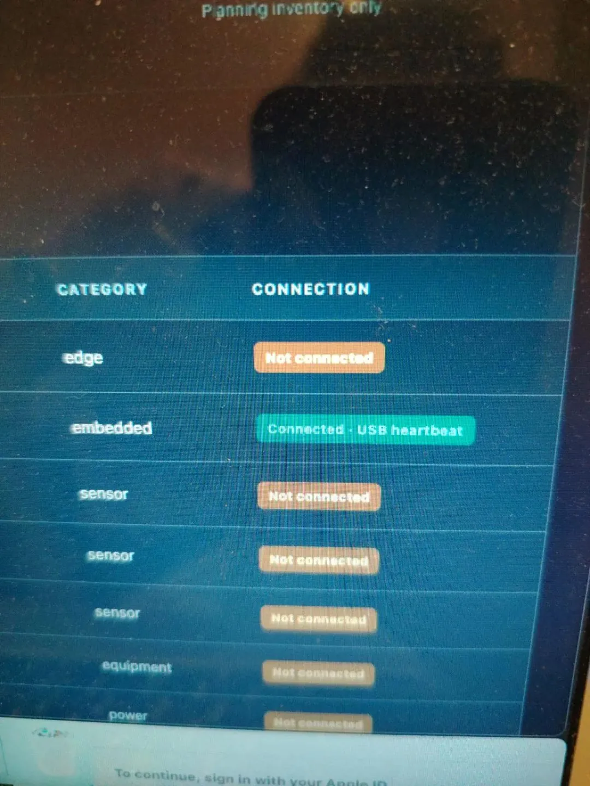

# EDGEOPS Daily Experiment Log

A visual record of successful practical experiments. Add a dated entry here for each new experiment, with real evidence and a short explanation.

## 2026-11-28 — Experiment 01: ESP32 USB connection to the portal

**Result: successful USB heartbeat connection, disconnection detection, and recovery after reconnecting.**

The ESP32 sends `ESP32 is working!` over USB serial. The local EDGEOPS server reads the message and displays its connection status in the portal.

**Setup:** ESP32-WROOM-32 development board, USB data cable, MacBook Air running macOS Monterey 12.7.6, Arduino firmware, and the local Python EDGEOPS dashboard. Serial port: `/dev/cu.usbserial-0001`; baud rate: **115200**.

### 1. Before connection: no fresh heartbeat

The portal displays **“USB disconnected or port unavailable”** and **“No fresh heartbeat verified.”** This is the expected disconnected state.

### 2. After connection: heartbeat received

The portal displays **“Receiving ESP32 heartbeat”** and the serial message **“ESP32 is working!”** This screenshot records **470 heartbeats**, confirming that the board's serial messages reached the portal.

### 3. Physical experiment setup

The actual board is connected to the MacBook by USB while the portal receives heartbeats. This photo records the physical setup used for the experiment.

### 4. Disconnect and reconnect test

| Test step | Observed result |
|---|---|
| Connected | Receiving — 116 heartbeats |
| Unplugged | USB disconnected; no fresh heartbeat |
| Reconnected | Receiving resumed — 124 heartbeats |

This earlier test verified recovery after reconnecting. The 470-heartbeat screenshot above is a separate observation from the same day's work; the counts are observations, not throughput measurements.

### 5. Hardware inventory status synchronized

After the portal update, **HW-02 — ESP32** shows a green **“Connected · USB heartbeat”** badge. The row follows the live heartbeat and clears its connected state when freshness expires. Other components are not marked connected by this heartbeat.

**What this proves:** ESP32 → USB serial → MacBook → EDGEOPS portal communication, disconnect detection, recovery, and the ESP32 inventory badge.

**Current limit:** this experiment verifies a heartbeat only. Sensor telemetry, temperature/vibration/current measurements, motor control and predictive AI are not verified. Dashboard charts, health scores, asset counts and alerts remain simulated.

**Next experiment:** obtain the exact DS18B20 wiring and voltage confirmation, check the pull-up resistor, then verify the first real temperature reading.

---

## Format for the next daily entry

- Date and experiment number
- Objective and hardware used
- Actual screenshots or photos with short captions
- Observed result and verification steps
- Remaining limits and next step

Keep future daily results in this file, with images in `docs/experiments/YYYY-MM-DD/`.
