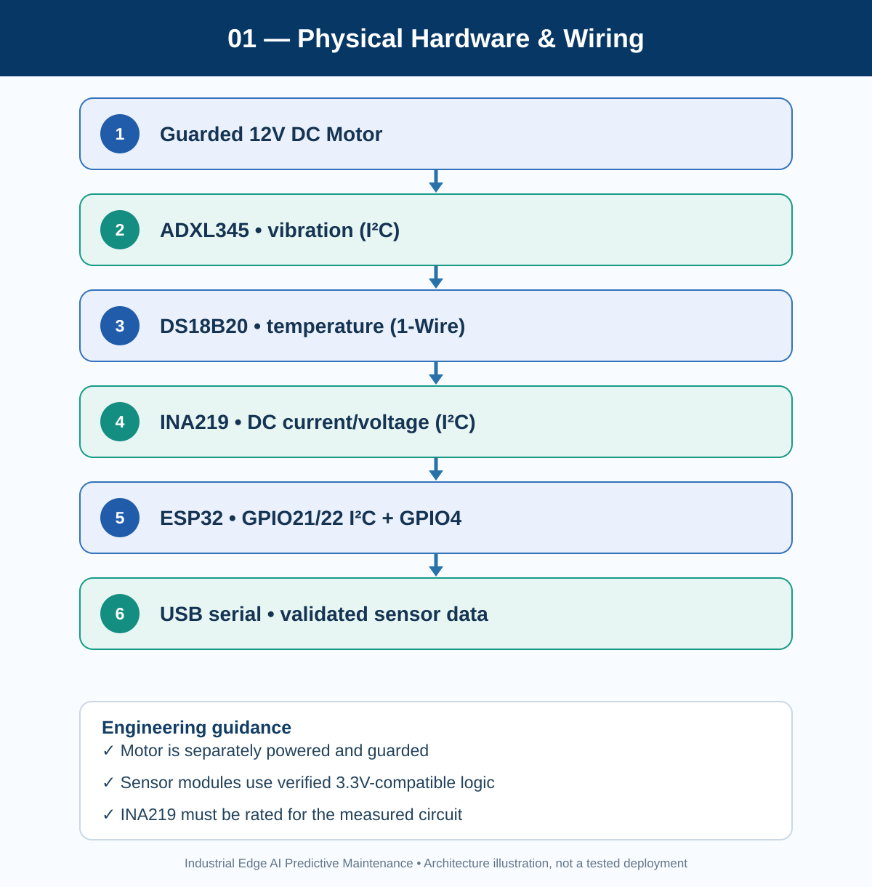
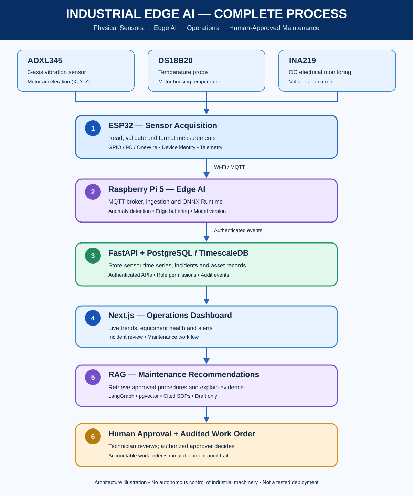

# Industrial Edge AI — Hardware Buying, Integration & Career Guide

**Project:** Industrial Edge AI Predictive Maintenance & Autonomous Operations Platform  
**Region:** United Arab Emirates; prices in AED  
**Status:** Purchasing and integration planning document. Prices are indicative and must be confirmed with sellers; hardware integration and tests are not yet verified.

## 1. Project objective

Build a guarded low-voltage DC motor monitoring prototype. An ESP32 reads vibration, temperature and DC electrical signals; a Raspberry Pi 5 receives data over MQTT and runs ONNX anomaly inference; FastAPI, PostgreSQL/TimescaleDB and Next.js provide monitoring, incident workflows and human-reviewed maintenance recommendations.

## 2. Hardware purchasing table

| Hardware | Qty | Use / function | Indicative AED | Where to buy / search | Integration |
|---|---:|---|---:|---|---|
| ESP32 DevKit (ESP32-WROOM class) | 1 | Microcontroller; sensor acquisition, validation and Wi-Fi telemetry | 29–42 | [DIY KIT UAE](https://diykit.ae/c/esp32) | ADXL345 and INA219 on I²C GPIO21/22; DS18B20 on GPIO4; USB programming |
| ADXL345 accelerometer breakout | 1 | Three-axis acceleration to monitor changes in vibration | 20–28 | [DIY KIT UAE](https://diykit.ae/product/226) | 3.3V-compatible breakout; I²C bus, typically address 0x53 depending on breakout straps |
| DS18B20 temperature probe | 1 | Motor housing / ambient temperature | 12–15 | [TechMaze UAE](https://www.techmaze.ae/shop/99187873-temperature-sensor-module-ds18b20-22276) | OneWire GPIO4; 4.7 kΩ pull-up from data to 3.3V |
| INA219 current and voltage breakout | 1 | Measure DC electrical load, bus voltage and current | 20–45 estimate | [Besomi UAE](https://besomi.com/ae_en/shop.html) | I²C, commonly 0x40; use only with appropriately rated shunt and load |
| Raspberry Pi 5 (4GB) | 1 | MQTT broker/ingestion, ONNX inference and edge services | 560–590 | [DIY KIT UAE](https://diykit.ae/c/raspberry-pi) | LAN/Wi-Fi MQTT from ESP32; forwards authenticated events to API |
| Guarded 12V DC motor | 1 | Physical test bench for controlled monitoring | 50–120 estimate | Reputable motor/electronics supplier | Separate rated power circuit, securely mounted and guarded |
| Rated 12V DC supply | 1 | Power motor, not ESP32 | 30–60 estimate | Electronics supplier | Correct voltage/current rating, protection and disconnect |
| Motor guard, fuse, switch and protection | 1 set | Reduce rotating-part and electrical risks | 50–120 estimate | Electrical/electronics supplier | Independent motor disconnect and suitable overcurrent protection |
| Breadboard and jumper wires | 1 set | Sensor-only prototyping | 15–35 estimate | DIY KIT / Besomi | Low-current 3.3V sensor circuits only |
| USB data cable | 1 | Flash ESP32 and capture serial data | 10–20 estimate | Electronics retailer | ESP32 to workstation |
| microSD card 64GB | 1 | Pi OS and local data | 25–50 estimate | Electronics retailer | Raspberry Pi storage |
| Raspberry Pi 5 USB-C power supply | 1 | Stable Pi power | 45–70 estimate | Raspberry Pi retailer | Use Pi 5-compatible supply |
| Raspberry Pi case and cooling | 1 | Cooling and protection | 30–70 estimate | Raspberry Pi retailer | Verify cooling and airflow |
| Multimeter | 1 | Check voltages, continuity and wiring | 35–100 estimate | Electronics retailer | Validate power before sensor connection |
| 4.7 kΩ resistor | 1 | DS18B20 OneWire pull-up | 1–5 estimate | Electronics supplier | Between DATA and 3.3V |

**Indicative complete hardware budget:** approximately **AED 930–1,370**, excluding an existing computer, shipping and optional instruments. The line-item ranges are approximate and may vary by configuration and seller. Verify the current cart total before purchasing.

## 3. Hardware function in the end-to-end system






*Vector flowchart of sensors, ESP32, Raspberry Pi, FastAPI/TimescaleDB, Next.js, RAG and human-approved work orders.*


```text
ADXL345 vibration -----+
DS18B20 temperature ---+--> ESP32 (sensor acquisition)
INA219 DC measurement -+            |
                                    | Wi-Fi / MQTT
                                    v
                           Raspberry Pi 5
                        MQTT + ONNX edge AI
                                    |
                                    | authenticated events
                                    v
                     FastAPI + PostgreSQL/TimescaleDB
                                    |
                                    v
                        Next.js operations dashboard
                                    |
                                    v
                    RAG maintenance recommendations
                                    |
                                    v
                    Human approval + audited work order
```

### Sensor and ESP32 wiring reference

| Device | Interface | ESP32 pin(s) | Notes |
|---|---|---|---|
| ADXL345 | I²C | SDA GPIO21, SCL GPIO22 | Check breakout voltage, CS/SDO straps and pull-ups |
| INA219 | I²C | SDA GPIO21, SCL GPIO22 | Check shunt and maximum current including startup |
| DS18B20 | OneWire | DATA GPIO4 | Add 4.7 kΩ pull-up to 3.3V |
| ESP32 to laptop | USB serial | USB connector | Initial firmware and CSV acquisition |
| ESP32 to Pi | Wi-Fi / MQTT | Network | Phase 02 onward |

**Critical safety:** The ESP32 must not power or drive the motor. Motor power requires a separate, appropriately rated circuit and a physical guard. Do not connect mains to breadboards or use the INA219 in a motor power path unless its entire module, wiring and shunt are rated for the motor's startup/stall current. Never deliberately stall or damage the motor to simulate a fault.

## 4. Practical buying and integration sequence

1. **Buy first:** ESP32, ADXL345, DS18B20, INA219, jumper wires, USB cable, 4.7 kΩ resistor and multimeter.
2. Confirm each board's pinout, logic voltage, I²C addresses and wiring with the motor **disconnected**.
3. Install VS Code/PlatformIO; compile and flash the existing Phase 01 firmware.
4. Check serial output for sensor-valid flags, measured values and sequence numbers.
5. Run the Python serial capture script and collect a 10-minute baseline CSV.
6. Only then buy/setup Raspberry Pi 5, compatible supply, cooling and microSD; configure authenticated MQTT and edge inference.
7. Source the motor, rated driver/power circuit, guard and protective devices; review wiring and mechanical safety before powering.
8. Add the FastAPI database and dashboard, then RAG maintenance recommendations and human approval.
9. Record hardware serial/model numbers, firmware versions, measurements, photos, test dates and limitations in GitHub.
10. Keep measured sensor evidence separate from simulated/replayed examples.

## 5. How this contributes to a professional profile

| Skill area | Concrete portfolio evidence |
|---|---|
| Embedded engineering | ESP32 C++ firmware, I²C/OneWire interfacing, sensor validation |
| Electronics | 3.3V signal integration, electrical measurement and power-safety review |
| IoT systems | MQTT messaging, device identity, buffering and data quality |
| Edge AI | ONNX Runtime deployment and benchmark on Raspberry Pi |
| Machine learning | Anomaly detection, baseline data and evaluation methodology |
| Backend engineering | FastAPI endpoints, PostgreSQL/TimescaleDB and audit trail |
| Full-stack engineering | Next.js fleet monitoring, alerts and maintenance workflows |
| Agentic AI | LangGraph/RAG recommendations with approved-source citations |
| MLOps | Model provenance, drift monitoring, deployment gates and rollback |
| Semiconductor applications | Practical integration of microcontrollers, MEMS sensors and embedded processors |

**Profile positioning:** This is a cross-disciplinary **embedded systems + Edge AI + industrial IoT + full-stack** project. It demonstrates applying semiconductor-based components, but does **not** itself prove chip design, RTL/FPGA design, wafer fabrication, or a certified industrial deployment.

## 6. GitHub portfolio project description

**Industrial Edge AI Predictive Maintenance Platform**

Design and implement a condition-monitoring prototype integrating ESP32 sensor acquisition, ADXL345 vibration, DS18B20 temperature, INA219 DC electrical measurements, Raspberry Pi edge inference, MQTT, FastAPI, PostgreSQL/TimescaleDB, Next.js dashboards, and human-approved AI-assisted maintenance workflows.

**Current status:** Engineering documentation and initial ESP32/Python source code uploaded; physical hardware integration, end-to-end deployment and performance validation remain pending.

## 7. Recommended evidence checklist

- [ ] Verified hardware BOM with purchase links, receipts and exact module models
- [ ] Reviewed sensor wiring diagram and physical photos
- [ ] ESP32 firmware builds on chosen board
- [ ] 10-minute serial telemetry CSV with measured timestamps
- [ ] Raspberry Pi MQTT ingestion and ONNX inference demonstration
- [ ] Database and dashboard screenshots from real running software
- [ ] Documented anomaly evaluation, including false alarms and limitations
- [ ] Human approval and authorization tests
- [ ] Security, backup/restore and model rollback tests
- [ ] Honest demo video with real vs synthetic data labels

## 8. Existing project documents

- [Phase 01 hardware starter code](./phase-01-hardware/README.md)
- [Hardware requirements](./HARDWARE_REQUIREMENTS.md)
- [Phase 01 implementation guide](./PHASE_01_HARDWARE_IMPLEMENTATION.md)
- [Phase 02 MQTT guide](./PHASE_02_EMBEDDED_IOT_MQTT_IMPLEMENTATION.md)
- [Phase 03 Edge AI guide](./PHASE_03_EDGE_AI_ONNX_IMPLEMENTATION.md)
- [Phase 08 deployment guide](./PHASE_08_SECURITY_MLOPS_DEPLOYMENT_PORTFOLIO.md)

**Note:** The hardware infographic from the chat is a visual planning aid. Product illustrations are representative, not verified photographs of purchased components. Prices must be confirmed at checkout.
