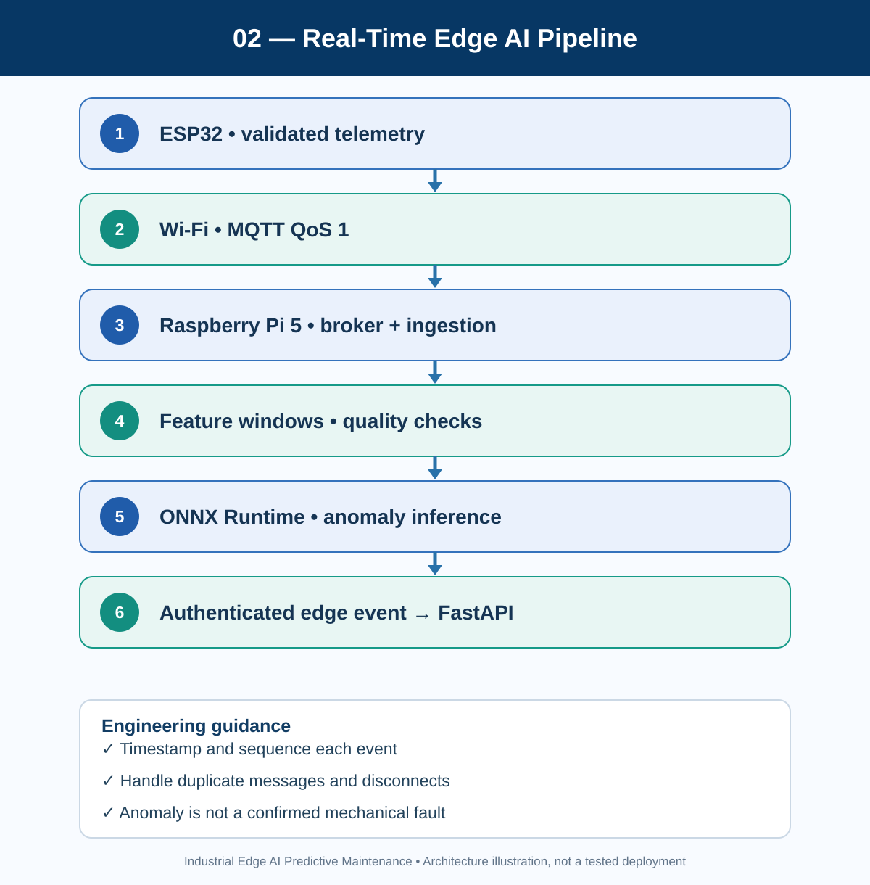

# Phase 02 — Embedded IoT, MQTT and Reliable Edge Telemetry



**Project:** Industrial Edge AI Predictive Maintenance & Autonomous Operations Platform  
**Status:** Implementation plan; no hardware or network tests claimed.  
**Prerequisite:** Phase 01 ESP32 sensor acquisition validated.  
**Goal:** Transmit real sensor data reliably from ESP32 to a Raspberry Pi 5 (or development laptop), tolerate temporary network failures, and prepare trustworthy telemetry for Phase 03 edge AI.

## 1. Practical problem statement

A sensor-only demo is insufficient for industrial monitoring. Wi-Fi can disconnect, a broker can restart, timestamps can drift, devices can reboot, and malformed data can silently corrupt AI training. Phase 02 builds a measurable, secure **device-to-edge telemetry pipeline**, not merely an MQTT publish example.

## 2. Hardware and responsibilities

| Hardware | Qty | Function |
|---|---:|---|
| ESP32 DevKit | 1 | Reads Phase 01 sensors, builds records, reconnects, publishes MQTT |
| ADXL345 | 1 | Three-axis vibration measurements |
| DS18B20 | 1 | Motor temperature |
| INA219 | 1 | DC voltage and current (only within verified module limits) |
| Raspberry Pi 5 + supply + cooling + storage | 1 | Runs MQTT broker, ingestion, local storage, monitoring |
| Laptop | 1 | Flash/debug firmware, run tests and inspect data |
| Wi-Fi router or isolated test network | 1 | ESP32-to-edge network |
| Low-voltage motor test bench | 1 | Optional controlled telemetry source after Phase 01 safety review |
| USB data cable, multimeter, wiring | As needed | Development and electrical verification |

**Laptop-first option:** Run broker and subscriber on your laptop before purchasing a Pi. The protocol and tests should remain identical.

## 3. End-to-end architecture

```text
ADXL345 + DS18B20 + INA219
              |
          ESP32 firmware
  sampling -> validation -> sequence ID
              |
       bounded offline queue
              |
      Wi-Fi + MQTT over TLS
              |
        Raspberry Pi 5
     Mosquitto MQTT broker
              |
      Python ingestion service
   validate -> deduplicate -> UTC time
              |
       SQLite (prototype)
              |
     telemetry health checks
              |
   Phase 03: edge AI inference
```

**Security boundary:** The ESP32 is an authenticated publisher. The edge subscriber validates all messages. Do not expose broker port 1883 to the public internet.

## 4. Proposed repository layout

```text
phase-02-embedded-iot/
├── firmware/esp32/
│   ├── platformio.ini
│   ├── src/main.cpp
│   └── include/config.example.h
├── edge/
│   ├── requirements.txt
│   ├── ingest.py
│   ├── schema.py
│   └── storage.py
├── mqtt/
│   ├── mosquitto.conf.example
│   └── acl.example
├── tests/
│   ├── test_schema.py
│   ├── test_deduplication.py
│   └── test_reconnect.md
├── docs/
│   ├── architecture.md
│   ├── security.md
│   └── test-report.md
└── README.md
```

## 5. MQTT topic design

Use versioned, device-scoped topics:

```text
industrial/v1/devices/motor-001/telemetry
industrial/v1/devices/motor-001/status
industrial/v1/devices/motor-001/events
```

- **telemetry:** regular sensor measurements; MQTT QoS 1, retain=false.
- **status:** online/offline health; retained state may be used with a correctly configured Last Will and Testament.
- **events:** diagnostic or anomaly-related device events; not remote motor control.
- Restrict each device to publishing only its own topics through broker ACLs.
- Avoid unrestricted wildcard subscriptions for device identities.

**QoS 1 can deliver duplicates.** The subscriber must deduplicate using `device_id + boot_id + seq`. QoS does not guarantee end-to-end exactly-once storage.

## 6. Versioned payload schema

Illustrative JSON message (synthetic values, not measured data):

```json
{
  "schema_version": 1,
  "device_id": "motor-001",
  "boot_id": "boot-2026-11-15-001",
  "seq": 184,
  "uptime_ms": 94122,
  "sample_window_ms": 1000,
  "vibration_rms_mps2": 0.32,
  "temperature_c": 31.4,
  "bus_voltage_v": 12.1,
  "current_ma": 180.0,
  "sensor_valid": true,
  "dropped_local_records": 0
}
```

- `boot_id` must change across restarts; use a random or persistent boot identifier rather than relying on a static timestamp.
- `seq` increments monotonically within each boot.
- Use documented SI units and distinguish raw acceleration samples from windowed features.
- `uptime_ms` is not a UTC timestamp; the gateway adds `received_at_utc`.
- Validate ranges and types; reject NaN, infinity, impossible payload sizes, unknown versions, and missing required fields.
- Store firmware version and sensor configuration as separate device metadata.

## 7. Practical implementation steps

### Step 1 — Raspberry Pi setup
1. Flash a supported 64-bit Raspberry Pi OS image to microSD/SSD.
2. Configure an ordinary non-default user, SSH keys, system updates and time synchronization.
3. Connect Pi to the test LAN; record its hostname and LAN IP.
4. Install Mosquitto broker and clients via the operating system package manager.
5. Confirm a **localhost-only** publish/subscribe smoke test before enabling LAN access.

Example localhost smoke test:

```bash
sudo apt update
sudo apt install -y mosquitto mosquitto-clients python3-venv
mosquitto_sub -h 127.0.0.1 -t lab/test -v
# In a second terminal:
mosquitto_pub -h 127.0.0.1 -t lab/test -m "hello"
```

### Step 2 — Secure broker configuration
1. Create dedicated broker credentials or per-device certificates; never use anonymous access.
2. Configure a broker listener accessible only from the isolated LAN.
3. Configure TLS for device-to-broker communication and verify the broker identity.
4. Create ACLs so `motor-001` can publish only its allowed topics.
5. Enable broker logs, resource limits and startup via systemd.
6. Keep credentials/certificates outside Git; commit only redacted examples.
7. Verify that an unauthenticated client and an unauthorized topic publish are rejected.

**Important:** ESP32 TLS certificate validation requires correct trust anchors and reliable time handling; use a pinned trust anchor and ensure certificate-validity checks are not bypassed. For an initial local-only smoke test, plaintext MQTT can be used on an isolated lab network, but mark it **development-only** and do not call it production secure.

### Step 3 — ESP32 firmware
1. Start from working Phase 01 sensor code; preserve its validated sensor sampling rates.
2. Add Wi-Fi connect/reconnect state machine with bounded exponential backoff and jitter.
3. Add MQTT client with authenticated TLS, broker host, client ID and keepalive.
4. Configure Last Will status before connecting; publish online status after connection.
5. Serialize schema-v1 messages with device ID, boot ID and sequence number.
6. Publish **windowed features** on a defined interval (e.g. 1 second), while maintaining higher-rate local accelerometer sampling separately.
7. Use a bounded RAM queue for short outages; count dropped records when full.
8. Add persistent queue only if required, with flash-wear limits and integrity checks.
9. Keep networking non-blocking relative to sensor acquisition; use separate FreeRTOS tasks/queues when appropriate.
10. Emit serial diagnostics for connection attempts, queue depth, failures and dropped messages.

**Do not use `delay()`-heavy networking loops that silently interrupt sensor sampling.** Validate actual sample timing.

### Step 4 — Edge ingestion
1. Create Python virtual environment and install an MQTT client library, Pydantic and SQLite access.
2. Subscribe to the versioned telemetry topic.
3. Parse JSON and validate payload against a strict schema.
4. Add gateway `received_at_utc` and broker/topic metadata.
5. Deduplicate on `device_id, boot_id, seq` with a database unique constraint.
6. Store raw valid payloads and a normalized telemetry table.
7. Track invalid-message counts, duplicate counts, gap counts and ingestion lag.
8. Expose a local health endpoint or CLI report for device last-seen and broker state.
9. Use a bounded queue and explicit backpressure policy when storage slows.

Suggested SQLite prototype schema:

```sql
CREATE TABLE IF NOT EXISTS telemetry (
    device_id TEXT NOT NULL,
    boot_id TEXT NOT NULL,
    seq INTEGER NOT NULL,
    received_at_utc TEXT NOT NULL,
    uptime_ms INTEGER NOT NULL,
    vibration_rms_mps2 REAL,
    temperature_c REAL,
    bus_voltage_v REAL,
    current_ma REAL,
    sensor_valid INTEGER NOT NULL,
    PRIMARY KEY (device_id, boot_id, seq)
);
CREATE INDEX IF NOT EXISTS idx_telemetry_received
    ON telemetry (received_at_utc);
```

SQLite is suitable for a single-device prototype. Plan PostgreSQL/TimescaleDB for multi-device Phase 08 deployments.

### Step 5 — Device identity and health
- Maintain a device registry: device ID, firmware version, sensor types, expected publish interval and allowed topics.
- Monitor last-seen, packet gaps, uptime resets, sensor-valid flag, queue depth and broker reconnect count.
- Implement a retained online status and MQTT Last Will offline status, understanding that LWT is not instantaneous and network partitions can delay detection.
- Record operator-visible states: healthy, stale, offline, sensor fault.

### Step 6 — Resilience experiments
- Disconnect Wi-Fi for 30 seconds, reconnect and inspect queue recovery.
- Restart Mosquitto and confirm automatic client reconnect.
- Reboot ESP32; confirm new `boot_id` and reset `seq`.
- Re-send an identical QoS 1 payload; confirm one stored row.
- Send malformed JSON, missing fields and oversized messages; confirm safe rejection.
- Simulate subscriber crash and restart; inspect message-loss behavior and retention policy.
- Run a supervised 24-hour soak test and log disconnects, gaps, duplicates and memory use.

## 8. Test plan and measurable acceptance criteria

| Test | Required evidence |
|---|---|
| Sensor continuity | Same plausible measurements as Phase 01 |
| Auth and ACL | Unauthorized clients/topics rejected |
| TLS verification | Invalid server certificate fails connection |
| Message schema | Valid records accepted, malformed records rejected |
| Deduplication | Duplicate `device_id/boot_id/seq` stored once |
| Offline recovery | Reconnection and bounded queue behavior documented |
| Restart handling | New boot ID and sequence restart documented |
| Device health | Offline/stale and invalid sensor states visible |
| Soak test | 24-hour report with packet gaps, uptime and memory |
| Performance | Measured end-to-end ingestion delay and effective rate |

Do not invent success metrics. Capture actual test logs, hardware versions and measured results. A failure with a documented root cause is better evidence than fabricated benchmarks.

## 9. Security and safety checklist

- [ ] No MQTT broker exposed to the internet
- [ ] Anonymous MQTT disabled outside isolated smoke tests
- [ ] Device credentials/certificates excluded from source control
- [ ] TLS server certificate verification enabled
- [ ] Least-privilege per-device topic ACLs enforced
- [ ] Strict payload validation and size limits implemented
- [ ] No unauthenticated remote motor control topics
- [ ] Motor remains manually controllable with emergency disconnect
- [ ] Sensitive logs and secrets are redacted
- [ ] Dependencies and firmware versions pinned/documented

## 10. Common problems and fixes

| Symptom | Investigation |
|---|---|
| ESP32 cannot connect | Wi-Fi credentials, DNS, broker IP, firewall, TLS CA/time |
| MQTT connects but cannot publish | ACL topic mismatch, credentials, client ID |
| Duplicate rows | QoS 1 replay; enforce unique database key |
| Missing sensor windows | Blocking firmware, queue overflow, Wi-Fi outages |
| Sensor values change after motor starts | Electrical noise, grounding, sensor mount, power supply |
| LWT offline not immediate | Keepalive and broker timeout behavior |
| Pi storage fills | Retention policy, batching, metrics and disk alerts |
| Inference-ready data inconsistent | Schema versions, units, sample window and sensor validity |

## 11. Required GitHub evidence

- [ ] ESP32 firmware and build instructions
- [ ] Sanitized MQTT broker configuration and ACL examples
- [ ] Strict JSON schema and ingestion service
- [ ] Database migration/schema and deduplication test
- [ ] Wi-Fi outage and broker restart test logs
- [ ] Authentication/TLS negative-test evidence
- [ ] 24-hour soak test report
- [ ] Architecture diagram and exact hardware BOM
- [ ] Short video showing sensor -> MQTT -> stored telemetry
- [ ] Known limitations and next actions

## 12. Definition of done and next phase

**Phase 02 is complete only when** an ESP32 publishes real, validated sensor telemetry to an authenticated edge MQTT broker, the subscriber stores deduplicated records, network interruptions are tested, and reproducible evidence is committed.

**Next: Phase 03 — Edge AI Model Development & ONNX Deployment.** Use this real dataset for signal processing, anomaly model training, validation, and local inference on Raspberry Pi. Do not claim predictive remaining-useful-life estimates without sufficient labeled degradation data.

> This document is a practical plan, not proof that devices, security controls, or performance tests have already been implemented.
