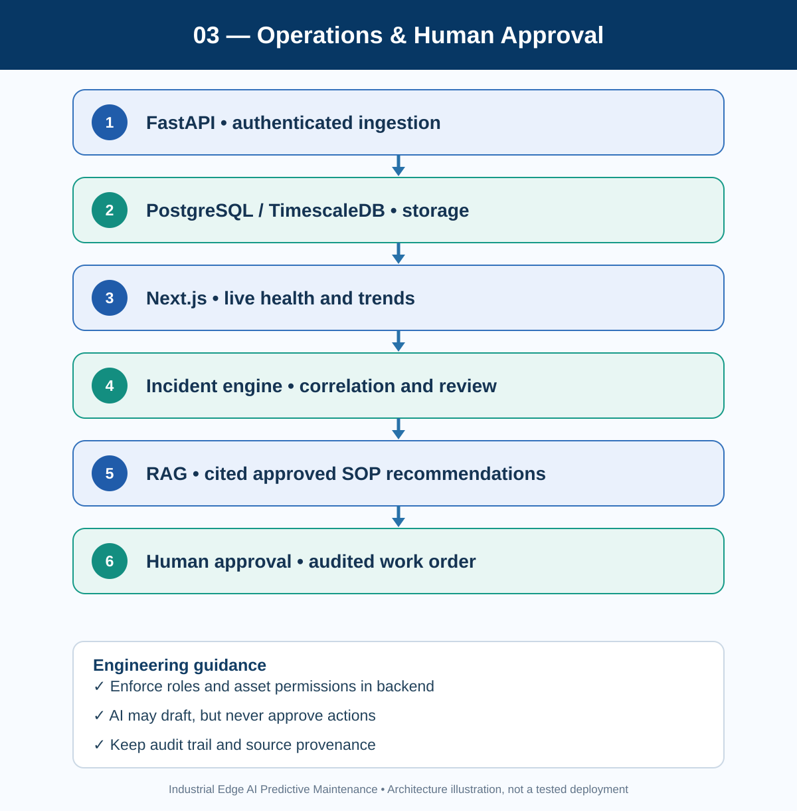

# Phase 04 — Industrial Predictive Maintenance and Human-Approved Maintenance Workflows



**Project:** Industrial Edge AI Predictive Maintenance & Autonomous Operations Platform  
**Status:** Practical implementation guide — no hardware tests or deployed workflows claimed.  
**Prerequisites:** Phase 01 physical sensors, Phase 02 MQTT telemetry, Phase 03 validated ONNX anomaly inference.  
**Goal:** Convert trustworthy edge anomaly events into equipment health monitoring, actionable alerts, evidence-based investigations, maintenance work orders and auditable human-approved decisions.

## 1. Problem statement

An anomaly score by itself does not tell a maintenance engineer what to do. Raw alerts may be duplicated, triggered by sensor faults, or caused by normal changes in motor speed. This phase builds the **operational decision layer** between model inference and maintenance action. It prioritizes safe condition-based maintenance. Remaining-useful-life prediction is explicitly out of scope until suitable degradation and failure-history labels are available.

## 2. Realistic use cases

1. **Motor vibration drift:** Repeated abnormal vibration windows trigger an inspection recommendation, with signal features and model version attached.
2. **Sustained temperature rise:** Correlate temperature trends with current and motor operating state before escalating.
3. **Electrical load anomaly:** Compare current against a speed/load-conditioned baseline; avoid assuming a particular fault.
4. **Sensor disconnection:** Generate a sensor-quality incident instead of mislabeling the equipment as healthy.
5. **Repeated alerts:** Deduplicate and group events into one active incident.
6. **Technician investigation:** Display timeline, sensor readings, maintenance notes and cited procedures.
7. **Human-approved work order:** An authorized operator approves a proposed inspection; the platform records who approved and why.
8. **Post-maintenance verification:** Compare subsequent healthy measurements with pre-maintenance baseline and close the incident only after review.

## 3. Architecture

```text
Guarded 12V DC motor + ADXL345 + DS18B20 + INA219
                         |
                     ESP32 firmware
                         |
                     MQTT broker
                         |
              Raspberry Pi / ONNX model
                         |
              anomaly + quality events
                         |
             FastAPI event ingestion
                         |
           validate -> dedupe -> correlate
                         |
               incident state machine
                         |
          PostgreSQL / TimescaleDB / audit
                  /             \
          React dashboard     RAG assistant
                  \             /
               proposed maintenance
                         |
               human authorization
                         |
                 approved work order
                         |
           inspection -> evidence -> close
```

Keep equipment safety interlocks and emergency disconnects independent of the AI software. This platform **must not directly actuate motors or bypass industrial safety systems**.

## 4. Hardware required

| Hardware | Purpose | Required? |
|---|---|---|
| ESP32 + Phase 01 sensor set | Real condition telemetry | Yes |
| Guarded low-voltage DC motor test bench | Repeatable monitored asset | Yes for physical demo |
| Raspberry Pi 5 (or laptop initially) | Edge anomaly detection and local events | Yes, or equivalent |
| Wi-Fi/LAN router | Telemetry network | Yes |
| Development workstation | Backend, dashboard and model evaluation | Yes |
| Optional ambient temperature / RPM sensor | Context for normal load/speed variation | Recommended later |
| Optional industrial gateway / RS485 adapter | Industrial protocol pilot | Later |

No industrial PLC, high-voltage equipment or live factory connection is required for this prototype.

## 5. Technology stack

| Layer | Recommended tools | Function |
|---|---|---|
| Edge events | Python, ONNX Runtime, MQTT | Produce versioned anomaly/quality events |
| APIs | FastAPI, Pydantic | Validate event ingestion, incidents and work orders |
| Database | PostgreSQL + optional TimescaleDB | Store events, asset metadata, time series and audit history |
| Queue/background work | Redis + worker or PostgreSQL outbox | Reliable notifications and processing |
| Incident engine | Python deterministic rules | Deduplication, hysteresis, correlation, escalation |
| Maintenance intelligence | LangGraph + RAG | Retrieve procedures and draft evidence-backed recommendations |
| Document index | PostgreSQL pgvector or another controlled index | Search maintenance manuals and SOPs |
| UI | Next.js, TypeScript, React | Equipment health, alert review, approvals and work orders |
| Monitoring | Prometheus, Grafana, structured logs | Service and model operations |
| Deployment | Docker Compose, GitHub Actions | Repeatable environments and CI |
| Authentication | OIDC/JWT, RBAC | Separate operator, technician and approver roles |

Use deterministic rules for incident state transitions and permissions. An LLM can draft an explanation but must not decide authorization.

## 6. Data contracts

### Edge event example — illustrative only

```json
{
  "schema_version": 1,
  "event_id": "evt-demo-001",
  "device_id": "motor-001",
  "asset_id": "motor-bench-001",
  "model_version": "ae-v0.1.0",
  "window_end_utc": "2026-11-15T12:00:00Z",
  "status": "anomaly",
  "quality": "valid",
  "anomaly_score": 0.081,
  "threshold": 0.06,
  "evidence_features": {
    "vibration_rms_mps2": 0.45,
    "temperature_c": 32.1,
    "current_ma": 180.0
  }
}
```

**These numbers are fabricated schema examples, not measurements.** Preserve model/feature version, source timestamp, sensor validity, and device identity. Accept a unique `event_id` or derive a stable idempotency key from device, boot ID, sequence and model version.

### Incident lifecycle

```text
NEW -> TRIAGED -> ACKNOWLEDGED -> INSPECTION_REQUESTED
                                      |
                               APPROVED / REJECTED
                                      |
                                  IN_PROGRESS
                                      |
                              VERIFIED -> CLOSED
```

Also support `SENSOR_FAULT`, `SUPPRESSED` (with reason/expiry), `REOPENED`, and `ESCALATED` states. Define authorized transitions in code; do not allow arbitrary status edits.

## 7. Database design

Suggested core entities:

- `assets`: asset ID, type, location label, criticality, operating limits.
- `devices`: device ID, firmware version, sensor mapping, last-seen.
- `telemetry`: time-series measurements and quality flags.
- `model_versions`: model hash, feature schema, validation summary, deployment date.
- `edge_events`: unique event ID, timestamps, model version, scores, evidence.
- `incidents`: asset ID, state, severity, first/last seen, correlation key.
- `incident_events`: append-only incident timeline and rule decisions.
- `maintenance_recommendations`: proposed action, rationale, document citations, AI/policy versions.
- `work_orders`: requested work, status, assigned technician, due date.
- `approvals`: actor, role, decision, timestamp, reason.
- `audit_log`: immutable-intent records for all sensitive actions.
- `documents`: approved maintenance SOP metadata and version.

Example PostgreSQL schema fragment:

```sql
CREATE TABLE assets (
    asset_id TEXT PRIMARY KEY,
    display_name TEXT NOT NULL,
    criticality TEXT NOT NULL CHECK (criticality IN ('low','medium','high'))
);

CREATE TABLE edge_events (
    event_id TEXT PRIMARY KEY,
    asset_id TEXT NOT NULL REFERENCES assets(asset_id),
    device_id TEXT NOT NULL,
    occurred_at TIMESTAMPTZ NOT NULL,
    received_at TIMESTAMPTZ NOT NULL DEFAULT now(),
    model_version TEXT NOT NULL,
    status TEXT NOT NULL,
    quality TEXT NOT NULL,
    anomaly_score DOUBLE PRECISION,
    threshold DOUBLE PRECISION,
    evidence JSONB NOT NULL
);

CREATE TABLE incidents (
    incident_id UUID PRIMARY KEY,
    asset_id TEXT NOT NULL REFERENCES assets(asset_id),
    state TEXT NOT NULL,
    severity TEXT NOT NULL,
    correlation_key TEXT NOT NULL,
    first_seen_at TIMESTAMPTZ NOT NULL,
    last_seen_at TIMESTAMPTZ NOT NULL
);

CREATE TABLE approvals (
    approval_id UUID PRIMARY KEY,
    incident_id UUID NOT NULL REFERENCES incidents(incident_id),
    actor_id TEXT NOT NULL,
    decision TEXT NOT NULL CHECK (decision IN ('approved','rejected')),
    reason TEXT NOT NULL,
    decided_at TIMESTAMPTZ NOT NULL DEFAULT now()
);
```

Add migrations, indexes, transaction-safe state transitions, append-only audit storage controls and least-privilege DB access before production claims.

## 8. Step-by-step practical implementation

### Step 1 — Validate event ingestion
1. Build `POST /api/v1/edge-events` with authenticated device identity.
2. Validate schema version, asset mapping, timestamps, quality and numerical ranges.
3. Enforce idempotency with unique `event_id`.
4. Store raw event and normalized fields in one transaction.
5. Return explicit accepted, duplicate or invalid responses.
6. Test malformed, replayed, out-of-order and unauthorized events.

### Step 2 — Implement equipment health rules
1. Establish per-asset operating baselines from Phase 03.
2. Apply configurable consecutive-window persistence before opening an incident.
3. Add cooldown/hysteresis to prevent alert flapping.
4. Treat invalid/missing sensors as **data quality incidents**.
5. Correlate vibration, temperature and current only when time-aligned and valid.
6. Attach rule ID, model version, contributing features and decision timestamp.
7. Distinguish **anomaly detected** from **fault diagnosed**; avoid unsupported fault labels.

Suggested *initial demonstration-only* policy: open a low-severity incident after 3 consecutive valid anomaly windows, escalate after sustained abnormality, and require 5 valid normal windows before recommending recovery. Tune these parameters on held-out sessions; they are **not industrial safety thresholds**.

### Step 3 — Incident correlation and deduplication
1. Create correlation key from asset + event family + time window.
2. Merge repeated alerts into an existing open incident.
3. Maintain first/last seen, event count, peak score and evidence history.
4. Avoid creating a new work order for every MQTT message.
5. Add deterministic escalation and acknowledgement timeouts.
6. Test two independent assets and concurrent events.

### Step 4 — Maintenance recommendation engine
1. Build a small, versioned SOP collection for the **low-voltage test bench**.
2. Index approved manuals with document ID, revision and source location.
3. Retrieve relevant procedures using asset type, symptoms and safety constraints.
4. Ask the LLM to draft a recommendation with citations and explicit uncertainty.
5. Validate structured output against an allowlist of permitted recommendation types.
6. Require human review; do not let the LLM trigger a work order or physical action.
7. Show when no relevant SOP exists instead of inventing instructions.

Example recommendation: “Inspect motor mounting and sensor attachment; verify measurements with a reference instrument before attributing the vibration change to a mechanical fault.” This is a generic inspection suggestion, **not a diagnosis**.

### Step 5 — Human approval and work orders
1. Define roles: viewer, operator, maintenance technician, approver, administrator.
2. Create `POST /incidents/{id}/recommendations` for proposals only.
3. Create `POST /incidents/{id}/approvals` restricted to approvers.
4. Make approval transitions atomic and audit actor, reason and time.
5. On approval, create one idempotent inspection work order.
6. Allow rejection with reason and return to review.
7. Require technician evidence and authorized verification before closure.
8. Ensure no direct motor control or safety-interlock commands are exposed.

### Step 6 — Build the dashboard
Implement:
- Asset fleet overview with healthy/anomaly/sensor-fault/offline states.
- Motor detail view: vibration, temperature, current and anomaly score trends.
- Incident queue: severity, duration, status, assigned owner.
- Evidence panel: raw feature values, model version, rule ID and data quality.
- Recommendation panel: cited SOPs, uncertainty, approval controls.
- Work order board: requested, approved, in progress, verified, closed.
- Audit history: who changed what and when.
- Device health: MQTT last-seen, firmware version, ingestion lag.

### Step 7 — Notifications and reliability
1. Use transactional outbox or durable worker queue for incident notifications.
2. Retry transient failures with backoff and idempotency.
3. Avoid duplicate emails/messages on repeated events.
4. Record notification delivery status and errors.
5. Test database restart, worker restart and upstream MQTT outage.
6. Keep local edge anomaly detection running when cloud/backend is unavailable; synchronize later without duplicate incidents.

### Step 8 — End-to-end lab demonstration
1. Start the guarded motor in a documented healthy operating condition.
2. Record baseline telemetry and model scores.
3. Introduce a **safe operating-state variation** (e.g. supported speed or load adjustment), without intentionally damaging or stalling the motor.
4. Observe whether a validated anomaly event is generated; do not force the model to claim a fault.
5. Confirm event ingestion, correlation and incident creation.
6. Retrieve an SOP-backed maintenance recommendation.
7. Have a separate authorized user approve an inspection work order.
8. Record technician review and verification evidence.
9. Restore baseline operating condition and document post-event readings.
10. Export an audit trail and repeat the demo to verify determinism.

## 9. Testing and measurable metrics

| Metric | Definition |
|---|---|
| Alert precision/recall | Only when trustworthy labeled anomaly/fault data exists |
| False alarms per hour | Alerts during held-out healthy operating sessions |
| Detection delay | Time from known controlled deviation to confirmed event |
| Duplicate incident rate | Repeated events incorrectly opening separate incidents |
| Event ingestion latency | Edge event emitted to persisted event |
| Incident creation latency | Persisted event to correlated incident |
| Approval audit completeness | Sensitive transitions with actor, time, reason and evidence |
| Offline recovery | Events synchronized after outage without duplicates |
| Authorization coverage | Unauthorized state transitions rejected |
| RAG citation validity | Recommendations trace to approved document revisions |

Do not present synthetic load changes as real bearing failures. Report the dataset composition and failure modes.

## 10. Security, safety and governance

- [ ] Authenticate devices and users separately.
- [ ] Enforce role-based authorization on **every** state-changing endpoint.
- [ ] Apply rate limits, strict input validation and request size limits.
- [ ] Never expose device credentials or API secrets in Git.
- [ ] Use parameterized queries and migrations.
- [ ] Protect sensitive logs; define retention and access policies.
- [ ] Audit all incident, recommendation, approval and work-order transitions.
- [ ] Require explicit human approval before maintenance workflow execution.
- [ ] Do not permit LLM-generated shell commands or motor control.
- [ ] Keep hardware emergency disconnect independent of software.
- [ ] Record model, prompt, retrieval document and rule versions.
- [ ] Clearly label synthetic demonstrations versus measured hardware evidence.

## 11. Suggested repository layout

```text
phase-04-maintenance/
├── backend/
│   ├── app/api/
│   ├── app/models/
│   ├── app/services/incident_engine.py
│   ├── app/services/recommendations.py
│   ├── app/services/work_orders.py
│   ├── migrations/
│   └── tests/
├── frontend/
│   ├── app/assets/
│   ├── app/incidents/
│   ├── app/work-orders/
│   └── app/audit/
├── sop/
│   ├── approved/
│   └── manifest.yaml
├── infra/
│   ├── compose.yaml
│   └── monitoring/
├── docs/
│   ├── architecture.md
│   ├── threat-model.md
│   ├── incident-state-machine.md
│   ├── evaluation.md
│   └── demo-script.md
└── README.md
```

## 12. Definition of done

- [ ] Versioned and authenticated edge-event ingestion
- [ ] Idempotent event persistence and incident correlation
- [ ] Explicit sensor-fault and offline handling
- [ ] Configurable persistence/hysteresis rules with tests
- [ ] SOP-grounded, citation-bearing maintenance recommendations
- [ ] RBAC-protected approval and work-order workflow
- [ ] Equipment, incident, work-order and audit dashboards
- [ ] Automated unit, integration, security and recovery tests
- [ ] Measured alert quality, latency and duplicate rates
- [ ] Reproducible demo and clear limitations

**Phase 04 is complete** when real sensor-derived anomaly events can reliably create explainable incidents, support SOP-backed recommendations and move through an authorized, auditable inspection workflow **without any autonomous safety-critical actuation**.

**Next: Phase 05 — Production Backend, Time-Series Database and Operations Dashboard Integration** (or follow the broader portfolio roadmap's vision/wafer phase separately).

> This document is an implementation blueprint, not evidence that the platform has been built or tested.
