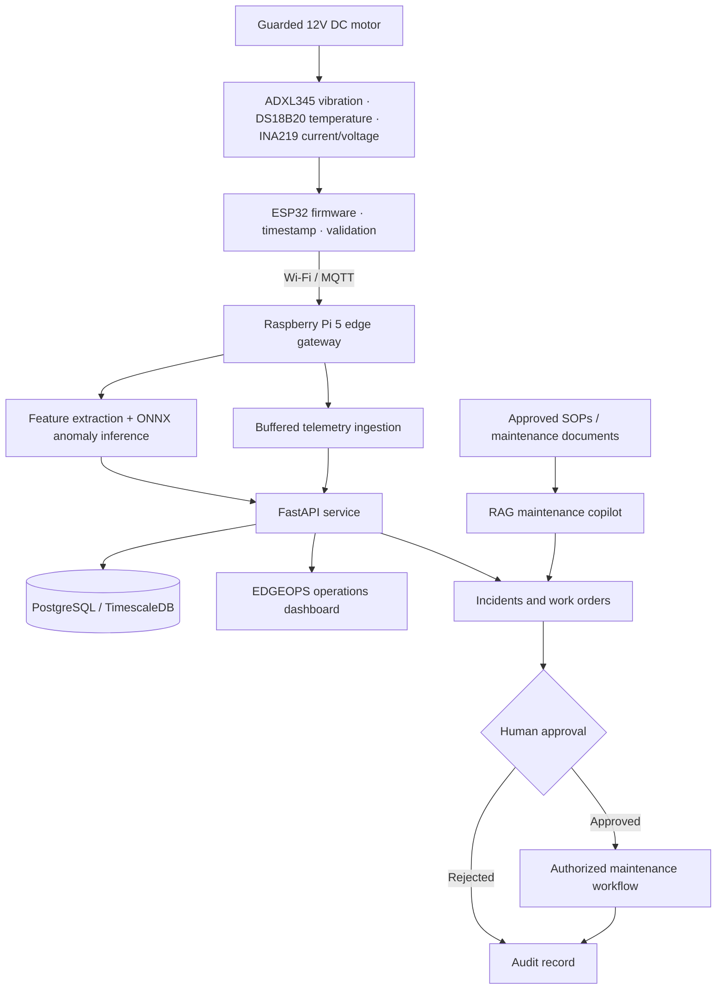
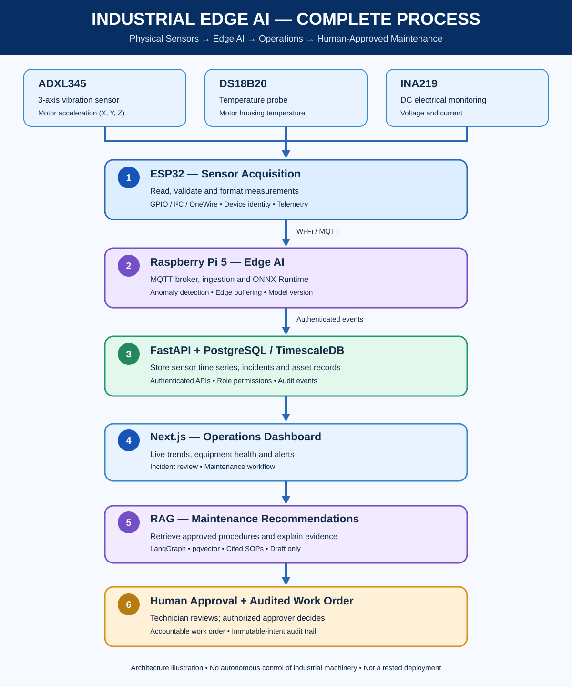
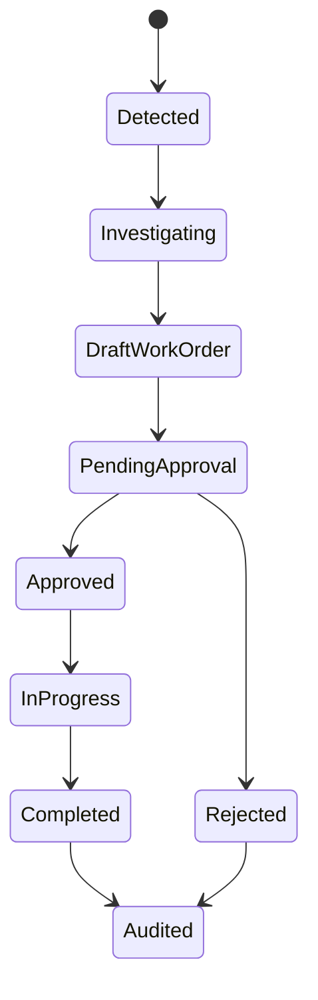

# EDGEOPS — Industrial Edge AI Predictive Maintenance & Autonomous Operations


**Choose your computer:** [start here](START_HERE.md) · [office Windows](OFFICE_WINDOWS.md) · [tonight on the Mac](TONIGHT_MAC.md). Fresh MacBook/ESP32 verification remains pending.


**Home Mac USB mode:** [setup, launch and safe update instructions](HOME_MAC.md). Lightweight local dashboard, ESP32-only test and source-labelled sensor history; no Docker or home training. Online hosting and ESP32 Wi-Fi remain pending.

> **MacBook / arriving hardware handoff — 26 November 2026:** [Start here](MACBOOK_START_HERE.md). The release branch includes the current dashboard, lightweight USB-to-configurable-HTTPS gateway, scoped bench-reading endpoint, secret-free configuration examples and a 16-item arrival guide. Hosting is deferred; exact-part checks and real Mac/ESP32 acceptance remain pending.

> **Consolidated production design — 19 November 2026:** Start with the [complete production system design baseline](production-design/README.md). It reconciles all 48 existing project text documents, maps all 30 planned hardware categories, and specifies the target contracts, services, workflows and acceptance path. The current local dashboard is an authenticated development prototype; hardware commissioning and production acceptance are not established. Older status statements below describe earlier source snapshots.

> **Engineering portfolio project | Architecture and implementation roadmap | Demonstration UI**  
> **Status:** The local dashboard has authenticated accounts, verified offline experiment reports and a responsive product workspace. Equipment views remain simulated. A validated end-to-end hardware-to-cloud deployment has **not** yet been demonstrated.

## Current implementation and evidence — 24 November 2026

The current implementation is on `ui/production-workspace-20261119` in [draft PR #2](https://github.com/shah-hussain-bangash/AI-Edge-Semiconductor-Career-Projects./pull/2), targeting `dashboard-live-edit`. It includes the [local FastAPI/dashboard application](dashboard/README.md), persisted synthetic observation inspection, incident preparation and maintenance drafts with retained source evidence. It is not a merged release or accepted industrial deployment.

- [Reproduce the saved synthetic operations example](phase-01-hardware/validation/README.md): one observation inspected, an incident created and a maintenance record retained as a draft in disposable data.
- [Read the bounded software review](dashboard/reviews/2026-11-24-request-boundary-review.md): malformed anti-forgery token handling fixed; 68 targeted regression tests and the browser password suite passed.
- [Review the public visual walkthrough and PDF brief](https://github.com/shah-hussain-bangash/shah-hussain-bangash/blob/main/docs/edgeops/EVIDENCE.md): captures and test results are explicitly synthetic and pinned to their recorded source revisions.
- [Prepare H1 hardware acceptance](phase-01-hardware/validation/FIRST-HARDWARE-ACCEPTANCE.md): proposed 600-second sensor-only baseline and channel reference checks; every physical check remains pending.

All four workflow families passed for software commit `5ee6ad79e94f473588fbde1d5b0d5c6ccf75c620`: [dashboard checks](https://github.com/shah-hussain-bangash/AI-Edge-Semiconductor-Career-Projects./actions/runs/45338661219), [browser acceptance](https://github.com/shah-hussain-bangash/AI-Edge-Semiconductor-Career-Projects./actions/runs/45338661341), [offline experiment registry](https://github.com/shah-hussain-bangash/AI-Edge-Semiconductor-Career-Projects./actions/runs/45338661330) and [offline model comparison](https://github.com/shah-hussain-bangash/AI-Edge-Semiconductor-Career-Projects./actions/runs/45338661339). These are historical software outcomes, not a live badge or physical verification.

The owner reports that some hardware has arrived. Sensor-only communication bring-up can proceed with reviewed received parts; full motor operation remains gated by the relevant bench review. No exact received variant, calibration or real acquisition is verified by this README. The full operational dashboard remains a synthetic rehearsal. This release also has a separate scoped USB bench-ingest view and a lightweight direct USB home dashboard; real physical measurement acceptance remains pending.

## Target system

EDGEOPS is a proposed end-to-end industrial condition-monitoring platform that combines **low-voltage sensors, ESP32 firmware, MQTT messaging, Raspberry Pi edge inference, ONNX anomaly detection, FastAPI, PostgreSQL/TimescaleDB, a monitoring dashboard, AI-assisted maintenance guidance, and human-approved work orders**.

Its goal is to demonstrate the engineering skills needed to move from AI/full-stack software into **embedded systems, edge AI, industrial IoT and semiconductor-adjacent computing**. This repository is an implementation guide and portfolio work in progress—not a claim that the system is deployed in a real factory.

## 1. What problem does it solve?

Industrial teams often have fragmented equipment telemetry, late detection of abnormal operating conditions, difficult-to-trace maintenance decisions and inconsistent operational records. EDGEOPS is designed to:

- Capture motor **vibration, temperature, current and voltage** from a safe laboratory test rig.
- Stream timestamped measurements from **ESP32** to an edge gateway over **MQTT**.
- Detect unusual patterns with an evaluated **ONNX** model running on **Raspberry Pi 5**.
- Store historical telemetry and operational records in **PostgreSQL/TimescaleDB**.
- Give operators a visual overview of equipment health, alerts, incidents and work orders.
- Use retrieval-augmented AI to **suggest** inspection steps grounded in approved maintenance documents.
- Require **authenticated human approval** before work-order execution or operational actions.
- Measure reliability, model quality, latency, security and recoverability.

**Safety boundary:** EDGEOPS is intended for a guarded low-voltage demonstration motor. It is not a safety-rated industrial controller. No AI output may directly operate safety-critical equipment.

## 2. Target system architecture — integration pending



**Data path:** sensor → firmware → MQTT → edge validation → model inference → backend → time-series database → dashboard → incident → human-reviewed maintenance action.



## 3. UI design reference and current workspace

The committed local application currently provides [18 workspaces plus sign-in](dashboard/README.md). The 15-screen table below is an earlier design reference; its illustrative interactions do not define current authorization or acquisition behavior. Use [current functionality and boundaries](dashboard/PRODUCT_WORKSPACE.md) for the implemented workspace.

The visual design reference uses a **dark navy industrial control-room theme**, teal navigation, high-contrast KPI tiles, motor/sensor imagery, dense tables and clear status badges.

| Screen | Operator purpose | Example interaction |
|---|---|---|
| 01. Sign In | Enter the workspace | Demo credential check; production identity integration pending |
| 02. Executive Overview | Fleet KPIs, health and alerts | Open telemetry, incidents or work orders |
| 03. Equipment & Assets | Inspect asset inventory and condition | Select asset; create demo asset |
| 04. Live Telemetry | View vibration, temperature and current | Start/pause simulated readings; export sample CSV |
| 05. Devices & Hardware | Understand sensors, ESP32 and gateway | Review wiring and diagnostics plan |
| 06. Edge AI Models | Model registry and anomaly scoring | Run illustrative model evaluation |
| 07. Incident Management | Triage abnormal conditions | Assign or resolve a demo incident |
| 08. Work Orders | Review maintenance actions | Approve, reject, start and complete demo orders |
| 09. AI Copilot & RAG | Maintenance recommendations | Ask a demonstration question |
| 10. Digital Twin | Explore equipment scenarios | Run simulated temperature/vibration scenarios |
| 11. Backend & Data | Understand APIs and data storage | Inspect proposed service endpoints |
| 12. Security & Audit | Access and accountability | Inspect local demo activity log |
| 13. MLOps & Deployment | Release readiness and rollback | Review uncompleted production gates |
| 14. Project Phases | Track the eight engineering phases | Navigate implementation roadmap |
| 15. Settings & Profile | Demo configuration | Update local demo preferences |

**Prototype limitation:** The pixel-matched HTML visual guide displays reference screens as images and places clickable demo controls in separate dialogs. It is **not** a complete, component-by-component recreation of those screens, nor is it connected to live hardware or a production backend. The HTML/PDF package produced in the design workflow should be committed separately before claiming that the files are hosted in this repository.

## 4. Hardware and component roles

| Component | Why it is needed | Where it runs / connects |
|---|---|---|
| **12V DC motor + guard** | Safe rotating-equipment test subject | Physical bench; protected motor circuit |
| **ADXL345** | Introductory 3-axis vibration measurements | I²C to ESP32; not an industrial-grade analyzer |
| **DS18B20** | Motor housing temperature trend | 1-Wire to ESP32; suitable pull-up |
| **INA219** | Low-voltage DC current and voltage | I²C to ESP32; confirm shunt and stall ratings |
| **ESP32 DevKit** | Samples and publishes sensor readings | Embedded firmware / Wi-Fi |
| **Raspberry Pi 5** | MQTT gateway, preprocessing, edge model | Linux edge computer |
| **MQTT broker** | Lightweight sensor-message transport | Edge gateway or trusted service |
| **ONNX Runtime** | Portable edge inference | Raspberry Pi |
| **FastAPI** | Validated APIs and application rules | Backend service |
| **PostgreSQL** | Asset, user, incident and approval records | Backend database |
| **TimescaleDB** | Timestamped equipment telemetry | PostgreSQL extension |
| **Next.js / web UI** | Operator-facing workflows | Browser frontend |
| **LangGraph + RAG** | Document-grounded recommendations | Server-side assistant with human oversight |

Optional extensions: BME280 ambient context, RPM sensing, isolated industrial interfaces, Jetson benchmarking and FPGA acceleration experiments.

See [hardware requirements](HARDWARE_REQUIREMENTS.md), [hardware integration and buying guide](HARDWARE_BUYING_INTEGRATION_AND_CAREER_GUIDE.md), and [wiring and safety](phase-01-hardware/docs/WIRING_AND_SAFETY.md).

## 5. Eight-phase engineering plan

| Phase | Implementation focus | Evidence needed to call it complete |
|---|---|---|
| **01 — Hardware** | Motor rig, power protection, sensor wiring and calibration | Photos, schematic, measured readings, safe baseline |
| **02 — Embedded IoT** | ESP32 acquisition, MQTT topics, reconnect, packet validation | Firmware tests, delivery/packet-loss measurements |
| **03 — Edge AI** | Features, baseline models, ONNX export, Raspberry Pi runtime | Held-out evaluation, latency, RAM/CPU measurements |
| **04 — Predictive Maintenance** | Rules, incidents, escalation and approvals | Repeatable incident-to-work-order test |
| **05 — Backend & Dashboard** | FastAPI, TimescaleDB, asset APIs, UI | Integration tests, migrations, authenticated UI |
| **06 — Agentic AI & RAG** | SOP ingestion, retrieval, grounded suggestions | Retrieval evaluation, citations, human approval tests |
| **07 — Digital Twin & Fleet** | Simulations, replay, drift and multi-asset analytics | Scenario tests and documented model limitations |
| **08 — Security & MLOps** | RBAC, secrets, CI/CD, monitoring and rollback | Threat model, deployment test, backup/restore drill |

### Detailed phase documentation

1. [Phase 01 — Hardware implementation](PHASE_01_HARDWARE_IMPLEMENTATION.md)
2. [Phase 02 — Embedded IoT and MQTT](PHASE_02_EMBEDDED_IOT_MQTT_IMPLEMENTATION.md)
3. [Phase 03 — Edge AI and ONNX](PHASE_03_EDGE_AI_ONNX_IMPLEMENTATION.md)
4. [Phase 04 — Predictive maintenance](PHASE_04_INDUSTRIAL_PREDICTIVE_MAINTENANCE_IMPLEMENTATION.md)
5. [Phase 05 — Backend, timeseries and dashboard](PHASE_05_PRODUCTION_BACKEND_TIMESERIES_DASHBOARD.md)
6. [Phase 06 — Agentic AI and controlled RAG](PHASE_06_AGENTIC_AI_RAG_CONTROLLED_AUTOMATION.md)
7. [Phase 07 — Digital twin, fleet and evaluation](PHASE_07_DIGITAL_TWIN_FLEET_ANALYTICS_EVALUATION.md)
8. [Phase 08 — Security, MLOps and deployment](PHASE_08_SECURITY_MLOPS_DEPLOYMENT_PORTFOLIO.md)

## 6. Repository structure

```text
projects/industrial-edge-ai-predictive-maintenance/
├── README.md
├── HARDWARE_REQUIREMENTS.md
├── HARDWARE_BUYING_INTEGRATION_AND_CAREER_GUIDE.md
├── PHASE_01_HARDWARE_IMPLEMENTATION.md
├── PHASE_02_EMBEDDED_IOT_MQTT_IMPLEMENTATION.md
├── PHASE_03_EDGE_AI_ONNX_IMPLEMENTATION.md
├── PHASE_04_INDUSTRIAL_PREDICTIVE_MAINTENANCE_IMPLEMENTATION.md
├── PHASE_05_PRODUCTION_BACKEND_TIMESERIES_DASHBOARD.md
├── PHASE_06_AGENTIC_AI_RAG_CONTROLLED_AUTOMATION.md
├── PHASE_07_DIGITAL_TWIN_FLEET_ANALYTICS_EVALUATION.md
├── PHASE_08_SECURITY_MLOPS_DEPLOYMENT_PORTFOLIO.md
├── assets/
│   ├── complete-process-flow.svg
│   ├── hardware-sensor-integration.svg
│   ├── edge-ai-data-pipeline.svg
│   ├── dashboard-maintenance-workflow.svg
│   └── evaluation-deployment-lifecycle.svg
├── dashboard/                       # Current local FastAPI/UI implementation and tests
├── production-design/               # Consolidated design and acceptance gates
├── enterprise-architecture/          # Contracts and architecture references
└── phase-01-hardware/
    ├── README.md
    ├── docs/WIRING_AND_SAFETY.md
    ├── firmware/platformio.ini
    ├── firmware/src/main.cpp
    ├── scripts/requirements.txt
    ├── scripts/capture_serial.py
    ├── tests/test_capture.py
    └── validation/                  # Synthetic result and pending physical checklist
```

The structure above is a selected view of committed documentation and software. The local dashboard/API is implemented; measured MQTT/Pi/ONNX integration, live RAG and production deployment remain separate unverified target capabilities.

## 7. Getting started — reproducible first milestone

**Software-only review:** Start with the [synthetic walkthrough](phase-01-hardware/validation/README.md) or [dashboard setup](dashboard/README.md); neither requires connected equipment. The steps below describe the embedded/offline preparation path. A real bench run has separate part-identification, readiness and qualified-review prerequisites in [H1](phase-01-hardware/validation/FIRST-HARDWARE-ACCEPTANCE.md).

```bash
git clone "https://github.com/shah-hussain-bangash/AI-Edge-Semiconductor-Career-Projects..git" edgeops-projects
cd edgeops-projects
git switch --track origin/ui/production-workspace-20261119
cd projects/industrial-edge-ai-predictive-maintenance
```

> The remote repository name ends in a period; the explicit local directory avoids trailing-period path handling. The selected branch is draft review work, not a release.

### Step A — Review the build

Read [hardware requirements](HARDWARE_REQUIREMENTS.md) and [wiring/safety](phase-01-hardware/docs/WIRING_AND_SAFETY.md). Check sensor logic voltage, motor stall current, fusing, emergency disconnect, enclosure and rotating-part guard.

### Step B — Inspect ESP32 firmware

```bash
cd phase-01-hardware/firmware
pio run
```

`pio run` builds firmware for the configured PlatformIO environment; it does **not** verify electrical wiring or sensor accuracy. The starter firmware is not yet confirmed to have passed physical bench testing.

### Step C — Inspect the serial-capture tooling

```bash
cd ../scripts
python -m pip install -r requirements.txt
python capture_serial.py --help
```

Check the actual CLI help and script configuration before choosing a serial port or data file. Do not assume the board is connected or that telemetry has been captured.

### Step D — Run available starter tests

```bash
cd ..
python -m pip install -r tests/requirements.txt
python -m unittest discover -s tests -v
```

This runs the hardware-folder software tests with their declared test dependencies. It does not read a serial port or establish physical sensor operation. Record your own environment and results.

### Step E — Progress through integration

Use the existing local API, dashboard and synthetic review workflows as software foundations. After the separate physical entry gates and sensor baseline are satisfied, evaluate measured transport, Raspberry Pi processing and model inference against the [consolidated acceptance plan](production-design/04-IMPLEMENTATION-AND-ACCEPTANCE.md). Do not route measured data through the synthetic-only ingestion API. Record evidence for each stage rather than treating a planned architecture as an integrated system.

## 8. Proposed telemetry contract

The following is a **design example**, not a verified production schema:

```json
{
  "schema_version": "1.0",
  "device_id": "esp32-motor-001",
  "asset_id": "MTR-001",
  "timestamp": "2026-11-15T10:00:00Z",
  "sequence": 1024,
  "readings": {
    "vibration_x_mps2": 0.42,
    "vibration_y_mps2": 0.31,
    "vibration_z_mps2": 9.73,
    "temperature_c": 41.8,
    "current_a": 2.1,
    "voltage_v": 12.0
  },
  "quality": "simulated_example"
}
```

Recommended production contract: validated units, timestamps, device identities, schema versioning, monotonic sequence numbers, missing-sensor flags, message authentication, idempotent ingestion and explicit calibration metadata.

## 9. Planned APIs and database

**Illustrative endpoints** (not yet confirmed implemented):

| Method | Endpoint | Purpose |
|---|---|---|
| GET | `/api/assets` | Asset registry |
| GET | `/api/assets/{id}/telemetry` | Time-series measurements |
| GET | `/api/incidents` | Incident queue |
| POST | `/api/incidents/{id}/assign` | Assign investigation |
| POST | `/api/work-orders` | Draft work order |
| POST | `/api/work-orders/{id}/approve` | Authorized approval |
| GET | `/api/models` | Model registry |
| GET | `/health` | Service health |

Proposed tables: `assets`, `devices`, `sensor_readings`, `model_versions`, `inference_events`, `incidents`, `work_orders`, `approval_events`, `users`, `audit_events` and `document_sources`. Apply appropriate foreign keys, retention, migrations, RBAC and time-series partitioning.

## 10. Model training and evaluation

**Do not claim accuracy without experiments.** The recommended evaluation process is:

1. Capture a reproducible healthy baseline with sensor calibration notes.
2. Create safe, labeled test scenarios without exposing people to rotating machinery.
3. Split training, validation and test sets by **run or time window** to reduce leakage.
4. Compare simple statistical thresholds with Isolation Forest and an autoencoder.
5. Export a supported model to ONNX and verify parity against the source model.
6. Measure precision, recall, false alarms per hour, detection delay, p50/p95 inference latency, RAM, CPU and power use.
7. Test disconnections, corrupted packets, sensor drift and recovery.
8. Publish reproducible results, confidence intervals where appropriate, and failure cases.

No benchmark results are asserted by this README.

## 11. Incident and maintenance lifecycle



The dashboard may **suggest** actions, but production APIs must enforce authenticated approval, valid transitions, role permissions and immutable audit evidence. A frontend button alone is not authorization.

## 12. Security, privacy and safety requirements

- **Electrical and mechanical:** guarded 12V rig, correctly rated motor driver, power isolation, fusing, safe wiring and emergency disconnect.
- **Network:** trusted MQTT transport, unique device credentials, TLS where appropriate, broker authorization and rate limits.
- **Application:** role-based access control, secure sessions, input validation, least privilege and server-enforced approval gates.
- **Data:** retention policy, encrypted backups, recovery drills and audit-event integrity.
- **AI:** versioned models, reproducible datasets, evaluated drift, prompt-injection defenses for RAG and verified document provenance.
- **Operations:** health checks, observability, staging, rollback and incident response.

**Never connect hobby modules directly to mains-powered industrial equipment.** No autonomous control of safety-critical equipment is in scope.

## 13. Test and acceptance checklist

- [ ] Wiring diagram, power budget and physical protection reviewed.
- [ ] ESP32 firmware builds on a clean machine.
- [ ] Each sensor produces validated timestamped measurements.
- [ ] At least ten minutes of healthy baseline data captured.
- [ ] MQTT reconnect and packet-loss behavior measured.
- [ ] Edge feature extraction and ONNX parity tested.
- [ ] Held-out model evaluation and latency reported.
- [ ] Database migrations and ingestion integration tests pass.
- [ ] Dashboard shows actual backend data and handles offline states.
- [ ] Human approval is enforced on the server.
- [ ] RAG responses cite approved SOPs and reject unsupported actions.
- [ ] Audit trail, backup/restore and rollback verified.
- [ ] Reproducible demo video, diagrams and limitations published.

**Definition of done:** complete the checklist with artifacts, tests and measured evidence—not only screenshots or documentation.

## 14. Milestones and recommended build sequence

| Milestone | Outcome |
|---|---|
| **M1: Bench sensor capture** | Guarded rig, serial output and validated baseline |
| **M2: MQTT + edge gateway** | Reliable ingestion, buffering and disconnect recovery |
| **M3: Edge anomaly inference** | Evaluated ONNX model with latency measurements |
| **M4: Backend + time-series** | Persisted assets, readings, incidents and work orders |
| **M5: Connected EDGEOPS UI** | Real API-driven dashboard with honest online/offline states |
| **M6: AI assistance + approvals** | Document-grounded suggestions and server-side approval |
| **M7: Fleet simulation + tests** | Replayable scenarios and measurable evaluation |
| **M8: Security + release** | CI, threat review, staging, backups, monitoring and rollback |

## 15. Current implementation status

| Area | Evidence currently represented | Status |
|---|---|---|
| End-to-end engineering plan | Eight detailed phase guides | **Documented** |
| Hardware inventory and safety | Requirements, buying guide and wiring notes | **Documented** |
| Embedded firmware | PlatformIO starter and serial-capture tooling | **Starter code; unverified on hardware** |
| System diagrams | SVG architecture and lifecycle visuals | **Documented** |
| Local dashboard and FastAPI service | [Committed application, persistence, authentication and tests](dashboard/README.md) | **Implemented local development prototype; synthetic equipment inputs** |
| Observation evidence and maintenance preparation | [Saved synthetic operations example](phase-01-hardware/validation/README.md) | **Demonstrated software path; no equipment action** |
| Software review and verification | [68 targeted tests, browser password workflow and documented fix](dashboard/reviews/2026-11-24-request-boundary-review.md); CI snapshot above | **Verified for the cited source revision** |
| MQTT / Raspberry Pi | Integration instructions | **Not verified implemented** |
| ONNX anomaly model | Model design and evaluation plan | **Not verified trained/deployed** |
| PostgreSQL / TimescaleDB deployment | Target architecture; current local service uses SQLite | **Not verified deployed** |
| RAG copilot | Controlled recommendation design | **Not connected to live RAG** |
| Production security / MLOps | Requirements and release gates | **Not production validated** |

## 16. Career and portfolio outcomes

A finished, validated version would demonstrate embedded programming, sensor integration, signal processing, edge inference, API engineering, time-series modeling, operations UX, human-in-the-loop automation, security and deployment. For semiconductor-focused roles, extend the project with **inference profiling, quantization, memory-bandwidth analysis, processor comparisons, FPGA acceleration and measured performance-per-watt**.

**Portfolio presentation rule:** include the source code, test evidence, diagrams, real hardware photos (when available), measured results and explicit limitations. Keep AI-generated visuals labeled as illustrative.

## 17. Contributing and responsible use

Suggested contributions: reproducible sensor drivers, MQTT tests, data contracts, anomaly benchmarks, accessible UI components, API authorization tests and security documentation. Never commit secrets, real customer telemetry, private SOPs or credentials.

This project is for education, research and portfolio development. Industrial deployment would require additional domain-specific validation, regulatory review and safety engineering.

---

**Start here:** [Phase 01 hardware guide](PHASE_01_HARDWARE_IMPLEMENTATION.md) · [Hardware requirements](HARDWARE_REQUIREMENTS.md) · [Complete hardware-to-AI integration guide](HARDWARE_BUYING_INTEGRATION_AND_CAREER_GUIDE.md)
