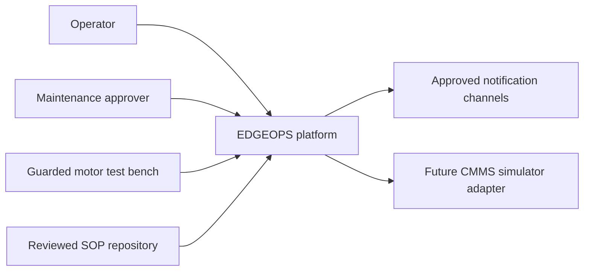
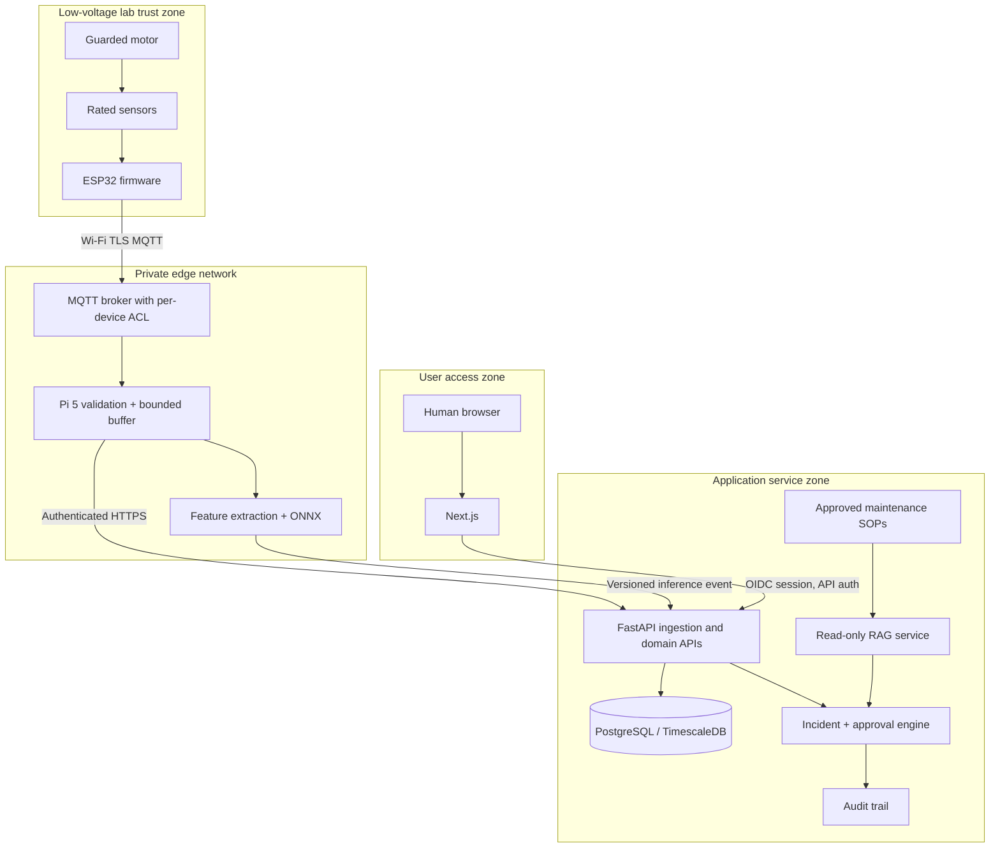

# EA-02 — Solution Architecture and C4 Views

**Status:** Proposed; deployment topology not verified.

## Context — system boundary

External integrations (CMMS/ERP/notifications) are **future adapters** until a tested endpoint exists.

## Container architecture

## Container ownership

| Component | Responsibility | Must not do |
|---|---|---|
| ESP32 | Sample sensors, timestamp/sequence, validate, publish | Authorize work orders or drive safety controls |
| MQTT broker | Authenticate publishers and enforce topic ACL | Infer health state |
| Pi gateway | Validate schema, buffer, infer and record model provenance | Silently drop anomalous/invalid windows |
| Ingestion API | Validate, deduplicate and persist events | Trust user-supplied tenant IDs |
| Incident engine | Correlate events and manage state | Execute uncontrolled equipment commands |
| RAG service | Read approved SOPs and suggest steps | Write work orders without independent authorization |
| Approval service | Enforce roles, version-bound approvals, audit | Allow self-approval when policy forbids it |
| Dashboard | Show measurements, quality, incidents, simulated data labels | Treat cached status as real-time without indication |
| Database | Own transactional records and time-series telemetry | Act as message broker |

## Deployment patterns

- **Development:** laptop/simulator + isolated ESP32 bench; Docker Compose services; nonproduction secrets.
- **Staging:** separate test identities, broker, DB, dashboards and seeded datasets; CI release gates.
- **Pilot (future):** segregated device LAN, broker private to trusted network, Pi with resilient storage, HTTPS ingress, monitored backend, encryption, backups and authorized operations.

No AWS, Azure, Pi or industrial hardware deployment is asserted by this document.

## Interfaces and trust boundaries

- Hardware voltage and physical isolation: electrical reviewer owns.
- Device -> broker: unique credentials, authenticated TLS, ACLs, replay controls.
- Broker -> gateway: validation, identity association, bounded queue and provenance.
- Edge -> API: mutual-service trust or scoped tokens; idempotency and versioning.
- Browser -> API: OIDC validation, RBAC + asset-level authorization.
- Docs -> RAG -> approval: untrusted document content treated strictly as data.
- Database -> backup: protected encryption keys and restore process.

## Technology choice rationale

ESP32 is inexpensive and adequate for introductory sensor acquisition; ADXL345 is not a calibrated industrial vibration analyzer. Pi 5 supports portable ONNX inference but requires measured capacity tests. MQTT supports constrained devices and intermittent networks. PostgreSQL/TimescaleDB combines relational workflows and time-series queries. FastAPI supports validated schemas, while Next.js provides operations views. RAG should aid people without being the authoritative maintenance controller.

## Architectural risks

Shared edge hardware introduces compute/resource contention; wireless connections can fail; sensor drift can create false alarms; a monolithic control plane can cause broad privileges. Mitigations require explicit queues, observability, quality flags, scoped credentials and audit evidence.
