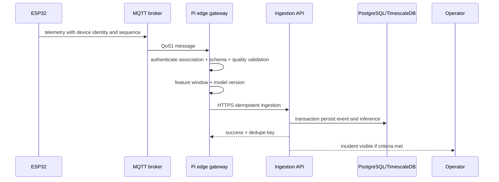

# EA-03 — System, Data and Integration Design

**Status:** Contract proposal; incompatible payloads in code must be reconciled before implementation.

## Data ownership and entities

| Domain | Entities | Owner |
|---|---|---|
| Asset registry | Asset, site, device, firmware identity | Asset service |
| Telemetry | Sample, quality flag, sample timestamp, ingestion timestamp | Telemetry service |
| ML | Feature window, model manifest, score, threshold, evaluation | Edge ML / model registry |
| Incidents | Incident, trigger, severity, lifecycle transition | Incident service |
| Work orders | Work order, policy decision, approval, review note | Workflow service |
| Knowledge | SOP, revision, source permission, citation | Knowledge service |
| Governance | Principal, access grant, audit event, retention policy | Identity/governance services |

Tenant/site ownership must be enforced at the API and query level; a client-provided tenant ID must never bypass server-side authorization.

## Suggested MQTT topics and quality of service

`edgeops/v1/{site_id}/{device_id}/telemetry` and `edgeops/v1/{site_id}/{device_id}/status`. Separate command/control namespaces should not be enabled for physical actuation. MQTT QoS 1 is a candidate for telemetry that needs at-least-once delivery; implement deduplication because duplicates are possible. Broker topics must be authorized per device. Never use anonymous internet-exposed broker.

## Illustrative telemetry JSON (not a verified existing message)

```json
{
  "schema_version": "1.0",
  "site_id": "lab",
  "asset_id": "motor-001",
  "device_id": "esp32-001",
  "boot_id": "boot-0001",
  "sequence": 142,
  "event_time_utc": "2026-11-17T06:00:00Z",
  "sampling": { "rate_hz": 50, "window_ms": 1000 },
  "measurement": {
    "acceleration_x_g": 0.01,
    "acceleration_y_g": -0.03,
    "acceleration_z_g": 1.00,
    "motor_case_temperature_c": 28.0,
    "bus_voltage_v": null,
    "current_a": null
  },
  "quality": {
    "vibration": "unverified",
    "temperature": "unverified",
    "electrical": "not_connected",
    "provenance": "illustrative_not_measured"
  }
}
```

The example values above are **illustrative only**, not evidence of acquired measurements. In production, define clock synchronization, monotonic counters, sensor availability, missing-value representation and consistent measurement units.

## Data processing sequence



## API proposal

- `POST /v1/ingest/windows` — device/service authentication, idempotency key; bounded payload.
- `GET /v1/assets/{id}/telemetry` — RBAC, site/asset filter, pagination and retention enforcement.
- `GET /v1/incidents` — filtered incident list with event provenance.
- `POST /v1/incidents/{id}/acknowledge` — authorized transition and concurrency version check.
- `POST /v1/work-orders/{id}/approve` — independent approver and version-bound decision.
- `POST /v1/work-orders/{id}/reject` — audited decision.
- `POST /v1/knowledge/query` — read-only guidance, citation validation and refusal on insufficient evidence.

Contracts above are candidate design, not confirmed implemented endpoints.

## State and consistency rules

Incident: `candidate -> open -> acknowledged -> resolved -> closed`, with documented reopening. Work order: `draft -> pending_review -> approved | rejected -> in_progress -> completed | cancelled`. Only authorized roles can transition states; changing draft content invalidates a stale approval. Use optimistic concurrency + idempotency on mutating requests. Retain causation IDs for tracing and an outbox for reliable domain event publication.

## Failure handling

| Failure | Required response |
|---|---|
| Wi-Fi outage | bounded offline buffer, dropped-event count, reconnect with backoff |
| Duplicate/replayed packet | uniqueness key on device + boot + sequence, telemetry idempotency |
| Sensor out of range or absent | quality flag, no false healthy inference |
| Unsupported schema | quarantine or reject + visible metric |
| Pi failure | status stale, no inference claim |
| API/DB unavailable | bounded retries, dead-letter or review queue, no silent loss |
| RAG missing citation | abstain and direct to human/SOP |
| Revoked approver | server rejects decision, audit denial |

## Retention and data migration

Propose separated retention tiers for raw sensor samples, aggregates, incidents, approvals and audit; negotiate exact days with the data owner. Hash and version dataset snapshots. Schema migration requires backward compatibility/replay test and verified restore procedure.
