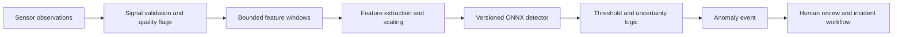
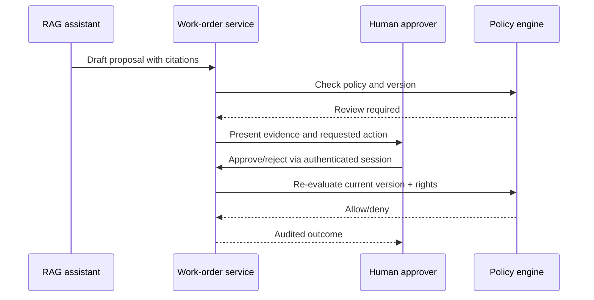

# EA-04 — Edge AI, Generative AI and Agentic Architecture

**Status:** Proposed. No claimed model quality, physical condition-label accuracy or completed edge benchmark.

## AI problem formulation

Objective: flag changes from a defined **healthy operating baseline**, not diagnose specific industrial failures without labeled and independently validated evidence. A small sensor rig can demonstrate anomaly scoring, but cannot prove industrial fault generalization. Distinguish measured lab data, simulation and replay.

## Measurement and inference pipeline

### Candidate features

Windowed means, standard deviation, RMS, peak-to-peak vibration, vibration-axis magnitude, temperature change per interval, appropriately rated current trend, missingness and timestamp irregularity. Verify sensor sampling bandwidth and aliasing before frequency-domain feature claims. Temperature can be slow-varying relative to accelerometer data.

### Dataset and model validation plan

- Record sensor firmware, sensor placement, motor model, guard/mount conditions and operator.
- Start with normal baseline over multiple sessions; split train/validation/test by session, not random adjacent windows, to avoid leakage.
- Label synthetic perturbations separately; do not fabricate damaged machinery or deliberately stall motors.
- Compare simple threshold, isolation forest and small neural detector where appropriate.
- Evaluate precision, recall and false alarm rate when meaningful labels exist; report detection latency, missed windows, calibration uncertainty and confidence intervals.
- Export scaler, features, thresholds and ONNX together; parity-test against reference.
- Benchmark Pi inference p50/p95, memory, CPU, boot/recovery and thermal behavior on real hardware.
- Gate release by both model quality **and** fallback behavior when sensors are stale or invalid.

## Model lifecycle

`proposed -> trained -> evaluated -> security_reviewed -> staged -> human_approved -> active -> retired`. Rollback restores a compatible model + feature extractor + threshold. Track model hash, dataset manifest, dependencies and test results.

## RAG maintenance assistant

Knowledge sources must be approved SOP versions and nonconfidential training manuals with provenance. Ingestion: file validation -> extraction -> chunking -> metadata ACL -> retrieval -> optional reranking -> citation verification -> output checks. Require abstention if evidence is absent. Track answer attribution, retrieval recall, unsafe-action rate and prompt-injection outcomes.

### Agent privilege contract

Allowed: search approved SOPs, read authorized incident context, draft diagnostic summary, suggest work-order text. Disallowed: electrical switching, PLC commands, modifying safety controls, changing model deployments, self-approving work orders, executing shell commands, reading unrelated tenants or exfiltrating documents. Tool grants are explicit and short-lived; every call logged and rate limited.

## Human approval threat boundary

An approval for a work-order recommendation does **not** authorize the agent to control physical equipment. Physical execution remains a separate safety-reviewed manual procedure.

## Model and RAG evaluation gates

Record test fixture ID, data provenance, expected output, measured output, model/version, pass/fail and reviewer. Include missing sensor, distribution shift, malicious SOP injection, stale citations, forbidden tool requests and high-uncertainty windows.
