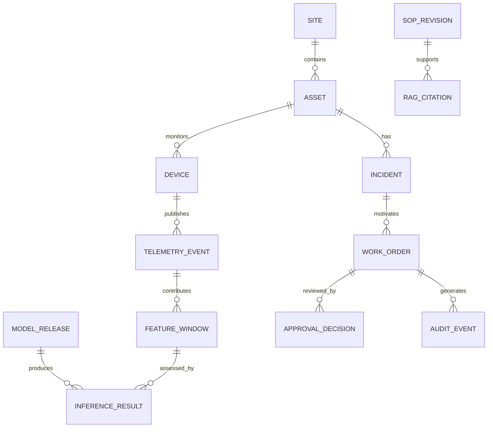

# EA-11 — Data Architecture, Ownership and Governance

**Status:** Proposed logical model; physical DDL, retention and migration evidence pending.

## Domain ownership

- **Asset registry:** asset, site, device binding and firmware identity.
- **Telemetry:** immutable ingest envelope, measurements, provenance, quality and retention.
- **AI registry:** feature schema, scaler, threshold, ONNX artifact, evaluation and approval records.
- **Maintenance:** incident, work order, revision, decision, authorization and audited transitions.
- **Knowledge:** SOP document/revision, source permissions, extraction/chunk lineage and retrieval citations.
- **Identity and audit:** principal, grant, policy version, actor, timestamp and immutable event chain/retention strategy.

## Logical entity relationships

## Data quality and provenance

Every reading should carry measurement unit, physical channel, sampling/aggregation context, device identity, firmware hash/version, schema version, time provenance, uncertainty/quality flags, and source label `measured | synthetic | replayed`. Missing sensor is not `0`; stale data must not be displayed as a healthy condition. Validate sensor calibration status and mounting environment.

## Storage segmentation

PostgreSQL relational tables support transactional workflow data; TimescaleDB hypertables, **if installed and supported**, store time-series windows/aggregates. Keep binary SOP source documents in controlled object/file storage and store references, ACL and content hashes in DB. Keep raw and derived telemetry separate; version feature extraction.

## Privacy and retention

Classify principal, device, site and operator metadata; identify owners and legal basis for any personal data; document cross-border processing and UAE requirements **based on actual deployment and legal review**. Propose retention by data class, but do not choose arbitrary periods. Implement access/deletion/export practices only after scope and obligations are confirmed.

## Data lifecycle

Collection -> validation -> storage -> access -> feature generation -> model training/evaluation -> controlled archive/deletion. Backups must have separate expiry and restoration procedures. Publish only approved synthetic or explicitly authorized and sanitized records.

## Access and isolation tests

Verify authenticated user cannot query unrelated tenant/site, device cannot impersonate another device, service credentials cannot read unrelated SOP, user exports respect filters, and retrieval indexes maintain source ACLs at search and answer time.

## Migration and observability

Each change includes versioned Alembic/SQL migration, rollback strategy, integrity test, capacity estimate and backup checkpoint. Measure ingestion lag, duplicates, stale readings, database size and query latency during testing; do not claim performance absent results.
