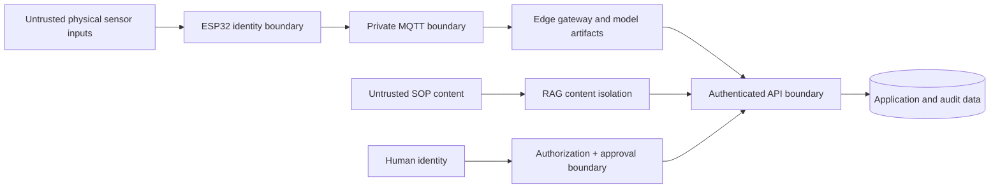

# EA-12 — Threat Model, Risk Register and Treatment Plan

**Status:** Initial design-time risk identification. Likelihood and impact are estimates for prioritization, **not validated ratings**. No risk has been accepted or closed.

## Security and safety boundaries

## Proposed register

| Risk ID | Risk and affected asset | Initial severity* | Treatment | Verification | Owner role |
|---|---|---|---|---|---|
| R-01 | Spoofed MQTT device and forged telemetry | High | unique device credentials, per-topic ACL, TLS, replay detection | revoked/unrelated publisher denied | security architect |
| R-02 | Motor overcurrent or contact with shaft | Critical | correct driver ratings, fuse, isolation switch, rigid mounting and guard | independent electrical safety inspection | electrical safety reviewer |
| R-03 | INA219 shunt overheats under stall/load | High | datasheet review, current-rated path, alternative transducer if needed | rated circuit review before motor operation | hardware engineer |
| R-04 | Credential leakage through GitHub | High | secret store, scanners, least privilege, rotation | secret leak rehearsal | security engineer |
| R-05 | Unauthorized cross-tenant retrieval | High | server-side site and SOP ACL; scoped queries | negative asset/doc access tests | backend owner |
| R-06 | Prompt injection in SOP documents | High | treat SOP as data, tool allowlists, independent human approval | adversarial SOP corpus | AI security owner |
| R-07 | Hallucinated diagnosis | High | anomaly labels as tentative, citations, abstention, human decision | held-out/uncertain case evaluation | ML owner |
| R-08 | Unreviewed autonomous actuation | Critical | no equipment actuation APIs or tool permissions | search/negative API tests | architect / safety reviewer |
| R-09 | Connectivity loss or Pi failure yields stale healthy status | High | freshness indicators, local queue, degraded state | network partition and restart tests | platform owner |
| R-10 | Misleading model evaluations through data leakage | High | split by session, provenance, reproducible manifests | split audit and repeat evaluation | ML owner |
| R-11 | Model or dependency supply-chain tampering | High | hashes, signatures where supported, SBOM and review | altered artifact rejected | MLOps owner |
| R-12 | Backup failure or silent recovery loss | High | encrypted off-host backups, restore drill | clean restore with reconciliation | operations owner |
| R-13 | Personal/operator data exposed in public demo | High | synthetic-only by default, redaction, publish approval | privacy review of repo/screenshots | data owner |

*Severity is a design-time estimate. In an actual pilot, use a validated organizational likelihood/impact matrix and assign named accountable owners.

## Treatment tracking template

`Risk ID | Threat scenario | Initial L/I | Control owner | Treatment action | Due date | Residual L/I | Test ID | Evidence URL | Reviewer | Decision`

## Stop conditions

Do not energize the motor before R-02 and R-03 electrical ratings and protective measures have been reviewed. Do not deploy internet-facing broker access without R-01 control tests. Do not publish real customer, operator or company data before authorized privacy review. AI agent tools must not be given physical control rights under this prototype.

## Approval integrity

There are **zero recorded independent signoffs** in this baseline. An individual author may document a self-assessment, but must not impersonate another reviewer or indicate risk approval without an actual decision record.
