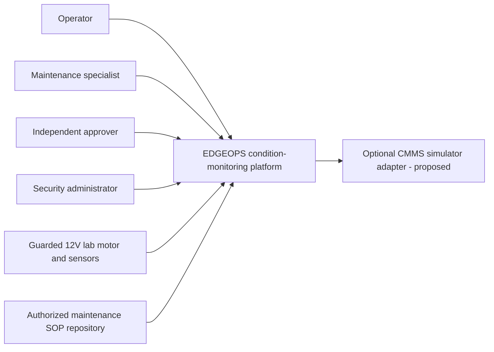
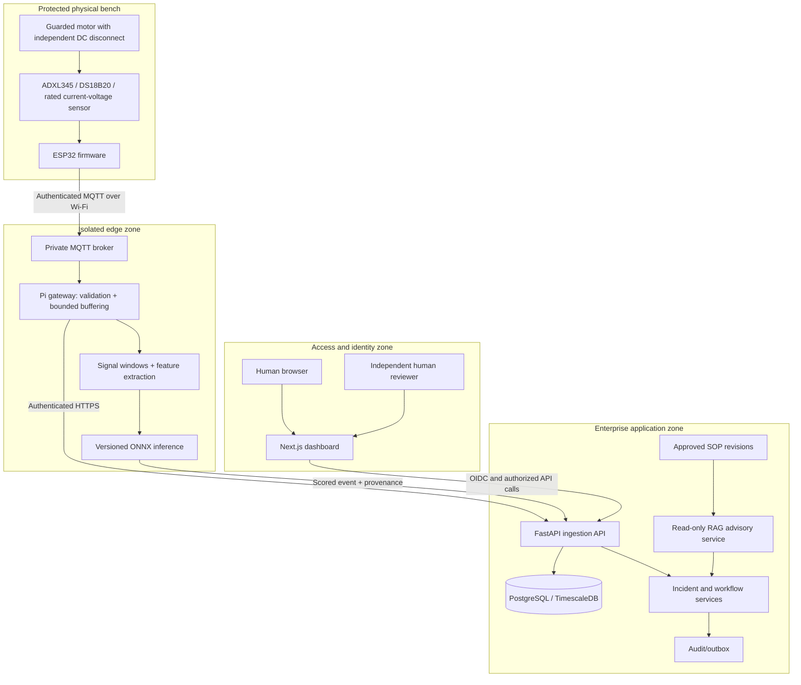
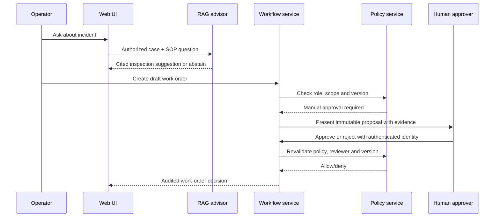

# EA-16 — Master Enterprise Solution Architecture (EDGEOPS)

> **Version:** 1.0 design candidate · **Status:** Proposed / unapproved · **Date:** 2026-11-17  
> **Project:** Industrial Edge AI Predictive Maintenance & Autonomous Operations Platform  
> **Intended audience:** Enterprise AI Architect, AI Solutions Architect, Agentic AI Architect, Senior Generative AI Architect, AI Technical Lead, Security & AI Governance.  
> **Evidence notice:** Architecture documentation and starter ESP32 code exist; physical sensors, measured model performance, end-to-end deployment, industrial validation and independent design approval are not established.

## 0. Executive architecture decision

Design a **guarded low-voltage laboratory condition-monitoring system** that keeps deterministic sensor acquisition, edge anomaly inference, domain workflows, and AI advisory services separate. Use authorization at every service boundary and independently enforced human approval for maintenance work-order transitions. **No network service or LLM may actuate equipment or replace physical safety devices.**

The system is a portfolio-grade **reference architecture**, not an industrial safety-certified product. It should prove ability to make transparent enterprise architecture decisions, and should generate evidence once implemented.

## 1. Business architecture

### 1.1 Problem / strategic drivers
- Inconsistent signal quality and siloed asset condition information.
- Slow investigation and duplicated alerts/work orders.
- Unverifiable model scores and generative recommendations.
- Weak provenance between sensor event, interpretation, business decision and maintenance approval.
- Limited capability to reproduce incidents and explain decisions to auditors.

### 1.2 Stakeholders and value streams
| Persona | Needs | Decision accountability | Evidence of success |
|---|---|---|---|
| Operator | Current and trustworthy asset condition | Acknowledge operational incidents | Freshness/quality indicators and timestamps |
| Maintenance engineer | Actionable evidence and cited SOPs | Assess inspections | Incident to approved procedure trace |
| Human approver | Context, permissions, full proposal version | Approve/reject work order | Version-bound audit decision |
| Enterprise architect | Interoperability and design boundaries | Architecture standards | ADRs, contracts, reviews |
| AI/ML lead | Reproducible measured evaluation | Model promotion recommendation | Dataset/model manifest, metrics |
| Security/OT safety reviewer | Safe physical and software boundaries | Independent risk disposition | Test results and safety review |
| Sponsor | Budget, scope, outcome and operational constraints | Business case and pilot scope | Baseline/target metrics |

### 1.3 Capability map
**L1:** Asset and Device Management | Telemetry and Data Governance | Edge Intelligence | Incident Management | Maintenance Workflows | Knowledge and AI Advice | Identity and Risk | Operations and Model Lifecycle.
**L2 illustrative decomposition:** registration, assignment, device health, schema validation, buffering, features, scoring, incident dedupe, approvals, SOP citation, RBAC, monitoring, rollback and audit.

**Out of scope:** PLC/SCADA actuation, autonomous repair, real factory claims, industrial safety certification, unsupported fault diagnosis and unapproved proprietary data. Scope requires approval before expansion.

## 2. Architecture principles

AP-01 Physical safety independent of AI/network.  
AP-02 Least privilege and zero implicit device trust.  
AP-03 Every result has source/provenance and revision.  
AP-04 Domain services own their state and authorization.  
AP-05 Bad/stale/missing telemetry cannot render as "healthy".  
AP-06 Human-approved, version-bound work-order decisions.  
AP-07 Compare deterministic rules against ML before deployment.  
AP-08 Contract-first interoperability and idempotent event processing.  
AP-09 Edge outages degrade visibly and fail safely.  
AP-10 Documentation status never exceeds demonstrated evidence.

## 3. System context (C4 L1)

## 4. Containers, data flows and trust zones (C4 L2)

**Deployment assumption:** Pi hosts private edge processing; back end may run on a secure development or staging server. Cloud provider, region, network CIDRs, retention and hosting topology are intentionally **undecided**. Record a new ADR after measuring workload and determining governance needs.

## 5. Component responsibility matrix (C4 L3)

| Component | Owns | Explicitly does not own | Proposed failure action |
|---|---|---|---|
| ESP32 | Sampling, sequence/boot identity, sensor status | Business approval, safety shutdown, inference policy | Reconnect/backoff, bounded loss counter |
| Broker | Authenticated topic transport and ACL | Analysis or authorization of work orders | Surface disconnected state |
| Pi gateway | Validate packets, buffer and timestamp provenance | Suppress missing data as healthy | Stale/degraded state and replay |
| Feature engine | Deterministic window transforms | Data fabrication | Flag invalid windows |
| ONNX service | Versioned anomaly score | Safety actuation or medical-grade diagnosis | Abstain + fall back to quality/rules |
| FastAPI domain layer | Identity-bound asset, incident, approval logic | Blindly trust client tenant | Reject and audit denied calls |
| Database | Persist relational and time-series records | Business authorization decisions | Transaction rollback, backup/restore |
| RAG service | Retrieve approved SOPs and draft cited advice | Approve orders or execute tool actions | Cite or abstain |
| Next.js UI | Display evidence and initiate authorized requests | Security enforcement on client only | Signal stale, denial and errors |

## 6. Data architecture and integration

The logical entities are Site, Asset, Device, TelemetryEvent, FeatureWindow, ModelRelease, InferenceResult, Incident, WorkOrder, ApprovalDecision, SOPRevision and AuditEvent. Source of truth: PostgreSQL domain state; TimescaleDB extension **only if installed and supported** for time-series storage.

**MQTT candidate topic:** `edgeops/v1/{site_id}/{device_id}/telemetry`, authenticated TLS with per-device topic ACL. **QoS1 is at-least-once**, so deduplicate using authenticated `device_id + boot_id + sequence` (or a documented equivalent). Devices may publish telemetry only, no physical command topics.

**API proposals:** `POST /v1/ingest/windows`, `GET /v1/assets/{id}/telemetry`, `GET /v1/incidents`, `POST /v1/incidents/{id}/acknowledge`, `POST /v1/work-orders/{id}/approve`, `POST /v1/knowledge/query`. All paths are **proposed, not implemented evidence**. Refer to [EA-10](10-API-EVENT-AND-CONTRACT-CATALOG.md) and [EA-03](03-SYSTEM-INTEGRATION-DESIGN.md) for versioned payload and retry rules.

**Provenance invariant:** Every dataset, chart and model test must label `measured / synthetic / replayed`. Missing readings are `null` with quality state, never invented zeros. Device clocks require synchronization design; when unavailable, record receipt time and event-order sequence separately.

## 7. Edge AI and machine-learning design

- First baseline: sensor-quality checks, physical-domain sanity bounds, basic threshold alerts.
- Candidate ML: feature windows, robust scaling, statistical or small neural anomaly model exported to ONNX **if it improves tested trade-offs**.
- Prevent leakage by splitting independent recording **sessions** before creating windows.
- Measure false alarms per hour, precision/recall where labels exist, time-to-detection, stale-data handling, inference latency p50/p95, memory/CPU/thermal on actual Pi.
- Bundle model hash + scaler + feature schema + threshold + dataset manifest; allow version-compatible rollback.
- Synthetic perturbations are not evidence of real equipment defects. Do not deliberately stall or damage motor.
- See [EA-04](04-AI-AND-AGENT-ARCHITECTURE.md) and [EA-13](13-AI-EVALUATION-AND-MODEL-GOVERNANCE-PLAN.md).

## 8. Generative AI and governed agent architecture

Use an advisory-only retrieval pipeline: approved SOP ingestion and source controls -> chunk/index with revision/ACL -> retrieval/rerank -> evidence-checking -> answer with citations or explicit abstention.

The LLM may **read** authorized incidents/SOPs and **draft** text. It may **not** control GPIO, PLC, motors, cloud shell or secrets, grant permissions, create self-approved orders, or bypass a policy decision. Approval of work-order text is not physical execution authorization.

## 9. Security, governance and compliance

Threat boundaries: sensor/ESP32, device broker, edge model artifacts, edge-to-API, human identity, cross-site/tenant data, retrieved SOP content, model release. Planned controls include unique device credentials, broker ACL, authenticated HTTPS, OIDC issuer/audience checks, server-side RBAC and site filters, secrets management, artifact signing/hashes, supply-chain scanning, audit/outbox, SOP prompt-injection resistance and independent work-order approval.

**Physical safety gate:** Exact motor rated/stall currents, driver sizing, inline fuse, cable sizing, polarity, switch, secure bracket and shaft guard require qualified review **before motor energization**. No exposed mains supplies. Not an IEC/industrial safety certified deployment.

Use NIST AI RMF, NIST CSF, OWASP GenAI/LLM risks and IEC 62443 concepts **as design references**, not certification assertions. UAE data/privacy and localization obligations require deployment-specific legal/security assessment. See [EA-05](05-SECURITY-GOVERNANCE-AND-SAFETY.md), [EA-12](12-THREAT-MODEL-AND-RISK-REGISTER.md).

## 10. Operations, cloud, availability and FinOps

Separate dev, staging and prospective authorized pilot environments. Proposed CI: contract lint -> unit/integration -> adversarial and ML regression -> secret/dependency/container scans -> SBOM -> staged release -> authorized manual promotion. Observability: device last-seen and dropped windows, broker ACL failures, gateway buffer, Pi inference p95, API errors, DB lag, model drift, work-order approvals/denials, RAG abstentions, restore age.

Define RPO/RTO, retention, p95 latency and model quality targets with stakeholders, then perform load, failure and restore drills; do not invent percentages or cloud invoices. Costs: BOM and replacement, energy/edge equipment, hosting/database, networking, LLM tokens/search, monitoring, backups, human operations. Choose hosting region after privacy/data-residency review.

## 11. Risk, ADR and change control

Proposed ADRs: Pi 5 edge, MQTT delivery, ONNX vs simple rules, PostgreSQL/TimescaleDB, advisory-only GenAI, independent physical safety, version-bound human approval, evidence labels. Every changed architecture choice needs consequences, alternatives, test impacts and superseding ADR when accepted.

Top stop conditions: unknown motor stall/driver/fuse rating; unreviewed physical guard; anonymous/public MQTT broker; cross-site data leakage; unbounded agent permissions; unvalidated SOP injection; missing rollback; inability to restore data. See EA-07, EA-08, EA-12.

## 12. Requirement-to-verification chain

| Objective | Requirement | Component | Test evidence |
|---|---|---|---|
| Trustworthy monitoring | FR-02 / FR-04 | ESP32 + ingest + UI | signed measurement provenance, quality flag visibility |
| Offline tolerance | FR-03 | MQTT + Pi queue | reconnect/dedupe/loss counters |
| Evaluated anomaly insight | FR-05 | model pipeline | baseline vs model holdout metrics |
| Safe governed advice | FR-07 / FR-08 | RAG + workflow | adversarial SOP and unauthorized approval denial |
| Auditable decisions | FR-09 | policy + DB | event trace and version-bound approval |
| Physical safety | FR-10 | rated circuit + guard | qualified review and disconnect |
| Secure tenancy | NFR-04 | API/DB | cross-site denial tests |

For full FR/NFR test cases use [EA-09](09-REQUIREMENTS-TRACEABILITY-MATRIX.md). No tests are claimed passed by this mapping.

## 13. Delivery and architecture-gate plan

**G0** business sponsor and MVP scope; **G1** requirements acceptance; **G2** data contracts/C4 and ADR review; **G3** model/RAG evaluation design; **G4** security plus independent physical safety review; **G5** development/test/deployment readiness; **G6** actual release evidence. **All gates currently open/unverified.** Hardware procurement is on hold at user's direction.

Suggested delivery after design review: sensor-only bench -> MQTT security -> Pi inference -> domain/API/DB -> dashboard -> read-only RAG -> approvals -> integration/security/DR tests -> portfolio evidence. See [EA-08](08-DESIGN-REVIEWS-AND-READINESS.md) and [EA-14](14-GOVERNANCE-OPERATING-MODEL-RACI.md).

## 14. Portfolio and interview evidence

Use a C4 diagram, bounded-context map, threat model, one ADR tradeoff, one negative authorization test, one RAG injection test, one measured Pi benchmark **when available**, and one incident-to-reviewed-order trace **when available**. Mark each as `proposed`, `implemented locally`, `tested`, `deployed in development/staging`, or `production authorized` with verifiable commit and artifacts.

**Current truth:** This master document demonstrates architecture reasoning and documentation discipline; it does not establish hardware operation, completed deployment, audited compliance, AI accuracy or industrial outcomes.

## 15. Canonical companion documents

[EA-01 Charter](01-ENTERPRISE-ARCHITECTURE-CHARTER.md) · [EA-02 C4](02-SOLUTION-ARCHITECTURE.md) · [EA-03 Integration](03-SYSTEM-INTEGRATION-DESIGN.md) · [EA-04 AI/Agents](04-AI-AND-AGENT-ARCHITECTURE.md) · [EA-05 Security](05-SECURITY-GOVERNANCE-AND-SAFETY.md) · [EA-06 Ops](06-QUALITY-OPERATIONS-AND-COST.md) · [EA-07 ADR](07-ARCHITECTURE-DECISIONS.md) · [EA-08 Gates](08-DESIGN-REVIEWS-AND-READINESS.md) · [EA-09 Traceability](09-REQUIREMENTS-TRACEABILITY-MATRIX.md) · [EA-10 Contracts](10-API-EVENT-AND-CONTRACT-CATALOG.md) · [EA-11 Data](11-DATA-ARCHITECTURE-AND-GOVERNANCE.md) · [EA-12 Risk](12-THREAT-MODEL-AND-RISK-REGISTER.md) · [EA-13 Evaluation](13-AI-EVALUATION-AND-MODEL-GOVERNANCE-PLAN.md) · [EA-14 RACI](14-GOVERNANCE-OPERATING-MODEL-RACI.md) · [EA-15 Case Study](15-PORTFOLIO-CASE-STUDY-AND-EVIDENCE.md).
