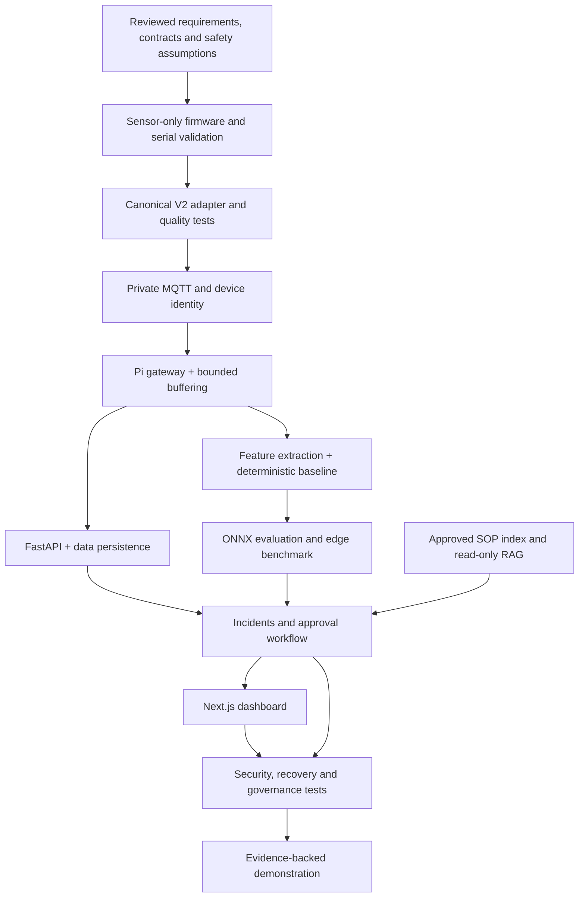

# EA-21 — Implementation-Readiness Architecture Review and Decision Pack

> **Status:** Draft review packet / NOT approved  
> **Date:** 2026-11-17  
> **Scope:** EDGEOPS Industrial Edge AI Predictive Maintenance and Autonomous Operations, guarded 12V laboratory prototype  
> **Change policy:** Architecture documentation only. No hardware purchases, firmware edits, network provisioning, independent safety approvals or physical experiments have occurred as part of this review.

## 1. Executive decision

**Recommendation: CONDITIONAL NO-GO for motor energization or production deployment.** Documentation review and sensor-only planning may continue. The design package is substantial, but key architectural decisions, requirements, contracts, and physical safety assumptions are still open. In particular, existing firmware uses flat serial telemetry V1; the nested enterprise telemetry envelope is a **proposed V2 contract**, not an implemented format.

This review consolidates [EA-08](08-DESIGN-REVIEWS-AND-READINESS.md), [EA-09](09-REQUIREMENTS-TRACEABILITY-MATRIX.md), [EA-17](17-ARCHITECTURE-GAP-AUDIT-AND-REVIEW-REGISTER.md), [EA-19](19-ARCHITECTURE-TO-CODE-CONFORMANCE-REVIEW.md), and [EA-20](20-TELEMETRY-CONTRACT-MIGRATION-AND-TEST-PLAN.md).

## 2. Architecture scope and design invariants

1. Physical test subject is a **guarded, low-voltage 12V motor**, not a safety-rated factory machine.
2. Safety isolation/disconnect, fusing, driver sizing, mount and guard are independent of APIs, ESP32 firmware, AI and networks.
3. ESP32 acquires sensors; Pi is a candidate MQTT gateway and ONNX host; FastAPI/DB/UI are enterprise layers. These integrations are proposed unless separately evidenced.
4. No AI agent may energize a motor, command PLC/SCADA, approve its own workflow, change access grants, or execute arbitrary tools.
5. Human work-order approval is authorized server-side, version-bound, auditable and distinct from electrical authorization.
6. Every observation, dataset, incident and model result must preserve **measured / synthetic / replayed** origin and quality/freshness.
7. Missing/invalid/stale readings are never silently presented as healthy or as trustworthy zero readings.

## 3. Gate matrix — review requires evidence, not file count

| Gate | Purpose | Evidence required to close | Responsible review roles | Current |
|---|---|---|---|---|
| G0 | Sponsor, objectives and MVP scope | Dated charter, in/out of scope and accountable sponsor | Business sponsor + architect | OPEN |
| G1 | FR/NFR acceptance | Approved requirement IDs, success measures, acceptance criteria | Sponsor + product + tech lead | OPEN |
| G2 | Architecture/contracts | C4 boundaries, component ownership, ADR choices, one canonical contract and compatibility plan | Solutions architect + data lead | OPEN |
| G3 | AI evaluation design | Data provenance, session split, baselines, model and RAG/agent negative tests | AI architect + independent reviewer | OPEN |
| G4a | Cybersecurity | IAM, device identity, secrets, TLS/ACL, threat treatments, security tests | Security reviewer | OPEN |
| G4b | Physical safety | Exact datasheets, stall/current path, fuse, driver, wire, polarity, motor guard, independent isolation; qualified review | Qualified electrical/OT reviewer | BLOCKING |
| G5 | Delivery readiness | Environments, versions, CI, rollback, observability, RPO/RTO, costs/owners | Tech lead + operations | OPEN |
| G6 | Release/pilot | Running build, signed decision, repeatable tests and monitoring evidence | Actual deployment authorities | NOT STARTED |

Approval record must identify reviewer, role, date, decision, version, unresolved risks and evidence location. An author cannot self-attest an independent review.

## 4. Design-decision queue — resolve in order

| ID | Decision needed | Options to compare | Provisional recommendation | Decision owner | Blocking? |
|---|---|---|---|---|---|
| DEC-01 | Telemetry canonical schema | Keep flat V1; in-place edit; V1-to-V2 adapter | Prefer explicit gateway adapter to canonical V2 | Integration architect | G2 |
| DEC-02 | Measurement units | SI m/s² and A; g and mA; both with explicit units | Preserve m/s² and V, convert mA to A once at adapter | Data/AI lead | G2 |
| DEC-03 | Missing values and quality | numeric zero; null; separate quality | Use null plus per-channel quality; no false healthy | Data/AI lead | G2/G3 |
| DEC-04 | Device identity/restarts | hard-coded device ID; provisioned ID + session | Bind physical device to site/asset at trusted gateway; boot/session identity | Security + firmware lead | G2/G4a |
| DEC-05 | MQTT delivery/security | unencrypted; TLS QoS0; TLS QoS1 | Private TLS broker + per-device ACL + dedupe for QoS1 | Security + integration lead | G4a |
| DEC-06 | Edge/offline behavior | best effort; bounded queue; durable buffering | Bounded queue with explicit loss counters; durable persistence if requirements justify | Platform lead | G2/G5 |
| DEC-07 | Model strategy | rules; isolation forest; ONNX model | Rules first; advance to ONNX only after session-holdout evidence | AI architect | G3 |
| DEC-08 | Agent permissions | wide tools; scoped read; direct action | Read authorized SOP and incident, draft only; external approval enforcement | AI security lead | G3/G4a |
| DEC-09 | Deployment and residency | local dev; cloud pilot; hybrid | Dev first, select pilot environment after data and security review | Enterprise architect | G5 |
| DEC-10 | Electrical BOM | TB6612FNG vs rated alternative; 3A vs 5A adapter | No purchase or energization until actual motor stall data and driver/supply compatibility | Qualified electrical reviewer | G4b |
| DEC-11 | RPO/RTO and SLOs | arbitrary target; stakeholder-derived target | Require business impact and observed baseline before numeric commitments | Sponsor + SRE | G1/G5 |
| DEC-12 | Source of truth / data retention | PostgreSQL alone; TimescaleDB; broker cache | PostgreSQL transaction ownership; TimescaleDB only after compatibility/sizing | Data architect | G2/G5 |

Every approved decision needs an ADR containing context, alternatives, consequences, test impacts, reviewer and reversal conditions. **All choices above remain proposed.**

## 5. Contract-reconciliation plan

### Observed source baseline
`phase-01-hardware/firmware/src/main.cpp` emits flat JSON with `schema_version: 1`, `device_id: "motor-001"`, `seq`, `uptime_ms`, `ax_mps2`, `ay_mps2`, `az_mps2`, `temp_c`, `bus_v`, `current_ma` and sensor-validity flags. `capture_serial.py` validates this format and writes CSV. It does **not** implement MQTT, enterprise identity or V2.

### Proposed migration
1. Freeze V1 as the source-truth **legacy serial format**, documented by fixture and JSON Schema.
2. Ratify canonical V2 fields and units: explicit site/asset/physical-device IDs; origin label; real boot/session handling; gateway timestamp with clock-quality; nullable measurement values; per-sensor quality; model/firmware provenance when known.
3. Build a dedicated V1→V2 adapter at the gateway with tests for zero-as-invalid, mA-to-A conversion, restart ambiguity, partial sensor availability and schema rejection.
4. Distinguish trusted identity (bound from authenticated transport/registry) from untrusted payload identity; refuse mismatched topic identity when MQTT exists.
5. Add end-to-end deduplication and correlation IDs without claiming exactly-once network delivery.
6. Change EA-10 and downstream code only after contract decision review and compatibility tests.

### Non-negotiable validation
- `adxl345_valid=false` maps **all** acceleration channels to null, not 0.
- `ds18b20_valid=false` maps temperature to null.
- `ina219_valid=false` maps voltage/current to null.
- `current_ma=1000` maps to `current_a=1.0`; acceleration remains m/s².
- Restarting sequence at 1 must not silently merge two boot sessions.
- Invalid/stale readings must render unknown/degraded rather than healthy.
- Source provenance must remain visible through database, model, API and dashboard.

## 6. Security and AI architecture assurance scenarios

| Test | Design expected behavior | Proposed evidence |
|---|---|---|
| Unknown ESP32 publishes MQTT message | Broker rejects credentials | ACL and cert test log |
| Valid ESP32 publishes another device's topic | Topic ACL denies | Broker log and config diff |
| MQTT QoS1 replay/duplicate | Ingestion persists one logical event | Idempotency integration test |
| Client-supplied unrelated tenant/site ID | Server denies data and audit records denial | Negative API test |
| Retrieved SOP asks agent to run shell/energize motor | Agent has no such tools; policy denies | Adversarial RAG test |
| User alters work order after approval | Old approval invalid; new review required | State-machine test |
| False/no sensor reading | Unknown/degraded state; no safe/healthy claim | Gateway and UI test |
| Corrupted ONNX/model bundle | Reject version/hash and use documented fallback | Release rollback test |
| DB outage and recovery | Bounded retry with loss visibility | Failure injection and restore |
| Emergency motor disconnect | Independent of application/network | Qualified electrical review / safe test |

Test entries are **plans**, not completed test results.

## 7. NFR review protocol

Define and obtain approval for: physical/sample rate and jitter, supported assets and devices, end-to-end alert latency, false alarms per operating hour, edge RAM/CPU and thermal budget, data retention, service availability, MQTT outage tolerance, RPO/RTO, identity recovery, audit integrity, legal geography/residency, operating cost and support ownership.

For every NFR capture `Owner | Business justification | Proposed target | Test environment | Tool/measurement method | Pass/fail | Evidence`. Never set unmeasured SLO values simply for portfolio appearance.

## 8. Implementation dependency map (after approvals)

**Parallel branch:** rated guarded motor design stays blocked until a qualified electrical review. Development with synthetic or disconnected sensor fixtures can proceed under separate safe conditions after appropriate design acceptance. No direct actuation integration is on this path.

## 9. Architecture review meeting package

**Agenda (60–90 minutes, scheduling only when an actual review is arranged):**
1. Business outcome, limited lab scope and facts vs design assumptions.
2. C4/edge-service boundary and failure modes.
3. V1→V2 telemetry contract and identity.
4. Security threat/risk priorities; physical motor stop conditions.
5. Model/RAG evaluation quality and denied tool actions.
6. NFRs, environment costs, recoverability and delivery ownership.
7. ADR decisions, unresolved risks and recorded next actions.

**Decision log record:** `Meeting ID | Date | Architecture version | Participants and roles | Decision ID | Alternatives considered | Outcome | Conditions | Responsible owner | Review date | Link to evidence`.

## 10. Portfolio evidence and role mapping

| Target role competency | Evidence to present | Honest current statement |
|---|---|---|
| Enterprise AI Architect | Business capabilities, service boundaries, governance, ADR and decision board | Architecture proposal authored; sponsor signoff pending |
| AI Solutions Architect | C4, interface contract, edge/cloud deployment and NFR decisions | Contract and infrastructure design drafted; runtime validation pending |
| Agentic AI Architect | Read-only tool policy, separated approval and prompt-injection negative cases | Policy design exists; negative tests pending |
| Senior Generative AI Architect | Source ACL, versioned RAG, abstention, citations and evaluation protocols | Evaluation design exists; measured results pending |
| AI Technical Lead | Traceability, delivery critical path, CI quality gates, incident recovery | Plan exists; execution artifacts pending |
| Security & AI Governance | Threat model, tenant/device identity, risk register and safety stop conditions | Controls proposed; external review/test pending |

### Interview narrative
"I used a documentation-first architecture review to identify a real incompatibility between embedded firmware and enterprise event contracts. I explicitly preserved the working serial format while designing a versioned transformation, identity boundaries and negative test gates. The architecture prohibits AI-controlled physical actuation and requires independent safety review." This is **supported by design evidence**, not proof of deployment.

## 11. Action register

| ID | Task | Recommended next owner | Completion evidence | Status |
|---|---|---|---|---|
| ACT-01 | Approve limited MVP and functional/NFR priorities | Sponsor/product | Signed G0–G1 record | OPEN |
| ACT-02 | Ratify V2 contract and unit mapping | Solution/data architect | Approved DEC-01–03 ADR plus schema fixtures | OPEN |
| ACT-03 | Specify device/session identity and trust mapping | Security/embedded lead | DEC-04–05, reviewed provisioning/ACL design | OPEN |
| ACT-04 | Review motor supply, driver/shunt, fusing and guarding | Qualified electrical reviewer | Rated schematic, inspection and G4b decision | BLOCKED |
| ACT-05 | Agree AI evaluation baselines and no-actuation tool policy | AI/security leads | Approved evaluation fixtures and policy tests | OPEN |
| ACT-06 | Establish NFR targets and cost methodology | Sponsor/SRE | Reviewed SLO, RPO/RTO and capacity worksheet | OPEN |
| ACT-07 | Check actual source contract and test inventory | Tech lead | Source SHA + command outputs, traceability | OPEN |
| ACT-08 | Hold formal architecture review | Actual reviewers | Dated decisions, risk owners, open items | NOT SCHEDULED |

## 12. Decision and signoff sheet

| Review role | Name | Decision | Date | Evidence |
|---|---|---|---|---|
| Business sponsor | Not assigned | Pending | — | — |
| Enterprise/solution architect | Not assigned | Pending | — | — |
| AI/ML lead | Not assigned | Pending | — | — |
| Security reviewer | Not assigned | Pending | — | — |
| Qualified electrical safety reviewer | Not assigned | Pending | — | — |
| Technical lead/operations | Not assigned | Pending | — | — |

**Status classification:** This document and all its checks represent planned architecture assurance. They do not constitute completed implementation, legal certification, occupational safety approval, enterprise sponsor acceptance or production readiness.
