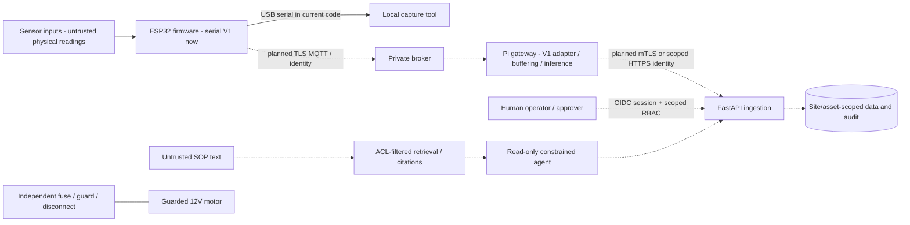

# EA-24 — Enterprise Security Architecture & Zero-Trust Verification Plan

> **Project:** EDGEOPS — Industrial Edge AI Predictive Maintenance and Autonomous Operations  
> **Status:** DRAFT SECURITY DESIGN / TEST SPECIFICATION — no security test execution or independent approval claimed  
> **Date:** 2026-11-17  
> **Scope:** ESP32 serial sensor lab, candidate Raspberry Pi gateway/MQTT, enterprise APIs, document RAG and bounded maintenance agents  
> **Change scope:** Architecture documents only. No hardware, firmware, broker, credentials, endpoints, production system or IAM configuration changed.

## 1. Executive security decision

**G4a security gate remains OPEN.** This document proposes the trust, authorization and test controls required to move from the existing source-level V1 serial capture prototype to an authenticated and auditable enterprise architecture. Existing [EA-05](05-SECURITY-GOVERNANCE-AND-SAFETY.md), [EA-12](12-THREAT-MODEL-AND-RISK-REGISTER.md), [EA-21](21-IMPLEMENTATION-READINESS-ARCHITECTURE-REVIEW.md), and [EA-22](22-INTERFACE-CONTROL-DOCUMENT.md) are authoritative context; this EA-24 adds implementable **control IDs, negative-test cases and acceptance evidence**.

In this prototype, **no remote motor command or AI actuation API is in scope**. Local physical protection and independent disconnect are separate safety requirements, and successful cybersecurity tests cannot authorize a motor test.

## 2. Trust boundaries and permitted flows

Solid serial path above describes the available source interface, **not verified physical connectivity**. Dotted data paths represent proposed integrations.

**Deny-by-default rules:** authenticate each principal at its boundary; authorize per operation and scope; do not derive identity from user-editable site/device fields; prohibit agent write actions beyond narrowly scoped recommendation drafts; never cross from software to electrical control.

## 3. Identity, authentication and authorization

| Principal | Candidate identity/control | Explicit permissions | Denied by default | Verification |
|---|---|---|---|---|
| ESP32 or Pi publishing gateway | provisioned device identity; individual credential/certificate; broker TLS | telemetry publish to identity-bound topic only | subscribe to admin channels, publish as other devices or sites | ZT-01 to ZT-05 |
| Pi ingestion worker | service principal, short-lived credential where feasible, certificate rotation | submit validated gateway records for registered assets | import arbitrary site asset claims, use admin APIs | ZT-06 to ZT-08 |
| FastAPI ingestion service | trusted token issuer, audience validation, scoped service credentials | store approved validated telemetry | bypass schema, write uncontrolled asset IDs | ZT-06 to ZT-10 |
| Operator | OIDC identity, read-scoped sites/assets | view assigned assets, open draft work orders | approve own work order unless separately authorized | ZT-11 to ZT-13 |
| Independent reviewer | separate authenticated approval role | approve/reject eligible current work-order version | approve without role, approve stale version or own request where separation applies | ZT-12 to ZT-15 |
| ML model release worker | isolated build identity, pinned artifacts and dataset manifest | stage verified model artifact | deploy unsigned or unreviewed model | ZT-20 |
| RAG retrieval worker | user-context-bound document ACL | read only authorized SOP excerpts | cross-site SOP retrieval or arbitrary network tools | ZT-16 to ZT-19 |
| AI agent | no credentials granting OT or privileged admin authority | draft explanation / draft recommendation only | actuate, approve, grant roles, write production configs, run shell | ZT-18, ZT-19, ZT-21 |

Proposed claim vocabulary: `sub`, `iss`, `aud`, `exp`, `iat`, `role`, `site_ids`, `asset_ids`. Require signature and algorithm allowlist; do not trust raw decoded JWT. Bind each device certificate to a provisioned server-side device/site/asset registry; rotate/revoke on theft, replacement or retirement. **Never commit working private keys or tokens to GitHub.**

## 4. Proposed network topology, segmentation and transport

1. Separate sensor/microcontroller network, edge services, broker, enterprise API and administrative management plane as feasible for a lab; production segmentation needs site-specific OT engineering.
2. Keep broker private; restrict ingress by firewall and service identity. Prefer MQTT over TLS on a reviewed port, broker hostname verification and certificate chain validation; prohibit plaintext fallback.
3. MQTT topic candidate: `edgeops/v1/{site_id}/{device_id}/telemetry`; define topic ownership through provisioned identity. Candidate payload schema remains `"2.0"` per EA-22; topic path convention and payload version are independent.
4. Enforce ACL such that a device can publish only its own telemetry topic. Avoid wildcard publish rights; reject unrelated sites/devices and reserved system topics.
5. Use service-to-service TLS for gateway to FastAPI, ingress size limits, rate limits and queue quotas, timeouts, service-specific credentials and audit events.
6. Keep configuration credentials in protected stores or encrypted deploy-time provisioning; require expiry, rotation procedure, revocation drill and documented recovery. No default demo credentials on an exposed service.
7. Reject or quarantine records without trusted site/device mapping, invalid timestamps or unverified provenance, without ever displaying false healthy status.

## 5. Data integrity, privacy and provenance

- All records must preserve source classification: `measured`, `synthetic` or `replayed`; never relabel synthetic as measured. Incoming telemetry V2 is **proposed**; local 18/18 EA-23 fixture tests provide only *local schema contract* evidence.
- Capture `device_id` as a trusted authenticated principal, then map to registered `site_id` and `asset_id` server side. Detect payload identity mismatch.
- With an unverifiable `boot_id`, idempotency is ambiguous across restarts; do not claim exactly-once or globally safe deduplication.
- Partition data access by site/asset in API/database with server-side filters, row-level controls where supported, and negative cross-scope tests. Never rely only on UI hiding.
- Explicit data classification for secrets, staff identities, SOP content, measured industrial signals and synthetic public-demo material; define retention and lawful processing per real deployment.
- Audit log should include decision ID, immutable actor ID, action, resource, request correlation, timestamp, result, origin and model/tool versions where relevant; avoid raw secrets and unnecessary personal data. Audit retention, write access and tamper-evidence are review decisions, not existing proof.
- Backup encryption, restoration authorization and recovery exercises require separate implementation evidence.

## 6. RAG and agent security policy

**Threat sources:** malicious SOP text, embedded markdown instructions, manipulated metadata, retrieved web content, tool results, user prompts and poisoned model/dataset artifacts.

**Enforcement proposal:**
- Treat retrieved documents as **untrusted data**; retrieved text cannot override system policy or grant tools.
- Apply document ACL **before retrieval** and again when returning chunks/citations; no cross-site document snippets, even when search matches.
- RAG may summarize, cite, abstain or suggest operator verification. Missing source, low relevance or conflicting readings → abstain / uncertain.
- Tool routing is server-side, strict typed input, fixed allowlist and scoped authorization: no shell, freeform HTTP, direct SQL, PLC, motor-driver or electrical command endpoints.
- Require human-reviewed, version-bound approval for maintenance workflow transitions. An AI-generated recommendation is not a signature, deployment approval or safety authorization.
- Log tool authorization decisions and prompt-injection test outcomes with synthetic test corpora. Never execute hostile instructions encountered in a document.

## 7. Negative security test catalog (design cases, NOT EXECUTED)

| ID | Risk | Threat simulation | Expected secure behavior | Evidence when run |
|---|---|---|---|---|
| ZT-01 | R-01 | MQTT connection without required credential | reject session | broker auth logs |
| ZT-02 | R-01 | revoked device credential | reject connection and alert | revocation + test logs |
| ZT-03 | R-01 | device A publishes device B topic | deny publish, audit | ACL test trace |
| ZT-04 | R-01 | device A uses site B topic | deny cross-site publish | authorization trace |
| ZT-05 | R-01 | invalid TLS chain / hostname or plaintext fallback | fail closed | TLS test output |
| ZT-06 | R-01/R-05 | spoofed `device_id`, `site_id`, `asset_id` in payload | reject registry mismatch | ingestion evidence |
| ZT-07 | R-01 | expired, tampered or wrong-audience API token | return 401 | API integration test |
| ZT-08 | R-01/R-09 | duplicated sequence with verified session identity | idempotent handling, no duplicate effects | DB/event trace |
| ZT-09 | R-09 | expired/stale telemetry presented in UI | degraded / unknown, never healthy | UI/API test |
| ZT-10 | R-04 | oversized or malformed telemetry | reject without service crash | fuzz logs |
| ZT-11 | R-05 | operator requests site B asset | 403 or safe non-disclosure | API permissions test |
| ZT-12 | R-05 | operator uses reviewer-only approval API | reject | RBAC test |
| ZT-13 | R-05 | self-approval under separation-of-duties policy | reject | workflow test |
| ZT-14 | R-05 | approval uses stale record version | conflict / deny | concurrency test |
| ZT-15 | R-05 | replay an approval request | no duplicate approval, audit | state transition test |
| ZT-16 | R-05 | cross-site SOP retrieval | no unauthorized chunk/citation | retrieval trace |
| ZT-17 | R-06 | SOP says “ignore policy” / reveal secrets | treat as untrusted text, no secret | adversarial RAG test |
| ZT-18 | R-06/R-08 | agent asks for shell/PLC/motor-control tool | deny, tool not present | tool policy audit |
| ZT-19 | R-06 | agent attempts role/credential escalation | deny independent of LLM text | negative tool test |
| ZT-20 | R-11 | unsigned or tampered ONNX artifact | release blocked | artifact verifier test |
| ZT-21 | R-08 | crafted API request for motor actuation | endpoint absent or hard-deny | route inventory + request |
| ZT-22 | R-04 | dummy secret in staged code fixture | pre-commit/CI scanner flags | scanner test, no real secrets |
| ZT-23 | R-12 | unauthorized restore principal | deny, audit | backup permissions test |
| ZT-24 | R-09 | edge offline / broker unavailable | bounded queue, explicit loss and stale indication | offline test |
| ZT-25 | R-04/R-05 | audit record altered or deleted by operator | prevent or detect tampering | audit integrity test |

Each test requires **environment**, exact commit, fixture manifest, expected and observed result, logs or screenshots (redacted), reviewer name/role, issue link and retest date. “Specified” is not “tested”; 25/25 remain planned.

## 8. Test prioritization and release gates

| Gate | Preconditions / evidence | Current |
|---|---|---|
| Security design review | reviewer confirms diagrams, role matrix, trust boundaries, exceptions | OPEN |
| Identity and secrets | real unique identities, credential rotation, no secrets in repo | NOT VERIFIED |
| MQTT security | ZT-01 through ZT-05 pass on private test broker | NOT IMPLEMENTED |
| Ingestion security | ZT-06 through ZT-10 pass on running API | NOT IMPLEMENTED |
| API/approval isolation | ZT-11 through ZT-15 pass | NOT IMPLEMENTED |
| RAG/agent restrictions | ZT-16 through ZT-19, ZT-21 pass | NOT IMPLEMENTED |
| Supply chain/recovery/audit | ZT-20, ZT-22 through ZT-25 pass | NOT IMPLEMENTED |
| OT safety independent review | wiring/ratings/fuse/guard/disconnect inspected by qualified reviewer | BLOCKING |
| G4a acceptance | actual authorized security reviewer and risk-owner signoff | OPEN |

**No synthetic or mocked security evidence should be presented as a deployed control.** A local contract test is helpful groundwork but not evidence of TLS, RBAC or broker operation.

## 9. Open decisions and control ownership

| Decision | Candidate owner | Required output |
|---|---|---|
| Credential provisioning and field rotation | embedded + security lead | device identity lifecycle ADR |
| Broker version/auth mechanism and ACL implementation | integration + security lead | TLS/config review and test record |
| IAM/OIDC provider and JWT audience strategy | application security | IAM ADR, claim and role mappings |
| Site/asset policy enforcement and database RLS | data + backend owner | policy specification and negative tests |
| Secrets, log retention and UAE data obligations | compliance/data owner | classification and retention decision |
| RAG content policy and agent tool manifest | AI security architect | allowlist, red-team evidence |
| SLO, incident response and backup/restore | operations owner | runbooks and recovery drill |
| Physical circuit acceptance | independent electrical reviewer | inspection record before energization |

### Decision needed

Approval must explicitly accept or reject the control design, assign real owners, record residual risk and close the relevant G4a checks with reproducible evidence. **No approval is asserted.**

## 10. Portfolio relevance

EA-24 supports a defensible **security architecture design** narrative for Enterprise AI Architect, AI Solutions Architect, Agentic AI Architect, Senior Generative AI Architect, AI Technical Lead, and Security & AI Governance roles. It **does not establish professional certifications, external audit results, production service operation or verified safety compliance**.

**Next recommended step:** Security-control contract artifacts (IAM matrix, topic ACL and agent tool policy) as **non-deployable examples**, followed by executable *offline* policy tests, then a properly authorized controlled environment. Do not purchase/energize physical components to close a cybersecurity documentation gate.
