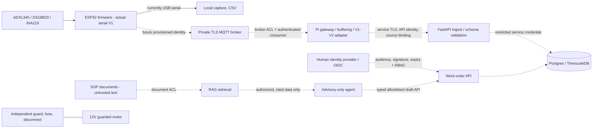

# EA-26 — Enterprise Security Integration Architecture and Identity Handoff Design

> **EDGEOPS** Industrial Edge AI Predictive Maintenance and Autonomous Operations Platform  
> **Version:** candidate 0.1 | **Date:** 2026-11-17  
> **Status:** DRAFT / NOT IMPLEMENTED / NOT INDEPENDENTLY APPROVED  
> **Change scope:** Design documentation only. No live TLS keys, tokens, broker, IAM, credentials, API endpoints, device operations or physical tests created.  
> **Evidence baseline:** EA-23 had 18/18 local schema/fixture checks; EA-25 had 34/34 **offline mock policy** checks, reported and pushed by the user. Neither proves live authentication or deployment.

## 1. Purpose, constraints and decision

Specify how EDGEOPS would **integrate** device identity, encrypted telemetry, trusted asset scope, API authentication, work-order separation of duties, RAG authorization and agent tool boundaries. The current source still emits **flat V1 JSON over serial**; the enterprise V2 envelope, MQTT, Raspberry Pi gateway, FastAPI ingestion and agent runtime are future designs. Existing documentation: [EA-22 interface control](22-INTERFACE-CONTROL-DOCUMENT.md), [EA-24 security verification](24-ENTERPRISE-SECURITY-AND-ZERO-TRUST-VERIFICATION.md), [EA-25 offline policy tests](25-EXECUTABLE-ZERO-TRUST-POLICY-AND-TESTS.md).

**G4a: OPEN. G4b: BLOCKING.** No design or test permits an AI, API, dashboard or remote operator to energize the motor. Mechanical guard, fuse, rated electrical path and physical disconnect require independent review before any motor operation.

## 2. Target trust and identity flow



**Architecture reconciliation:** choose exactly one target uplink after actual hardware/software assessment: (A) the *ESP32 publishes directly* with a provisioned cryptographic identity, or (B) *ESP32 stays on serial* and the authenticated **Pi gateway publishes** on behalf of a registry-bound serial device. The example diagram depicts candidate A and the existing serial baseline; it must not be taken as simultaneous already-running transports. For short-term prototyping, B can avoid the false claim that the present ESP32 code already implements MQTT. For B, document the **gateway as authenticating principal** and the physical board association as a weaker, separately verified trust assertion. Never treat V1's `device_id="motor-001"` as cryptographic ESP32 identity.

## 3. Identity ownership and trust anchors

| Principal / resource | Who provisions identity | Credential / trust mechanism (candidate) | Authorization source | Revocation / failure response |
|---|---|---|---|---|
| ESP32 on MQTT (option A) | designated device admin | per-device TLS client certificate or broker-compatible scoped secret | broker-side provisioned device/site map | revoke cert/credential, reject, quarantine untrusted data |
| Pi MQTT bridge (option B) | edge platform admin | Pi service identity, protected local credential; serial port inventory | broker-side service topic ACL + local asset registry | revoke gateway, reject publication; flag sensor origin as gateway-attested |
| MQTT broker | security/platform admin | trusted broker certificate; validated CA chain and hostname | TLS trust store and hardening baseline | fail closed; never silently use plaintext |
| Pi → ingestion service | IAM/platform admin | service-specific mTLS or short-lived OAuth client assertion | API scopes plus server-side registry | 401/403, bounded retry, spool without falsely acknowledging acceptance |
| Browser operator/reviewer | approved human IAM owner | OIDC Authorization Code + PKCE, validated issuer/audience/exp/signature | server-side RBAC / site/asset entitlement store | expire/revoke session and deny sensitive operation |
| Work-order service | backend owner | service principal, scoped database role | policy engine and workflow state/version | reject illegal transitions, record audit |
| RAG retrieval | AI/data owner | service principal and authenticated calling-user context | ACL filter before retrieval and citations | abstain if context, ACL or source evidence unavailable |
| AI agent | AI security owner | **no standalone privileged identity**, constrained service-issued context | typed tool allowlist + server-side enforcement | deny elevated action, create reviewable incident/audit record |
| Model release/CI | platform/MLOps owner | isolated release identity, signed/pinned artifact | release approval and provenance manifest | reject unsigned or mismatched model |

Exact broker, OIDC issuer, OAuth flow and credential stores are **not yet selected**, so this is a control-design contract, not a configuration recipe that should be deployed verbatim.

## 4. Message-by-message sequence: proposed telemetry

1. **Provision** gateway or physical device identity. Reviewer binds `principal_id`, `site_id`, `asset_id`, permitted MQTT topics, credential fingerprint, rotation date and enrollment status in a protected registry. Never embed private keys in firmware source or public GitHub.
2. **Connect** by TLS with peer trust/hostname verification; broker authenticates publisher identity. Broker denies anonymous, revoked or out-of-scope clients.
3. **Publish** telemetry only on assigned topic. Candidate convention: `edgeops/v1/{site_id}/{device_id}/telemetry`; topic version is independent from EA-22 payload `schema_version="2.0"`. Do not grant publisher wildcard rights.
4. **Consume** at gateway with scoped subscription and bounded buffering; preserve origin, topic, reception clock and connection identity. Do not silently turn broker receipt into a guarantee of database durability.
5. **Normalize** actual flat serial V1 only through an explicit adapter, applying schema version, mA→A conversion, nullable invalid readings, source classification and honest boot/session quality. This adapter **does not exist yet** as a verified runtime.
6. **Ingest** over protected service transport. API validates service principal, request size, schema with format checking, trusted site/asset registry mapping, freshness and idempotency. Reject payload claims that disagree with authenticated identity.
7. **Persist** with least-privilege DB role, immutable attribution/provenance and auditable acceptance record. Retry only idempotent operations; on ambiguous cross-reboot sequence identity, quarantine instead of falsely deduplicating.
8. **Expose** only authorized site/asset views. Stale, invalid or disconnected sensor data must be displayed as **unknown/degraded**, not healthy.
9. **Observe** denied MQTT publishes, credential failure, replay/duplication, backlog loss, ingestion denials and unauthorized API requests without logging raw credentials.

### Identity binding example (design illustration, not a live registry)

```json
{
  "principal_id": "edge-gateway-demo-001",
  "principal_type": "gateway_service",
  "site_id": "demo-lab",
  "asset_ids": ["motor-001"],
  "mqtt_publish_topics": ["edgeops/v1/demo-lab/edge-gateway-demo-001/telemetry"],
  "credential_fingerprint": "REPLACE_WITH_NONSECRET_FINGERPRINT_AT_PROVISIONING",
  "credential_status": "not_provisioned",
  "device_origin_attestation": "unverified_serial_association"
}
```

The placeholder is intentionally **not** a usable credential or proof of device enrollment.

## 5. MQTT broker / edge hardening decisions to approve

- **Transport:** TLS with proper trust chain, hostname verification, minimum versions/ciphers reviewed for the chosen broker and embedded capability; prohibit unencrypted fallback. Decide mTLS versus broker credential with documented risk tradeoff.
- **Authorization:** broker authorization based on *authenticated principal*, not topic string supplied by the sender. Explicit per-principal publish/subscribe ACLs. Reject `#` and `+` wildcards for routine publishers.
- **Identity:** preserve security semantics when ESP32 serial V1 is proxied by Pi; a Pi certificate proves the Pi, not every attached sensor or firmware.
- **Replay and ordering:** QoS 1 can redeliver. Bind event identity to trustworthy boot/session identity when available, else mark ambiguous, use bounded deduplication and review.
- **Availability:** bounded persistence and retry backoff; quotas, maximum payload size, limits on connections/rate, reserved disk, loss counters and stale indicators.
- **Broker placement:** private segmented network, no public unauthenticated access; management interface separated and least privilege.
- **Operational lifecycle:** unique enrollment, credential renewal, revocation, lost gateway response, clock loss and re-enrollment after board replacement; alert and fail closed where authentication is uncertain.

## 6. API / IAM security decision record (candidate)

Use a real OIDC issuer for humans. Validate signature, accepted algorithms, `iss`, `aud`, `exp`, token type and session/role claims; never use unverified JWT payload text as identity. For services choose mTLS or short-lived OAuth credentials, and require destination-specific scopes. Determine whether authorization is stored in a policy engine, entitlements DB, or application service; avoid divergent decisions between UI, API and DB.

**Response design:** 401 for missing/invalid authentication; 403 for authenticated but unauthorized request; safe 404 where non-disclosure is the policy; 409 for stale work-order version; 400/422 for invalid inputs; 429 for rate limits; 5xx for unavailable dependency. Do not reveal whether unrelated tenants' confidential assets exist in error details.

For work-order approval, the backend must atomically verify (1) authenticated distinct reviewer identity, (2) approval role, (3) site/asset ownership, (4) allowed workflow state, (5) expected current version, (6) idempotency key and (7) durable audit commit. **EA-25's offline 34/34 mock tests prove none of this is deployed or transactional.**

## 7. RAG and agent integration design

- **Source boundary:** SOP PDFs, database text and retrieved pages are data; embedded instructions are not executable policy.
- **Access:** apply site, asset, document and user ACLs before document retrieval; run a second eligibility check before citing excerpts.
- **Provenance:** return SOP identifier, version, authorized source location and retrieval date. If no trustworthy source remains, abstain.
- **Tools:** register only read-only diagnostics and `workorder.draft` with typed arguments and server-side authorization; no shell, arbitrary HTTP, SQL, PLC, motor-start/stop, role grants or self-approval.
- **Approval:** human approval is a separate privileged workflow; the agent can suggest but never sign off or energize equipment.
- **Red-team:** malicious SOP instructions, role escalation requests, unauthorized tool names, hidden cross-tenant snippets and model-proposed control calls must all fail authorization.

## 8. Failure-mode behavior and incident ownership

| Failure / attack | Local failure behavior | User-visible consequence | Proposed owner |
|---|---|---|---|
| TLS expired / peer untrusted | disconnect; no fallback | telemetry disconnected/unknown | platform/security |
| Publisher topic outside ACL | broker denies, audits | no unauthorized ingestion | security |
| Pi loses connectivity | bounded retry/spool; drop count and limits | stale/degraded state | edge/SRE |
| Unregistered V1 serial board | quarantine pending operator validation | unknown source | embedded/edge |
| Payload site/device mismatch | reject server-side; alert repeated attempts | denied/no cross-asset data | backend/security |
| Expired/wrong-audience token | 401 and audit | login/session action required | IAM |
| Cross-site query | 403 / safe 404 | denied without data leakage | backend/data |
| Agent tool injection | tool missing/denied; alert on attempts | advice only or abstain | AI security |
| Stale work-order approval | 409 and no state change | retry after reload/review | workflow owner |
| Missing trusted SOP citation | abstain, not fabricated explanation | unavailable guidance | AI/data |
| DB unavailable after broker ack | retain/retry boundedly; do not claim durable ingestion | pending/degraded | platform |
| Identity service unavailable | deny new sensitive actions; controlled degradation | unavailable approval | IAM/security |
| Electrical guard/disconnect not approved | **no motor energization** | lab actuation blocked | qualified reviewer |

## 9. Verification plan and evidence gates

| Test ID | Proposed controlled exercise | Expected result | Current status |
|---|---|---|---|
| INTEG-01 | Broker trust chain / hostname mismatch | TLS fails closed | NOT IMPLEMENTED |
| INTEG-02 | Revoked/expired device or gateway credential | connection denied | NOT IMPLEMENTED |
| INTEG-03 | Publisher tries other device's topic | publish denied | NOT IMPLEMENTED |
| INTEG-04 | Publisher attempts other site's topic | publish denied | NOT IMPLEMENTED |
| INTEG-05 | Broker/gateway offline and later reconnect | bounded spool, correct degradation/metrics | NOT IMPLEMENTED |
| INTEG-06 | V1 serial identity unrecognized | quarantine; no fabricated device identity | NOT IMPLEMENTED |
| INTEG-07 | Invalid/foreign site/asset claim at ingest | 403/422 by policy; no DB write | NOT IMPLEMENTED |
| INTEG-08 | Wrong-issuer, expired or wrong-audience token | 401 | NOT IMPLEMENTED |
| INTEG-09 | Human requests unauthorized asset | 403/safe 404; no details | NOT IMPLEMENTED |
| INTEG-10 | Duplicate telemetry and boot restart | explicit idempotency/ambiguity disposition | NOT IMPLEMENTED |
| INTEG-11 | Operator attempts approval | denied | NOT IMPLEMENTED |
| INTEG-12 | Reviewer attempts self-approval | denied | NOT IMPLEMENTED |
| INTEG-13 | Reviewer uses stale work-order version | 409, no state change | NOT IMPLEMENTED |
| INTEG-14 | Cross-site SOP search | no unauthorized snippet/citation | NOT IMPLEMENTED |
| INTEG-15 | Malicious SOP asks agent to use forbidden tool | unavailable/denied, audited | NOT IMPLEMENTED |
| INTEG-16 | API/agent issues motor or PLC command | route/tool absent or hard denied | NOT IMPLEMENTED |
| INTEG-17 | Unsigned/tampered model file | no release | NOT IMPLEMENTED |
| INTEG-18 | Secret in deliberately synthetic fixture | scanner detects without exposing real credentials | NOT IMPLEMENTED |
| INTEG-19 | Loss of current device/site registry | fail closed or quarantine | NOT IMPLEMENTED |
| INTEG-20 | Real reviewer replays already approved action | idempotent, immutable audit | NOT IMPLEMENTED |

Every future execution report must capture: **test ID, design version, code commit, tool/environment, sanitized synthetic fixture, timestamp, expected and observed result, logs, failing issue, reviewer and approval decision**. Use separate `mock`, `sandbox-integrated`, `lab-integrated` and `production` labels. An executed offline policy test must not be presented as integrated security evidence.

## 10. Architecture decisions and review gates

| ADR / gate | Responsible reviewer role | Blocking decision |
|---|---|---|
| ADR-26A: ESP32 MQTT or Pi serial bridge trust attribution | embedded / security lead | identity propagation and correct provenance |
| ADR-26B: MQTT 3.1.1 versus 5, broker, QoS and auth mode | integration / security | private broker interoperability |
| ADR-26C: OIDC/PKCE issuer, token and service identity strategy | IAM lead | API assurance |
| ADR-26D: entitlement source and site/asset row isolation | backend/data/security | cross-tenant exposure |
| ADR-26E: credential lifecycle and incident runbook | platform/security | revocation and recovery |
| ADR-26F: audit data protection and retention | compliance/data owner | forensics and privacy |
| ADR-26G: RAG access policy and agent tool allowlist | AI security | tool hijack and information leakage |
| G4a: cybersecurity readiness | independent authorized security reviewer | remains **OPEN** |
| G4b: electrical/physical safety | qualified electrical/OT reviewer | remains **BLOCKING** |
| G6: pilot/release | actual deployment authority | **NOT STARTED** |

### Recommended software-only next vertical slice

1. Record one reviewed trust-model ADR deciding direct-device MQTT vs gateway MQTT.
2. Implement **sandbox-only broker topic-ACL and certificate tests** with synthetic test principals and no physical device.
3. Implement test FastAPI identity-bound `/telemetry` ingest with schema/entitlement checks and a test database.
4. Execute a narrow integration sequence with known positive and negative cases; record truthful evidence and rollback.
5. Add human workflow and RAG/agent integrations only after the earlier authentication boundaries are proven.
6. Keep **all physical motor command interfaces absent**.

## 11. Portfolio evidence interpretation

This document demonstrates integration planning, zero-trust trust-anchor reasoning, enterprise API/IAM architecture, nonfunctional resilience design, explicit traceability and cross-functional security review planning, relevant to all six career roles. It does not claim security certification, formal architecture approval, deployed broker, actual customer data or working hardware.

**Disposition: design committed; zero integrated security tests executed; NO-GO for energized experiments or production.**
