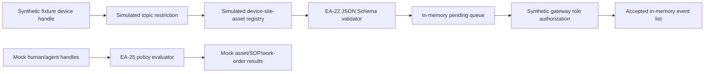

# EA-27 — In-Memory Sandbox Security Integration Harness

> **Status:** Executable synthetic sandbox authored and committed; **not yet executed on the user's computer or independently reviewed**.  
> **Date:** 2026-11-17  
> **Scope:** Simulated device publishing, broker topic ACL, identity registry, V2 schema checking, gateway ingestion, site/asset API authorization, SOP retrieval and advisory agent restrictions.  
> **Exclusions:** no real MQTT, TLS, cryptographic identity, OIDC, API server, database, motor or physical testing.

## 1. Architecture intent

EA-27 exercises **multiple policy boundaries in one deterministic in-memory program** using the proposed telemetry contract from [EA-22](22-INTERFACE-CONTROL-DOCUMENT.md), the candidate [EA-25 policy](25-EXECUTABLE-ZERO-TRUST-POLICY-AND-TESTS.md), and the security integration flow in [EA-26](26-ENTERPRISE-SECURITY-INTEGRATION-ARCHITECTURE.md).

The prior user-verified tests are **EA-23 18/18** and **EA-25 34/34**, both with local evidence pushed to the repository. EA-27's **24 new tests are not yet verified**. Do not add 24 to the verified test count before an actual local run and evidence commit.

## 2. Components and files

| Component | Location | Behavior |
|---|---|---|
| Synthetic integration sandbox | [`security/sandbox/sandbox.py`](security/sandbox/sandbox.py) | In-memory fixture identity lookup; simulated topic check; device registry match; V2 JSON Schema checks; policy-controlled ingestion and reads |
| 24 scenario tests | [`security/sandbox/tests/test_sandbox_security_integration.py`](security/sandbox/tests/test_sandbox_security_integration.py) | Happy path, negative identity/topic, malformed schema, cross-site policy, SOP, agent and approval tests |
| Authorization evaluator | [`security/policy/edgeops_policy.py`](security/policy/edgeops_policy.py) | Candidate EA-25 deny-by-default scoped policy |
| Telemetry contract | [`contracts/telemetry-v2.schema.json`](contracts/telemetry-v2.schema.json) | Candidate Draft 2020-12 V2 schema with format checking |

No production secrets exist in these examples; the `fixture:` handles are static **test labels**, not valid access tokens. Their lookup cannot authenticate a real human or device. Hard-coded topic and registry exist only to demonstrate isolated negative cases.

## 3. In-memory data path



**Security reality check:** This does not test an actual transport or credential protocol. The `Sandbox` class maintains its own test-memory queue and audit tuples. No durable persistence or audit integrity exists. Identity handles, principals and registry information are assumed trusted fixtures. Session identity remains ambiguous when `boot_id` is null; a duplicate key check in this sandbox is **not** proof of durable idempotency across reboot.

## 4. Local run instructions — Windows PowerShell

From:

`C:\Users\Gaming PC i9 3080\edgeops-workspace\projects\industrial-edge-ai-predictive-maintenance\enterprise-architecture`

Run:

```powershell
git pull --ff-only origin main
python --version
python -m unittest discover -s security/sandbox/tests -v
```

The EA-27 suite uses `jsonschema`, already installed for EA-23 on the user's Windows Python 3.14.8 environment. If another machine does not have it:

```powershell
python -m pip install "jsonschema[format]>=4.23,<5"
```

Expected **only if the local suite succeeds**: `Ran 24 tests` and `OK`. This is **an acceptance target, not a measured result**.

## 5. Scenario traceability and deliberate limitations

| Group | Test IDs | Expected checks | What they do *not* prove |
|---|---|---|---|
| Simulated publish/ingest | 01, 09, 10, 23 | allow registered fixture device and gateway; deny unauthorized roles or missing pending record | MQTT connection or API service |
| Simulated identity and topic | 02–06 | reject unknown mock handle, altered topic, asset/device mismatch | TLS, real certificate or broker ACL |
| Schema and measurements | 07–08 | reject incompatible V2 and invalid sensors as non-null numbers | actual firmware conversion or measured accuracy |
| Authorized reads | 11–14 | allow within-site asset/SOP, reject other site | deployed API/DB/vector ACL |
| Draft/approve flow | 15–19 | agent draft permitted; agent approve/self-approve/stale review denied | transactional workflow concurrency |
| Prohibited agent tools | 20–21 | reject motor and shell actions | deployed tool registry or OT interface inventory |
| Delivery/session semantics | 22, 24 | duplicate pending fixture rejected; null boot identity marked ambiguous | reboot-proof exactly-once delivery |

**Uncovered live security tests remain open:** EA-26's 20 integration cases, TLS CA/hostname/cipher validation, certificate revocation, JWT issuer/audience/signature verification, real broker topic ACLs, database row-level controls, prompt-injection attempts through a running LLM, tamper-evident audit, safety engineering.

## 6. Preserve actual test evidence (only after executing)

```powershell
New-Item -ItemType Directory -Force -Path "evidence/EA-27" | Out-Null
python -m unittest discover -s security/sandbox/tests -v *> "evidence/EA-27/test-results.txt"
$testExit = $LASTEXITCODE
Get-Content "evidence/EA-27/test-results.txt" -Tail 10
@(
  "EDGEOPS EA-27 sandbox security integration verification"
  "Date: $(Get-Date -Format 'yyyy-MM-dd HH:mm:ss zzz')"
  "Commit: $(git rev-parse HEAD)"
  "Python: $(python --version)"
  "Command: python -m unittest discover -s security/sandbox/tests -v"
  "Exit code: $testExit"
  "Environment: Local synthetic Python in-memory sandbox only"
  "Not verified: TLS, MQTT broker, OIDC, deployed API, durable database, hardware safety"
) | Set-Content "evidence/EA-27/README.txt"
if ($testExit -ne 0) { throw "EA-27 failed; review and fix before claiming a pass" }
```

Review the results and, if successful, commit just the evidence files:

```powershell
git add evidence/EA-27/README.txt evidence/EA-27/test-results.txt
git commit -m "test(edgeops): record EA-27 sandbox integration evidence"
git push origin main
git status
```

## 7. Review gates and next step

- **EA-27 status on authoring:** four classes of synthetic security boundaries linked in memory; 24 tests authored, **not yet executed**.
- **G4a cybersecurity:** OPEN. Offline success cannot close real transport, access-control or secrets lifecycle verification.
- **G4b physical safety:** BLOCKING. Do not energize or procure motor components on the basis of EA-27.
- **G6 pilot/release:** NOT STARTED.

**Proposed EA-28:** Decide a single approved broker/provider and minimal service-identity architecture, then design a **software-only Docker/testcontainer sandbox** for real MQTT TLS/ACL and FastAPI validation. Independent authorization and actual environment results would be required before any deployment claim.
