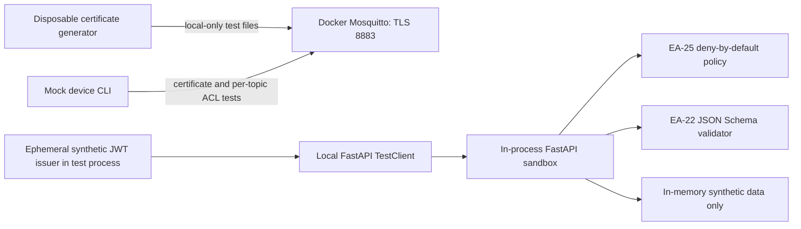

# EA-28 — Local MQTT mTLS and FastAPI Security Sandbox

> **Date:** 2026-11-17  
> **Status:** Software-only design and test harness **committed, NOT YET EXECUTED**  
> **Safety:** No ESP32 firmware upload, motor activation, production credentials or real customer data.  
> **Security:** Disposable localhost-only proof-of-concept; not production MQTT/IAM security or independently audited Zero Trust.  
> **Prior evidence:** EA-23 18/18, EA-25 34/34, EA-27 24/24 locally executed and committed by user (76 tests combined, across distinct offline suites).

## 1. Scope and rationale

Build the first candidate **real service-layer sandbox**. Unlike EA-27's in-memory broker simulation, this design can run a real private Eclipse Mosquitto container with local test CA, client certificates and broker ACL, alongside a FastAPI application invoked by **in-process TestClient** to verify JWT signature/issuer/audience/expiry and EA-25 role/site/asset policy. These are **two independently tested components, not yet an end-to-end MQTT→gateway→FastAPI connection**. None are running or verified by virtue of being committed.

[EA-26 integration architecture](26-ENTERPRISE-SECURITY-INTEGRATION-ARCHITECTURE.md) is the boundary contract. Keep hardware and agent actuation excluded.

### Topology and evidence classes



**Not connected yet:** broker subscription → serial V1 gateway adapter → FastAPI. Thus do not label the system fully integrated.

## 2. Committed sandbox files

| File | Purpose |
|---|---|
| [`compose.yaml`](security/live-sandbox/compose.yaml) | Loopback-exposed private Mosquitto container on `127.0.0.1:8883` |
| [`mosquitto.conf`](security/live-sandbox/mosquitto.conf) | Require TLS client certificate, use CN as username, apply topic ACL |
| [`acl`](security/live-sandbox/acl) | `device-a` publishes own site/topic; `gateway-a` subscribes to device topic |
| [`bootstrap_pki.py`](security/live-sandbox/bootstrap_pki.py) | Disposable local CA and server/client certificate generator |
| [`api.py`](security/live-sandbox/api.py) | In-memory FastAPI routes, synthetic JWT verification and V2 fixture validation |
| [`tests/test_api_contract.py`](security/live-sandbox/tests/test_api_contract.py) | 14 local FastAPI contract scenarios, **not executed yet** |
| [`tests/test_broker_optin.py`](security/live-sandbox/tests/test_broker_optin.py) | 3 opt-in tests requiring running real container, **not executed yet** |
| [`requirements.txt`](security/live-sandbox/requirements.txt) | Pinned compatible Python dependency major-version constraints |
| [`.gitignore`](security/live-sandbox/.gitignore) | Prevent accidental commit of generated private keys |

No real accounts, organization credentials or production endpoints are used.

## 3. Windows PowerShell: Step 1 — fetch and install

Open your existing PowerShell terminal in:

`C:\Users\Gaming PC i9 3080\edgeops-workspace\projects\industrial-edge-ai-predictive-maintenance\enterprise-architecture`

```powershell
git pull --ff-only origin main
python -m pip install -r security/live-sandbox/requirements.txt
python -m unittest discover -s security/live-sandbox/tests -p "test_api*.py" -v
```

This runs only the **14 TestClient-based API scenarios**, not real broker tests and not network-exposed API tests. If no exception and 14 tests are reported `OK`, then local FastAPI policy/identity checks passed.

### Step 2 — create disposable broker TLS identities

**Requires Docker Desktop installed and running, Docker Compose available**, with virtualization/WSL2 configured if needed. Docker Desktop is an optional software dependency, not hardware kit purchase.

```powershell
cd security/live-sandbox
python bootstrap_pki.py
docker compose -f compose.yaml up -d
docker compose -f compose.yaml ps
```

Disposable local test certs are created under ignored `generated/`. These credentials **are not secrets suitable for production**. Keep all private keys out of Git commits, chat screenshots and logs. The broker is mapped only to localhost, not the public network. Windows/Docker file-permission differences may require adjusting the local container execution model: **do not weaken private-key protections or turn off authentication as a workaround**.

### Step 3 — run opt-in broker certificate/ACL tests

Run from **`security/live-sandbox`**, after broker startup:

```powershell
$env:EDGEOPS_BROKER_TEST = "1"
python -m unittest discover -s tests -p "test_broker_optin.py" -v
Remove-Item Env:EDGEOPS_BROKER_TEST
```

These 3 cases test (1) authorized certificate publish, (2) unknown-certificate-CN publisher denied by ACL and (3) cross-site publishing denied by ACL. They do **not** prove certificate revocation/expiry, arbitrary forged CA rejection, message delivery to the API or production-level MQTT hardening.

Run `docker compose -f compose.yaml logs broker` for diagnosis if a case fails. **Do not label a skipped test as passed**. By default, the broker tests skip unless explicitly opted in.

### Step 4 — stop the sandbox

```powershell
docker compose -f compose.yaml down
cd ../..
```

If recreating certificates, stop the broker first and securely remove only disposable `generated/` contents, then generate fresh credentials. Never upload generated keys.

## 4. API sandbox checks: expected outcomes, not results

| Test | Intended policy response |
|---|---|
| API-01 | trusted synthetic gateway can submit V2 synthetic event → HTTP 202, durability **false** |
| API-02/03 | missing or malformed bearer token → 401 |
| API-04/05/06 | expired/wrong audience/wrong issuer JWT → 401 |
| API-07 | operator cannot ingest → 403 |
| API-08/10 | altered site or unknown device → 403 |
| API-09 | invalid V2 schema → 422 |
| API-11 | operator allowed assigned asset → 200 |
| API-12/13 | cross-site or unauthenticated asset read → 403/401 |
| API-14 | physical motor API route must not exist → 404 |

**Critical limitation:** The JWT test issuer shares a process-local ephemeral symmetric secret with the API test process. It does not emulate real OIDC key distribution, token refresh, mTLS service identity, key rotation or revocation. Successful `TestClient` checks are **unit/in-process HTTP integration evidence**, not a deployed API service.

## 5. Broker ACL and certificate design limitations

- This design uses a locally generated CA and client certificate CN as the principal identifier. It is for **synthetic local-only experiments** and must not be reused as real device provisioning.
- Test identities `device-a`, `gateway-a`, `rogue` are synthetic. Broker ACL controls are separate from the EA-25 Python policy; no shared real IAM authority exists yet.
- Binding broker to `127.0.0.1` reduces exposure but does not substitute for firewall review or production deployment controls.
- Certificate revocation, renewal/rotation, leak response, ACL change governance, TLS hardening and OIDC/issuer validation still require design decisions and independent testing.
- Keep physical motor control endpoints completely absent.

## 6. Preserve executed evidence only after reviewing outputs

From the **enterprise-architecture** folder (not the live-sandbox folder), for the API suite:

```powershell
New-Item -ItemType Directory -Force -Path "evidence/EA-28" | Out-Null
python -m unittest discover -s security/live-sandbox/tests -p "test_api*.py" -v *> "evidence/EA-28/api-tests.txt"
$apiExit = $LASTEXITCODE
Get-Content "evidence/EA-28/api-tests.txt" -Tail 10
@(
 "EA-28 local FastAPI TestClient verification"
 "Date: $(Get-Date -Format 'yyyy-MM-dd HH:mm:ss zzz')"
 "Commit: $(git rev-parse HEAD)"
 "Python: $(python --version)"
 "API test exit: $apiExit"
 "Scope: signed ephemeral test JWT and in-process FastAPI only"
 "MQTT broker test status: not run unless separate opt-in evidence supplied"
) | Set-Content "evidence/EA-28/README.txt"
if ($apiExit -ne 0) { throw "EA-28 API suite did not pass" }
```

If you separately execute broker tests, capture their output under `evidence/EA-28/broker-tests.txt`, note Docker/Mosquitto image digest and run date, count passes and **skips** independently. No GitHub evidence should include `generated/`, `*.key`, `*.pem`, access tokens or secret env variables.

Only after successful local execution and careful redaction, commit `README.txt` and the relevant `*-tests.txt` files; do not commit logs with secrets.

## 7. Acceptance gates and follow-up

| Gate | Required evidence | At authoring |
|---|---|---|
| FastAPI contract layer | API suite output with pass/fail and environment | NOT EXECUTED |
| Real loopback MQTT TLS/ACL | actual broker running + 3 opt-in test logs with no skips | NOT EXECUTED |
| MQTT→gateway→FastAPI integration | bridge implementation, source identity, schema migration, durable ack and audit | NOT IMPLEMENTED |
| Credential rotation and revocation | negative tests with reviewed security lifecycle | NOT IMPLEMENTED |
| Real organizational IAM / production security | independently verified OIDC, PKI, RBAC, safety and network policy | NOT APPROVED |
| G4a cybersecurity review | authorized independent sign-off | OPEN |
| G4b physical safety review | qualified inspector sign-off | BLOCKING |

**Next engineering milestone (EA-29):** Review and integrate broker subscriber → authenticated, provenance-preserving gateway → API using synthetic fixtures only; replace in-memory acceptance with controlled persistent store and a documented idempotency contract. Do not treat policy tests as proof of real edge-device identity or physically safe operation.

## 8. MQTT v5 negative-case assertion correction — 2026-11-17

Initial real-broker run after resolving Docker PID exhaustion showed 1/3 tests passing and 2/3 **failed assertions**. Both failed cases had `mosquitto_pub` process exit status zero. That status alone is **not evidence that Mosquitto accepted an unauthorized publish**; in MQTT, authorization may be communicated in the broker's QoS 1 PUBACK rather than as a CLI exit code.

The opt-in test file was revised to use `paho-mqtt` with MQTT v5 and QoS 1, and to assert the actual PUBACK reason code: 0/16 for allowed publish; 135 (`Not authorized`) for denied publish. TLS handshake, CONNACK failure, PUBACK timeout and client errors are treated as errors instead of accepted denials. This is still local test-PKI evidence and not proof of production security.

**Execution status following correction: NOT YET RE-RUN.** Do not report real MQTT tests passed until a new run shows **three executed, zero failures, zero skips**. Preserve the initial 1 pass / 2 failed assertion run as a useful verification-history note; never silently count it as three passes.
