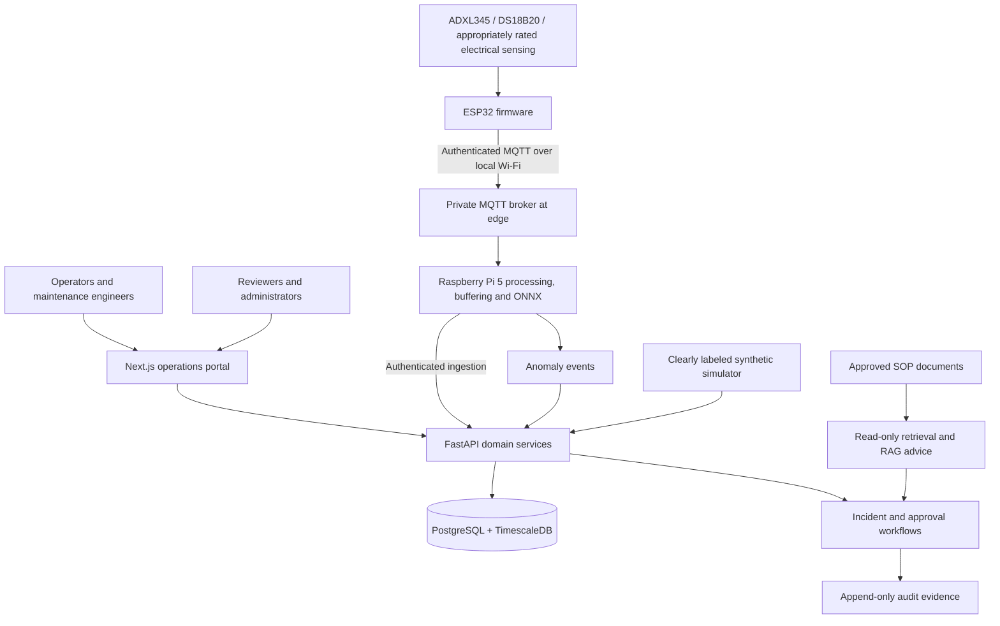

# EDGEOPS — Enterprise Architecture Baseline

**Architecture version:** 0.1 (proposed, unapproved)  
**Date:** 2026-11-17  
**Scope:** Guarded laboratory motor test rig, embedded telemetry, edge AI, enterprise maintenance workflow  
**Implementation status:** Documentation/starter code present; hardware purchase, physical calibration, integrated deployment, security controls and model results not yet independently verified.

## Executive architecture statement

EDGEOPS is a proposed predictive-maintenance platform that integrates a guarded low-voltage DC motor, sensor sampling on ESP32, reliable MQTT transport, Raspberry Pi 5 edge inference, enterprise APIs, PostgreSQL/TimescaleDB, human-reviewed maintenance workflows, and read-only RAG advice. A digital twin is a separately labeled simulator, not evidence that a calibrated physical twin exists.

**Safety principle:** No software, AI agent, model or dashboard may autonomously energize or command safety-critical equipment. A physical motor disconnect and guard must work independently of the application.

## Documentation reading order

1. [Enterprise architecture charter](01-ENTERPRISE-ARCHITECTURE-CHARTER.md) — business scope, stakeholders, capability map, decision rights.
2. [Solution architecture](02-SOLUTION-ARCHITECTURE.md) — C4-style system landscape, trust boundaries and deployment.
3. [System and integration design](03-SYSTEM-INTEGRATION-DESIGN.md) — interfaces, telemetry contracts, API patterns, data ownership.
4. [AI and agent architecture](04-AI-AND-AGENT-ARCHITECTURE.md) — edge inference, model governance, RAG and agent restrictions.
5. [Security, privacy and safety](05-SECURITY-GOVERNANCE-AND-SAFETY.md) — threats, controls, approval and risk register.
6. [Quality, operations and economics](06-QUALITY-OPERATIONS-AND-COST.md) — NFRs, SLO proposal, resilience, DR, FinOps.
7. [Architecture decisions](07-ARCHITECTURE-DECISIONS.md) — proposals, alternatives, consequences.
8. [Design reviews and implementation gates](08-DESIGN-REVIEWS-AND-READINESS.md) — required evidence, tests, acceptance and ownership.

## Enterprise architecture landscape

## Evidence labeling policy

- **Proposed:** architecture/design not yet implemented.
- **Implemented locally:** code works in local environment with reproducible log.
- **Tested:** named test, date, commit/environment, pass/fail, artifacts.
- **Deployed (dev/staging/pilot):** host, environment, release and monitoring evidence.
- **Production:** only if live organizational authorization and real operational evidence exist.
- **Synthetic/real/replayed:** every dataset and screenshot must identify provenance.

## Repository links

- [Project README](../README.md)
- [Original Phase 01–08 guides](../README.md#5-eight-phase-engineering-plan)
- [Hardware requirements](../HARDWARE_REQUIREMENTS.md)
- [30-product hardware register](../HARDWARE_30_PRODUCT_REGISTER.md)

## Professional portfolio interpretation

This package demonstrates enterprise AI solution design, embedded/edge architecture, integration, agent safety, risk management and verification discipline. It **does not** establish industrial safety certification, live factory deployment, measured performance or formal TOGAF certification. Review and revise after real measurement.
